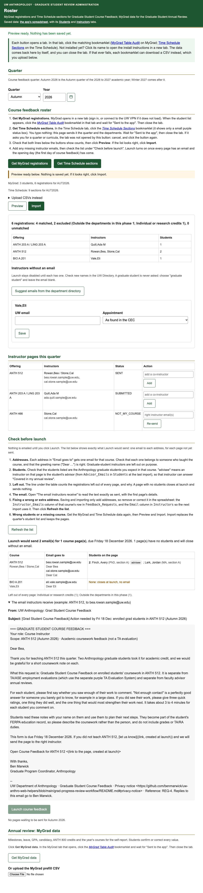
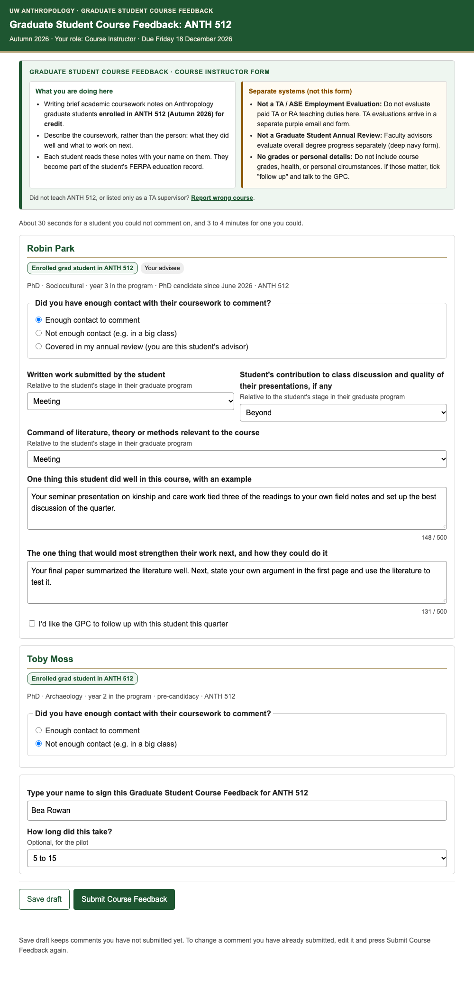
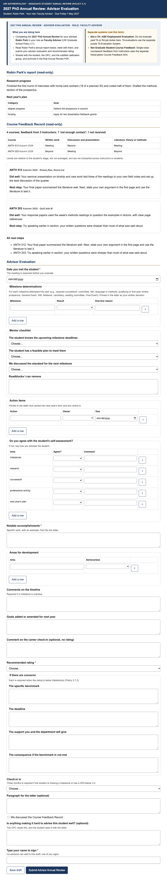
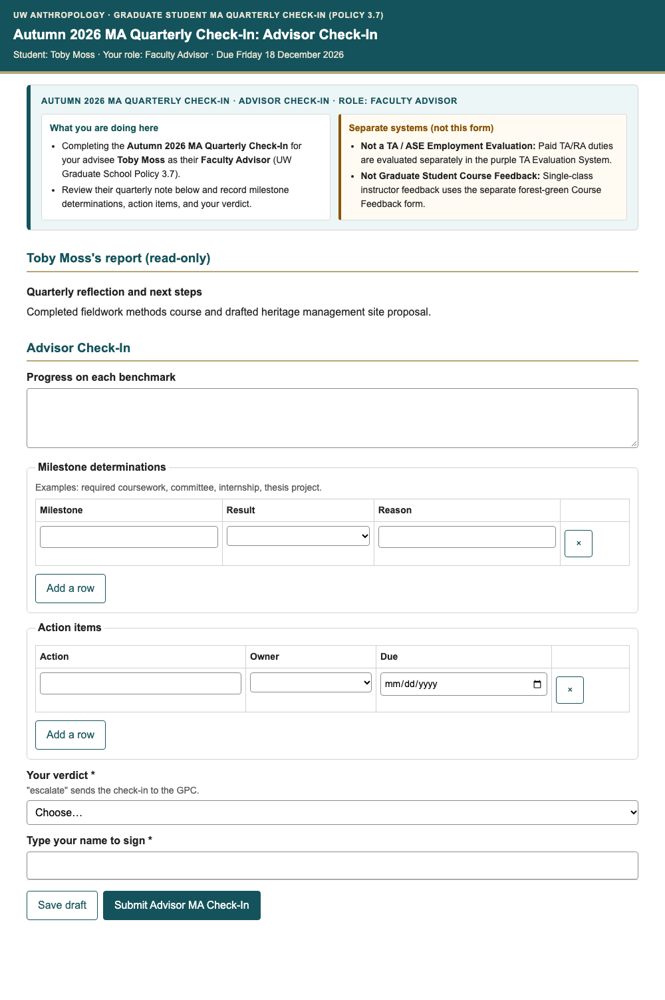
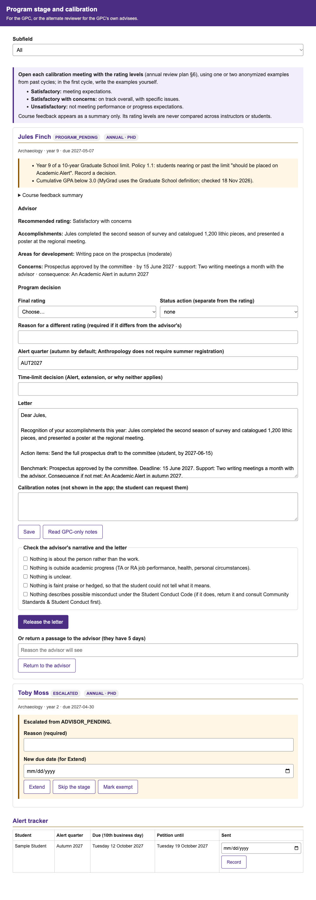
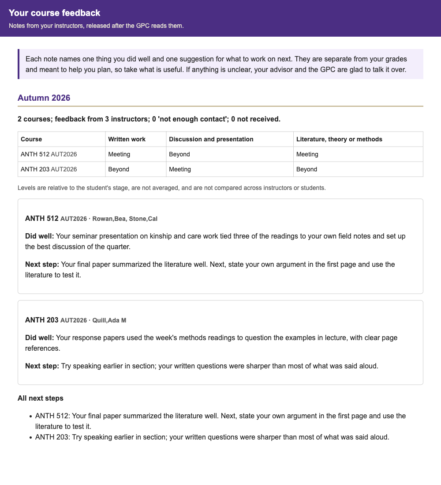

---
editor_options:
  markdown:
    wrap: sentence
---

# Graduate Review System (UW Anthropology)

A web app for two connected processes in the Department of Anthropology:

- the **annual review of graduate students** (Graduate School [Policy 3.7](https://grad.uw.edu/policies/3-7-academic-performance-and-progress/)), with quarterly check-ins for MA students and for students with concerns;
- **instructor feedback on graduate students in courses**, released to students each quarter and gathered into a yearly Course Feedback Record that feeds the annual review.

**Who's who.** The **GPC** (Graduate Program Coordinator) is the faculty member who runs the graduate program; the GPC owns the system, checks and releases feedback, and decides ratings. The **administrator** is the Graduate Student Administrator (agp-advisor@uw.edu), who runs the course feedback roster. The **alternate reviewer** (by default the department chair) does the GPC's work for the GPC's own advisees, co-advisees and students whose committee the GPC chairs.

**Email names.** Each email has a code: CF-1 to CF-11 for course feedback, AR-1 to AR-13 for the annual review. CF-1 is the instructor's invitation; AR-1 is the student's annual review invitation. All texts are in [`app/CoreEmail.gs`](app/CoreEmail.gs).

## Quick links

| What | Link | Who can open it |
|---|---|---|
| Roster page | [Roster](https://script.google.com/a/macros/uw.edu/s/AKfycbz5Ux91ZrBe-V8gH3aCg6DZBIHYES4_CyhcJFtTvBGOXHAFA5tM0Iy_9kzPW-Twjwxn/exec?view=roster) | Administrator, GPC |
| Review and Release | [Review and Release](https://script.google.com/a/macros/uw.edu/s/AKfycbz5Ux91ZrBe-V8gH3aCg6DZBIHYES4_CyhcJFtTvBGOXHAFA5tM0Iy_9kzPW-Twjwxn/exec?view=release) | GPC, alternate |
| Program stage | [Program stage](https://script.google.com/a/macros/uw.edu/s/AKfycbz5Ux91ZrBe-V8gH3aCg6DZBIHYES4_CyhcJFtTvBGOXHAFA5tM0Iy_9kzPW-Twjwxn/exec?view=program) | GPC, alternate |
| A student's course feedback | [Your course feedback](https://script.google.com/a/macros/uw.edu/s/AKfycbz5Ux91ZrBe-V8gH3aCg6DZBIHYES4_CyhcJFtTvBGOXHAFA5tM0Iy_9kzPW-Twjwxn/exec?view=student) | Each student, for their own |
| An advisor's advisees' course feedback | [Advisees' course feedback](https://script.google.com/a/macros/uw.edu/s/AKfycbz5Ux91ZrBe-V8gH3aCg6DZBIHYES4_CyhcJFtTvBGOXHAFA5tM0Iy_9kzPW-Twjwxn/exec?view=advisor) | Each advisor, for their advisees |
| Subfield summary | [Subfield summary](https://script.google.com/a/macros/uw.edu/s/AKfycbz5Ux91ZrBe-V8gH3aCg6DZBIHYES4_CyhcJFtTvBGOXHAFA5tM0Iy_9kzPW-Twjwxn/exec?view=coordinator) | Subfield coordinators |
| Main spreadsheet (all tabs: `Students`, `Instructors`, `Feedback_Requests`, `Course_Feedback`, `Logs`, …) | [Main spreadsheet](https://docs.google.com/spreadsheets/d/1mdkZo7d2e2WElWzjzGFgbQUUC0dxB_1hGmGRW_QDi1Q/edit) | Owner, and anyone it is shared with |
| Confidential spreadsheet ("Only for the GPC" text) | [Confidential spreadsheet](https://docs.google.com/spreadsheets/d/1cHgReD-TfNRXBQzQw8RySnBp-KxxZYCJhd8awqIsz6Y/edit) | Owner only |
| Archive folder (review PDFs, CVs) | [Archive folder](https://drive.google.com/drive/folders/1OJjLmo2DU12-v1lh87-4X07LHvpGvfK6) | Owner only |
| Apps Script editor | [Script editor](https://script.google.com/d/1tENrIKuOq5vag5eiD6m273r1NBr83XkVYSsEimfiXzICtmn6qrPexeJl/edit) | Owner |
| MyGrad, Anthropology student list | [MyGrad](https://webappssecure.grad.uw.edu/mgp-dept.stu.detail/home/studentlist?orgid=14) | Department staff (UW VPN off campus) |
| UW Time Schedule | [Time Schedule](https://www.washington.edu/students/timeschd/) | Anyone |
| Bookmarklets to install | [MyGrad Table Audit](../readme.md#mygrad-table-audit-bookmarklet), [Time Schedule Sections](../readme.md#time-schedule-sections-bookmarklet) | Administrator, GPC |
| Finding instructor emails | [UW Directory](https://directory.uw.edu/), [department people page](https://anthropology.washington.edu/people) | Anyone |
| Instructor appointment types | [UW course evaluation catalog (CEC)](https://www.washington.edu/cec/) | UW |
| Students' anonymous feedback form | [Anonymous feedback form](https://forms.cloud.microsoft/r/33dZKZyZtW) (listed on the department's [Advising page](https://anthropology.washington.edu/advising)) | UW students |

Instructor pages and students' and advisors' review pages have no fixed address: each person opens theirs from the link in their email, which carries a personal token.

## Status

The app is stable and ready for use. The live web app is one deployment whose address never changes ([Deploying a change](#deploying-a-change)).

**Autumn 2026 is the first course feedback quarter.** Instructor pages open Monday 7 December 2026, in the last week of classes; reminders go out on 14 and 16 December; pages are due Friday 18 December, the last day of finals; and comments are released Friday 8 January 2027. Later quarters follow the usual [calendar](#course-feedback-calendar). The first annual review is in spring 2027.

**Before Monday 7 December 2026:**

1. **Administrator and GPC:** install the two bookmarklets ([Quick links](#quick-links)).
2. **Owner:** approve the app's permissions once, including "connect to an external service", which reads the department people page ([Approve the permissions](#6-approve-the-permissions-owner-once)).
3. **GPC:** load the students: on the Roster page, click **Get MyGrad data** ([Fill in the Students sheet](#9-fill-in-the-students-sheet)). Until this is done, every registration is left out as "Student not in the Students sheet".
4. **GPC:** fill in `Advisor_Emails`, `Chair_Email` and `Subfield` in `Students`. Recusal needs them, and so does the advisor's "Covered in my annual review" option on instructor pages.
5. **Administrator:** import the Autumn 2026 roster and add the instructor emails ([Each quarter: course feedback](#each-quarter-course-feedback), steps 1 to 7).
6. **GPC:** create the triggers ([Create the triggers](#10-create-the-triggers-last)), after steps 3 and 4. MA check-ins then go out on 7 December with the instructor pages, to every active MA student with an advisor listed.
7. **Optional:** with a second UW account, open an instructor page as that instructor and confirm another instructor's page is refused.
8. **Administrator, Monday 7 December:** import again, then click **Launch course feedback**.

**After the first run, check once:**

- That comment text is stored exactly as typed: look at the first submitted page's rows in `Course_Feedback` (for example a comment starting with `-` or containing `3-4`).
- That the triggers run: check `Logs` the morning after creating them.
- Whether sharing an uploaded CV with the advisors sends them a Drive email.
- That the MyGrad bookmarklet asks to approve the app's address only the first time.

## How to Use

### Who does what

| Person | Where | What |
|---|---|---|
| Administrator | Roster page | Brings in MyGrad registrations and Time Schedule sections each quarter, adds instructor emails, launches course feedback, re-sends pages |
| GPC (or the alternate) | Roster page, Review and Release, Program stage, the spreadsheet's **Graduate review** menu | Loads and maintains `Students`; checks and releases course feedback; builds and releases the Course Feedback Records; launches the annual cycle and MA check-ins; sets final ratings and releases letters; tracks Alerts |
| Instructor | Their page, from the CF-1 email | Comments on each graduate student in their course |
| Student | Their review page, from the AR-1 (annual) or AR-10 (check-in) email; [Your course feedback](#quick-links) | Writes the annual report or check-in, reads course feedback, acknowledges the letter |
| Advisor | The review page, from the AR-3 email; [Advisees' course feedback](#quick-links) | Meets the student, evaluates, recommends a rating |
| Subfield coordinator | [Subfield summary](#quick-links) | Prepares the calibration meeting |

A menu item in the spreadsheet runs as, and sends email from, whoever clicks it. That is why the GPC runs the menu items that send email (**Launch Annual Cycle**, **Launch MA Check-ins**, **Build Feedback Records**). Buttons on the web pages run as the owner.

Every page checks the signed-in UW account. Opening a link sent to someone else shows a message naming the account you are signed in as. If Google shows a "Verify it's you" page first, continue as your UW account.

### Each quarter: course feedback

The dates are in the [course feedback calendar](#course-feedback-calendar).

**Administrator, a few weeks before the page opens.**

1. **Check the students.** Ask the GPC to update `Status` in `Students` for anyone now on leave (`ON_LEAVE`) or gone (`LEFT`). Each quarter the GPC can also click **Get MyGrad data** again to refresh the list.
2. **Open the [Roster page](#quick-links)** and choose the quarter (Autumn, Winter, Spring or Summer) and the year. The page opens on the current quarter, and the list of instructor pages follows your choice. The top of the page links to the spreadsheet's `Students` and `Instructors` tabs.
3. **Get the registrations.** Click **Get MyGrad registrations**. In the MyGrad tab that opens (sign in, or connect to the UW VPN), click the **MyGrad Table Audit** bookmarklet. When the Roster page shows "MyGrad: … registrations", close the tab. Grades never leave MyGrad.
4. **Get the sections.** Click **Get Time Schedule sections**. In the Time Schedule tab, click the **Time Schedule Sections** bookmarklet, wait for "Time Schedule: … sections", and close the tab.
5. **Preview.** Click **Preview**; it saves nothing. Check:
   - the counts and the reasons registrations were left out ([who is asked](#who-is-asked-about-whom));
   - **No Time Schedule match**: usually a course the Time Schedule does not list in the departments searched; get the sections again, or leave it out;
   - the list of pages and their instructors.
6. **Import.** Click **Import**. It creates the quarter's pages and sends nothing.
7. **Add the missing instructor emails.** Under "Instructors without an email":
   1. Click **Suggest emails from the department directory**. The app fills in each email it can match on the [department people page](https://anthropology.washington.edu/people), with a note naming the directory entry. Nothing is saved yet.
   2. Check each suggestion.
   3. Look up the rest in the [UW Directory](https://directory.uw.edu/): people from other departments, and anyone the page lists without an email.
   4. For a graduate student instructor, choose **graduate student** under Appointment and leave the email blank; graduate students are never asked. Otherwise leave Appointment as found in the CEC, or correct it.
   5. Click **Save** for each instructor. The email goes straight onto that instructor's unsent pages. Saved emails are kept in `Instructors` and reused every quarter, so later quarters list only new instructors.
8. **Check before launch.** For each page not yet sent, this lists every address that will get CF-1, the greeting each will see ("Dear …"), and the students on the page, plus the registrations left out and why. "The email instructors receive" shows the CF-1 text. Saving and importing only add addresses: to remove or correct a wrong one, edit `Instructor_Emails` in `Feedback_Requests` and `Email` in `Instructors` in the spreadsheet, then click **Refresh the list**.

If a bookmarklet cannot send its data back, it offers a CSV download. Upload it under **Upload CSVs instead**.

**Administrator, on the opening day.**

1. Repeat steps 2 to 7, to drop withdrawals and catch instructor changes.
2. Click **Launch course feedback**. It stays disabled, with the reason shown, until every page has an email for each of its instructors and the opening day has come. Each instructor gets one CF-1 email per course, sent from the owner's account. (The menu item **Graduate review → Launch Course Feedback…** does the same, but sends from whoever clicks it.)

**Administrator, while pages are open.**

- **A co-instructor the Time Schedule does not list:** type their email in the **Add** box beside the page. If the page has already been sent, they get CF-1 at once.
- **"Not my course":** when an instructor says a course is not theirs, you get an email. Find the right instructor and click **Re-send** beside the page; the new instructor gets a fresh page with the same due date.
- **Reminders** (CF-2 and CF-3) go out by themselves on the two reminder dates.

**Instructor.** Open the link in the email while signed in to UW. For each student, say whether you had enough contact to comment. If you did, give the three ratings, one thing the student did well, and the one next step. Tick "follow up" only for something the GPC should act on this quarter. Sign and click **Submit Course Feedback**. You can edit until the page closes; a change after submitting needs **Submit Course Feedback** again. If the course is not yours, use "let us know" in the email or "Report wrong course" in the box at the top of the page.

**GPC, the week after the page closes.**

1. Open [Review and Release](#quick-links) and load the quarter.
2. Read each comment against the four-item check on the page. Click **Passes the check**, or write a reason and click **Return to the instructor**, who then has 5 days to revise. The GPC never edits an instructor's words.
3. Click **Release this quarter's comments**. Students and advisors can then read them, and each student with a comment gets an email saying new feedback is there.
4. Under **Follow-up conversations**, record the outcome and date of each conversation within 21 days of the flag. "Raised as an interim check-in", with the box ticked, creates an interim review.

**GPC, spring week 2.** Choose **Graduate review → Build Feedback Records…** with the spring year. Add an optional synthesis to each record on Review and Release (written without AI) and click **Release records**. Each record then appears in the student's annual report and the advisor's view.

### Each spring: the annual review

The dates are in the [annual review calendar](#annual-review-calendar).

**GPC, before spring week 1.**

1. On the Roster page, choose **Spring** and the year, click **Get MyGrad data**, then the MyGrad bookmarklet in the tab that opens. The app updates `Students` with GPA, leave dates, committee flags, degrees, candidacy, ANTH 800 credits and the year's courses. The page lists anyone active in `Students` who is missing from MyGrad, so you can check whether they have left.
2. Check `Advisor_Emails`, `Chair_Email`, `Subfield` and `Status` for every student ([the columns](#9-fill-in-the-students-sheet)).
3. Ask the maintainer to set `CYCLE_YEAR` in `Config.gs` and deploy ([Deploying a change](#deploying-a-change)).

**GPC, spring week 1.** Choose **Graduate review → Launch Annual Cycle…** and enter the year. Every active PhD student with an advisor gets a review and an AR-1 email with their link. Students marked `ON_LEAVE` get an `ON_LEAVE` row and no email. A student with no advisor is skipped and logged. A student who has lost the email gets the same link in each reminder (AR-2); once a review is escalated, **Extend** emails a new one.

**Student.** Open the link in the AR-1 email and fill in the report. MyGrad values and last year's goals are filled in; correct anything wrong. The page saves a draft every minute while you type. The box "Only for the GPC" never reaches the advisor or the PDF. Submit when done; your advisor then gets an email (AR-3).

**Advisor.** Open the link in the AR-3 email, read the report, meet the student, then fill in the evaluation and recommend a rating. Any rating below Satisfactory needs the benchmark, deadline, support and consequence (Policy 3.7.2). Co-advisors share one draft; each one's changes are saved, and one of them signs.

**Subfield coordinators, weeks 7 and 8.** Open the [Subfield summary](#quick-links) to prepare the calibration meeting.

**GPC, after the calibration meetings.** Open [Program stage](#quick-links), filter by subfield if useful, and for each review:

1. Read the flags (for example nearing the Graduate School time limit, or GPA below 3.0) and the course feedback summary.
2. Set the final rating, giving a reason if it differs from the advisor's, and any status action. Alerts default to the autumn quarter, because Anthropology does not require summer registration.
3. Edit the starting letter, tick the five narrative checks, and click **Release the letter**. To send a passage back to the advisor instead, use **Return to the advisor** (5 days).
4. For escalated reviews, choose **Extend** (a new due date; the new link is emailed), **Skip the stage** or **Mark exempt**, with a reason.
5. In the **Alert tracker**, record the date each Alert recommendation went to the Graduate School. It is due by the 10th business day of the Alert quarter.

**Student, after the letter.** Read the evaluation and the letter, acknowledge them (acknowledging is not agreeing), optionally respond in writing or ask to meet the GPC, and sign. The PDF is then built and shared with the student, advisors, committee chair and GPC.

**Check-ins.** A rating of *Satisfactory with concerns* or *Unsatisfactory* creates an interim check-in ([details](#interim-and-ma-check-ins)). MA students get a short check-in at the end of every enrolled quarter instead of an annual review. The daily task launches these on the day the quarter's instructor pages open; the GPC can also use **Graduate review → Launch MA Check-ins…**.

### What runs by itself

Once the triggers exist, a daily task at 7 a.m. Pacific:

- sends review reminders every 5 days, at most 2, then marks the review `ESCALATED` and tells the reviewer (no annual-review reminders between spring finals and autumn);
- sends the course feedback reminders CF-2 and CF-3 on the two reminder dates, and closes pages after the due date;
- for each follow-up flag, emails the reviewer and the student's advisors the next day (CF-7), and the reviewer again on day 14 if it is still open (CF-8);
- launches MA check-ins on the day the quarter's instructor pages open;
- reminds the GPC 5 business days before each Alert deadline, and sends the calibration notice when the calibration window opens;
- deletes log rows older than 90 days.

A task scheduled for one day that is missed (for example because the daily run failed) runs on the next day's run, and never sends twice. Two hourly tasks retry failed emails from `Dead_Letter_Queue` and check the alert thresholds, emailing `ALERT_EMAIL` about problems. **Run Daily Tasks Now** and **Process Dead Letter Queue Now** in the menu run them by hand. `Logs` records every email sent, and `Audit_Log` every import, launch, submission and release. **Compute Metrics** writes the program metrics to `Metrics`.

### Changing the text

| Text | File |
|---|---|
| Every email | [`app/CoreEmail.gs`](app/CoreEmail.gs) |
| Instructor page | [`app/FeedbackForm.html`](app/FeedbackForm.html): `scopeBox()` and `studentBlock()` |
| Annual report, advisor evaluation, check-ins, acknowledgement | [`app/Index.html`](app/Index.html): `reviewMeta()`, `scopeBox()`, `STUDENT_ANNUAL`, `STUDENT_MA`, `ADVISOR_ANNUAL`, `ADVISOR_CHECKIN`, `ACK` |
| Rating levels and review ratings | [`app/Config.gs`](app/Config.gs): `CF_LEVELS_`, `REVIEW_RATINGS_` |
| GPC checklists | [`app/ReviewRelease.html`](app/ReviewRelease.html), [`app/Program.html`](app/Program.html) (`CHECKS`) |
| Roster page, student course feedback page | [`app/RosterPage.html`](app/RosterPage.html), [`app/Home.html`](app/Home.html) |

Then run the tests and deploy ([Deploying a change](#deploying-a-change)). Every email follows the [email rules and visual identity](#email-rules-and-visual-identity).

## How it works

Graduate School Policy 3.7 sets only the frequency ("The graduate program faculty should review a student's performance and progress at least annually"); the department chooses the method, described here.

### Course feedback

At the end of each quarter, every instructor who had one of the department's graduate students in a course gets **one email with one link** to a single page listing all of those students. For each student the instructor says whether they had enough contact to comment. If they did, they give three quick ratings, one strength and one next step. A student the instructor cannot comment on takes about 30 seconds; one with comments, 3 to 4 minutes.

**Design rules.**

1. One link per instructor per quarter. Multi-section and joint-listed offerings are merged into one page, so nobody gets duplicates.
2. "Not enough contact" is a respectable one-click answer.
3. Two short prompted fields (a strength and a next step, 500 characters each). No grade, no overall score, no open comment box.
4. About the course work only: nothing on grades, TA or RA work (that stays in the TA system), personality, health or personal circumstances.
5. Attributed and visible to the student. Every comment carries the instructor's name, as for any education record.
6. Single comments are never averaged, ranked or used alone for a decision. Rating levels are read within one student's record, never compared across instructors or students.
7. Concerns do not wait: an instructor can ask the GPC to follow up this quarter.
8. No fellow students: graduate students who are instructors of record, and quiz-section TAs, are never asked (Policy 3.7.2).
9. Comments reach the student while the course is recent: each quarter's comments are released a week or two after the page closes.

#### Who is asked about whom

The roster joins each student's MyGrad registrations to the Time Schedule section (quarter, curriculum, course number and section) to find the instructor. Each registration left out is listed with its reason:

| Case | Rule |
|---|---|
| Courses in ANTH, ARCHY and BIO A | Included (`CF_CURRICULA_PHASE1` in `Config.gs`; `CF_ALL_DEPARTMENTS` includes every department) |
| Student registered under another department's side of a joint listing (for example LING 203 A, joint with ANTH 203 A) | Left out while only the three departments are included |
| Instructor of record is a graduate student, or a quiz-section TA | Left out. The `Appointment` column in `Instructors` comes from the CEC and is confirmed by the administrator; a quiz section is matched to its lecture |
| Individual and research credits (600, 601, 700, 800, 801) | Left out; the advisor covers this work in the annual review |
| Student not in `Students` | Left out as "Student not in the Students sheet" |
| Student on leave or no longer enrolled | Left out |
| Student dropped the course | Left out (the grade starts with `W`) |
| Instructor is the student's advisor | Asked, with the one-click option "Covered in my annual review" |
| Co-taught course | One shared page. Whoever opens it holds a 30-minute editing lock; any co-instructor can submit, and every name is recorded |
| The GPC teaches the course | Asked like any instructor; recusal applies only to checking and releasing the GPC's own advisees |

#### The instructor's page

For each student the page shows:

- a header: name, program, subfield, year in program, candidacy for PhD students (for example "PhD candidate since June 2024" or "pre-candidacy"), course and quarter;
- **contact**: "Enough contact to comment", "Not enough contact", or for an advisor "Covered in my annual review";
- **three ratings** on a stage-relative scale (*Below what I'd expect at this stage*, *Approaching*, *Meeting*, *Beyond*, or *Not observed*) for written work; discussion and presentation; and command of the literature, theory or methods;
- **a strength**: "One thing this student did well in this course, with an example";
- **a next step**: "The one thing that would most strengthen their work next, and how they could do it";
- an optional **follow-up** tick, with the note "What did you observe, and when?".

Once per page the instructor types their name as a signature and may say how long it took. The top of the page reminds them that the student reads the comments with their name on them, to describe the work and not the person, and to leave out grades, TA work, health and personal circumstances. "Not my course" ends the page and alerts the administrator, who re-sends it to the right person with the same due date. The administrator can view any instructor page, read-only.

#### Follow-up flags

The GPC and the advisor get a content-free email the next day. The GPC (or the advisor, if delegated) talks with the student within three weeks; the handler is reminded at two weeks, and an overdue flag shows on the GPC's dashboard. The GPC records the outcome: "Discussed", "Support arranged" or "Raised as an interim check-in" (which creates an `INTERIM` review only when the GPC confirms it). The student sees a flag in their record once it has an outcome, so they hear about the concern in the conversation first. When the GPC is the student's advisor, the alternate reviewer handles it.

#### The GPC's check and release

Each quarter the GPC reads every comment before release against four questions: is anything about the person rather than the work; outside course work; unclear; or faint praise or hedged, so the student could not tell what the instructor means?

- The GPC never edits an instructor's words. A comment that needs changing is returned with a logged reason, and the instructor has 5 days to revise it.
- A comment not revised by release goes **to the student only**, with a GPC note, and is kept from the advisor, the calibration view and PDFs until it is revised or resolved.
- At release, the student and the advisor(s) see the comments in the app, and the student gets a content-free email.

#### The Course Feedback Record

Once a year, at the end of spring week 2, each student's feedback year (spring, autumn and winter) is compiled into a record:

- a coverage line: courses, instructors, "not enough contact", not received, and covered in the annual review;
- a ratings grid, not averaged;
- the comments, verbatim, attributed and in date order;
- all the next steps in one list;
- the follow-up flags and their outcomes;
- an optional 2 to 4 sentence synthesis by the GPC, written without AI.

A record with fewer than two comments says it is too thin to show patterns. In the annual review the student names the one or two next steps they will act on, and the advisor discusses them. MA students see each quarter's comments at release and at their quarterly check-in; students on leave or exempt get their record on the same day as everyone else; students leaving the program get a closing record.

| Who | What they see of course feedback |
|---|---|
| Student | Each quarter's comments at release, then the full record in the app and as a PDF shared only with their UW account |
| Advisor(s) | Each quarter's comments at release, then the full record in the advisor stage of the annual review |
| Committee chair | The record as an appendix to the annual review PDF |
| Subfield coordinators and the calibration meeting | The coverage line, the ratings grid and the follow-up flags, with no free text unless the GPC opens it for a student |
| GPC (alternate for recused students) | Everything, through the web app only |
| Instructors | Only what they wrote, until their page closes |
| Fellow students | Nothing |

#### Course feedback calendar

The page opens on the Monday of finals week, so instructors can write while grading, and closes on a Friday at least 10 days after the grade deadline (5 p.m. on the Tuesday after the last day of the quarter). There are at most two reminders: the Wednesday after grades are due, and about three days before the deadline. After that there is no escalation; a missing response shows in the record as "no feedback received". Comments are released one to two weeks after the page closes. Summer is off unless switched on in `CF_QUARTERS_ON`. Autumn 2026 uses its own dates (`CF_WINDOW_OVERRIDES`).

| Quarter | Page opens | Reminders | Due | Released |
|---|---|---|---|---|
| Autumn 2026 | Mon 7 Dec, last week of classes | 14 and 16 Dec | Fri 18 Dec, last day of finals | Fri 8 Jan 2027 |
| Winter 2027 | Mon 15 Mar | 24 and 30 Mar | Fri 2 Apr | Fri 9 Apr, with the year's records |
| Spring 2027 | Mon 7 Jun | 16 and 22 Jun | Fri 25 Jun | Fri 9 Jul |

### Annual review

Each spring every PhD student goes through one review:

1. **The student reports.** The form is prefilled with last year's goals and MyGrad data, and shows the released Course Feedback Record.
2. **The student and advisor meet.** The advisor responds to what the student wrote, with agree/disagree items and a three-level rating. Co-advisors share one draft; one of them signs.
3. **Each subfield's faculty calibrate the ratings in one meeting.** The GPC records the final rating; a rating that differs from the advisor's needs a reason.
4. **Every student receives a letter** in the app. A letter that raises a concern gives the benchmark, the deadline, the support offered, the check-in date and the consequence.
5. **The student acknowledges the letter and may respond.** The signed PDF is shared with the student, advisor(s), committee chair and reviewer, and any interim check-in is scheduled.

**Principles.**

- The student goes first, and the advisor responds.
- **A person decides; the system documents.** A rating never changes a student's standing by itself; a Notification or Alert is a separate action the GPC takes.
- Nothing about the student is hidden from them.
- The GPC handles the program stage through the web app only, and recusal routes the GPC's own advisees, co-advisees and the students whose committee the GPC chairs to the alternate reviewer.
- Developmental material (career check-in, mentoring map, skills self-assessment) is kept apart from evaluation and never feeds the rating.
- Students are reviewed against published expectations, and every review ends in written action items with owners and dates.
- The GPC checks the advisor's narrative and the letter for person-focused, unclear or hedged wording before release, and each calibration meeting starts by going through the rating levels with examples.

**Stages and escalation.** A review moves from the student to the advisor, the program stage (GPC), the student's acknowledgement, and the PDF ([states](#states)). Reminders go every 5 days, at most two, then the row is `ESCALATED` and the GPC chooses **Extend** (a new due date; the new link is emailed), **Skip the stage** (marked "no response" in the PDF) or **Exempt**, each with a logged reason. Reminders pause between the end of spring finals and the start of autumn, except for interim rows. A student on leave or leaving the program is marked `ON_LEAVE` or `EXEMPT`.

#### Interim and MA check-ins

A *Satisfactory with concerns* or *Unsatisfactory* rating creates an `INTERIM` review: due in 3 months (and quarterly until resolved) if the student is missing a milestone or has a GPA below 3.0, as Policy 3.7.2 asks; otherwise in 3 or 6 months, as the advisor chooses. A PhD interim goes straight to the advisor.

**MA (Archaeological Heritage) students** have no annual review. A short check-in at the end of every quarter they are enrolled starts with the student and then the advisor, and only a check-in that raises a concern goes to the GPC, who writes any concern letter.

#### Ratings and flags

| Rating | Meaning | What follows automatically | What a person may decide |
|---|---|---|---|
| Satisfactory | Meeting expectations | Nothing | — |
| Satisfactory with concerns | On track overall, with specific issues | Benchmark fields required; interim check-in created | The GPC may record an internal Academic Notification |
| Unsatisfactory | Not meeting performance or progress expectations | Benchmark fields required; interim check-in created; GPC alerted | The GPC and faculty decide whether to recommend an Academic Alert under Policy 3.7 |

**Flags shown to the advisor and GPC** (none changes a rating): near the Graduate School's time limit (year 8 or later for a doctorate, year 5 for the MA; the GPC must record a decision); a milestone past its deadline; no committee chair; a cumulative GPA below 3.0 (MyGrad's GPA follows the Graduate School's definition); a third consecutive *with concerns* rating; and no meeting with the advisor this year. The "past expected time to degree" flag and the plan to completion stay off until the faculty set an expected time to degree.

#### The letter

The letter is signed by the GPC (or the alternate) and contains:

- recognition of accomplishments; upcoming milestones; advice and next year's goals;
- milestone determinations and action items, and any plan to completion;
- for a concern, the benchmark, deadline, support, check-in date and consequence (Policy 3.7.2);
- rights and resources: how to respond; informal resolution with the GPC or the [Office of the Ombud](https://www.washington.edu/ombud/), then the College of Arts & Sciences grievance procedure ([Policy 3.8](https://grad.uw.edu/policies/3-8-academic-grievance-procedure/)); [Graduate Student Affairs](https://grad.uw.edu/graduate-student-affairs/), the [Counseling Center](https://www.washington.edu/counseling/), [Disability Resources for Students](https://depts.washington.edu/uwdrs/), the [Husky HelpLine](https://wellbeing.uw.edu/unit/husky-helpline/), and the student's Graduate School Representative.

An Alert recommendation uses a separate letter with the elements Policy 3.7.3 requires, sent by the 10th business day of the Alert quarter; the app's Alert tracker reminds the GPC 5 business days before.

#### The confidential channel

A student can raise a concern three ways: the department's [anonymous feedback form](https://forms.cloud.microsoft/r/33dZKZyZtW) (nothing reaches the record); the self-report section marked "Only for the GPC", kept in a separate spreadsheet, never shown to the advisor or printed in the PDF; or the [Office of the Ombud](https://www.washington.edu/ombud/).

#### Annual review calendar

Spring, set in `Config.gs` (`CYCLE_YEAR`): launch in week 1; Course Feedback Record released at the end of week 2; student report due at the end of week 4; advisor evaluation at the end of week 6; calibration meetings in weeks 7 and 8; letters released in week 9; acknowledgement 14 days after release.

### Why it is designed this way

The design follows Graduate School Policy 3.7, the [Provost and Graduate School PhD Taskforce report](https://facstaff.grad.uw.edu/ph-d-taskforce/taskforce-report/) (2026), practice in other programs, and research on feedback, assessment and doctoral persistence. Most of that research comes from other settings, and few of the design's specific features have been tested directly (see the last bullet).

- **Graduate School policy.** [Policy 3.7](https://grad.uw.edu/policies/3-7-academic-performance-and-progress/) asks programs to review every student at least annually, to "document and distribute" expectations, to give "clear descriptions of performance benchmarks" and "a timetable" for any concern, and to review quarterly students who are not meeting milestones and programs shorter than two years. It excludes fellow students from reviews. The Taskforce report asks departments for written milestone determinations and action items from every review, an advisor–advisee compact, a career check-in, a time-to-degree expectation with a plan to completion, and a feedback loop with program metrics.
- **Other programs.** Several UW departments already collect instructor feedback on graduate students each quarter (Philosophy, History, German Studies, Architecture's studio evaluations), as do anthropology programs at Emory, CU Boulder and Michigan State, and departments at Brown, Northwestern, Ohio State, Rochester and Cincinnati. Where a written report exists, the student usually sees it verbatim and attributed. None of the programs found combines one page per instructor, a one-click "not enough contact", stage-relative ratings with one strength and one next step, a yearly record with a synthesis, and a way to raise a concern within the quarter.
- **Comments about the work, with a next step.** Feedback improves performance on average, but more than a third of feedback interventions made performance worse, and feedback helped less the more it drew attention to the self rather than the task ([Kluger & DeNisi 1996](https://doi.org/10.1037/0033-2909.119.2.254)). Information-rich feedback had larger effects than simple rewards or punishment (d = 0.99 from 42 effects, against 0.24; [Wisniewski, Zierer & Hattie 2020](https://doi.org/10.3389/fpsyg.2019.03087)). The strength is there for motivation and to show what to keep doing: in lab studies, positive feedback raised intrinsic motivation, more in college students than in children ([Deci, Koestner & Ryan 1999](https://doi.org/10.1037/0033-2909.125.6.627)), but wrapping criticism in praise did not improve medical students' performance ([Parkes et al. 2013](https://doi.org/10.1007/s10459-012-9377-9)).
- **No grades beside the comments.** In one experiment with undergraduates, detailed comments helped most without a grade beside them ([Lipnevich & Smith 2009](https://doi.org/10.1037/a0017841)), and withholding marks until students had read the feedback improved later performance ([Kuepper-Tetzel & Gardner 2021](https://doi.org/10.1177/1475725721999958)). Whether the three stage-relative ratings act like a grade has not been tested.
- **The GPC reads every comment.** In faculty-hiring letters, letters for women had slightly more doubt raisers, and hedging and negativity lowered readers' judgements of the applicant ([Madera et al. 2019](https://doi.org/10.1007/s10869-018-9541-1)). In medical students' evaluations, wording differed by race and gender ([Ross et al. 2017](https://doi.org/10.1371/journal.pone.0181659)), and most of the words that differed by gender described the person rather than their competence ([Rojek et al. 2019](https://doi.org/10.1007/s11606-019-04889-9)). The GPC's four questions target these patterns. The differences are usually small and not found in every study, and no study has tested a check like this. Procedures that shift implicit measures of bias produced only trivial changes in behaviour ([Forscher et al. 2019](https://doi.org/10.1037/pspa0000160)), so the check is built into the procedure rather than left to training.
- **Stage-relative ratings.** In medical training, rating scales whose anchors describe the developing sophistication and independence of the work improved agreement between assessors ([Crossley et al. 2011](https://doi.org/10.1111/j.1365-2923.2010.03913.x)). The department's scale uses stage-relative labels ("Below what I'd expect at this stage" to "Beyond") rather than descriptions of the work, and it has not been tested.
- **One comment never decides anything.** Single ratings are noisy, and decisions should rest on many observations taken together ([van der Vleuten et al. 2012](https://doi.org/10.3109/0142159x.2012.652239), a model for programmatic assessment). In one medical school, small differences in ratings grew into large differences in honours for under-represented students ([Teherani et al. 2018](https://doi.org/10.1097/ACM.0000000000002323)). So comments are pooled in the yearly record, never averaged or ranked, and a thin record says so.
- **Written expectations, advisor meetings and annual review.** In PhD programs in the humanities and social sciences, including anthropology, departments that told students in writing about requirements, deadlines and what counts as satisfactory progress had modestly lower attrition; better advising was associated with lower attrition and higher graduation, and the authors call it "perhaps the most important factor" for graduation ([Ehrenberg et al. 2007](https://doi.org/10.3102/0162373707301707)). How often advisors and students communicated was linked to time to degree ([Main 2014](https://doi.org/10.1353/rhe.2014.0019)). Recording progress and reporting it to someone improved goal attainment in experiments, mostly on health goals ([Harkin et al. 2016](https://doi.org/10.1037/bul0000025)).
- **The student reports first.** In physicians, self-assessment was a poor measure of competence, and worst among the least skilled ([Davis et al. 2006](https://doi.org/10.1001/jama.296.9.1094)), so the student's report starts the conversation and the advisor's evaluation stays independent.
- **Development is kept apart from the rating.** In workplaces, ratings made for decisions run about a third of a standard deviation higher than ratings made for development ([Jawahar & Williams 1997](https://doi.org/10.1111/j.1744-6570.1997.tb01487.x)). Separation alone did not improve employees' attitudes ([Boswell & Boudreau 2002](https://doi.org/10.1023/A:1012872907525)), and postdocs more often found development plans useful when they had a good advisor relationship ([Vanderford et al. 2018](https://doi.org/10.12688/f1000research.15610.1)). Compacts and career check-ins are recommended practice, not proven.
- **Concerns get a conversation, not just a flag.** Doctoral supervisors often wait for students to raise problems, and some students do not raise them ([Manathunga 2005](https://doi.org/10.1080/1356251042000337963); [Lepp et al. 2016](https://doi.org/10.1177/2158244016659116)). In undergraduates, regular contact from a coach improved persistence ([Bettinger & Baker 2014](https://doi.org/10.3102/0162373713500523)), while automated nudges did not ([Oreopoulos & Petronijevic 2019](https://doi.org/10.3386/w26059)). The follow-up and check-in intervals come from Policy 3.7.2 and department choice, not from research.
- **Calibration meetings.** Training raters on a shared frame of reference improves accuracy, mostly in lab and video studies ([Roch et al. 2012](https://doi.org/10.1111/j.2044-8325.2011.02045.x)); a single workshop for faculty did not improve reliability ([Cook et al. 2009](https://doi.org/10.1007/s11606-008-0842-3)). Consensus meetings reduced variation between university graders ([O'Connell et al. 2016](https://doi.org/10.1080/02602938.2015.1008398)). Calibration narrows differences between raters but does not remove them, so it happens every year and starts from the rating levels and examples.
- **Wellbeing.** About a quarter of PhD students have clinically significant depression and about a sixth anxiety, with wide variation between studies ([Satinsky et al. 2021](https://doi.org/10.1038/s41598-021-93687-7)). A good relationship with the supervisor and social support are among the best-established protective factors ([Hazell et al. 2020](https://doi.org/10.1186/s13643-020-01443-1)); in a cross-sectional survey, more passive supervision was associated with higher odds of distress and more inspirational supervision with lower odds ([Levecque et al. 2017](https://doi.org/10.1016/j.respol.2017.02.008)); and opaque university processes are a known stressor ([Mackie & Bates 2019](https://doi.org/10.1080/07294360.2018.1556620)). The confidential channel, the rights and resources in every letter, and the absence of ranking respond to these findings; none has been tested.
- **Where the evidence is thin.** No study we found tests course instructors' narrative feedback to graduate students, a pre-release check of comments, one strength and one next step, a quarterly cadence, the release window, an annual advisor meeting, compacts, a confidential channel, a no-ranking rule, or calibration in doctoral programs. Most of the evidence above comes from schools, undergraduates, medical education, hiring letters and workplaces, and most of it shows association rather than cause. The design is informed by this evidence; it has not been proven by it.

## Screenshots

All eight screenshots below were rendered from the app's real `.html` files with invented sample data via [`app/tests/screenshots/build.js`](app/tests/screenshots/build.js) (annual review and check-in screenshots refreshed full-page on November 23, 2026). Every person, course assignment, and email address shown is invented. The color themes and two-column scope boxes distinguish the three graduate-review workflows from paid TA/ASE employment evaluations (UW purple): forest green for Course Feedback, deep navy for Annual Reviews, and deep teal for Progress Check-Ins.

The Roster page after CSV upload and Preview, showing the join table and the sample CF-1 instructor email (`From: UW Anthropology: Grad Student Course Feedback`, subject prefix `[Grad Student Course Feedback]`).



The instructor's Course Feedback page, opened from the CF-1 email link, with the forest-green header, two-column scope box, enrollment pills, candidacy status, and filled responses.



Review and Release (GPC), after the instructor submitted course feedback.


The student's Annual Review report (full page): the deep-navy header, scope box, MyGrad prefill note, released Course Feedback Record, and full Student Self-Report form (including the required status questions, milestones, coursework, research progress, outputs, goals, and CV upload).


The advisor's Annual Review page (full page): the deep-navy header, advisor scope box, read-only student report, Course Feedback Record, and full Advisor Evaluation form (meeting date, milestone determinations, mentor checklist, action items, self-assessment agreement, accomplishments, development areas, recommended rating, concern benchmarks, and signature).



The advisor's MA Quarterly Check-In page: the deep-teal header, check-in scope box, student report, and advisor check-in form.



Program stage (GPC): the calibration note, a review with the time-limit and GPA flags, the starting letter and narrative check, an escalated review, and the Alert tracker.



The student's released Course Feedback for one quarter.



## For maintainers

### Files

| File | What it is |
|---|---|
| [`app/`](app) | The Apps Script project |
| [`app/tests/`](app/tests) | Node tests: `run.js` for the pure rules, and the `fix-*.test.js` files for the November 2026 review fixes and the directory email suggestions |
| [`app/tests/screenshots/build.js`](app/tests/screenshots/build.js) | Builds the pages with sample data for the [screenshots](#screenshots): `node grad-progress-review-workflow/app/tests/screenshots/build.js <folder>`, then serve that folder and open each page |
| [`../bookmarklet-mygrad-table-audit.js`](../bookmarklet-mygrad-table-audit.js) | MyGrad bookmarklet, with the bridge to the app |
| [`../bookmarklet-time-schedule-sections.js`](../bookmarklet-time-schedule-sections.js) | Time Schedule bookmarklet for the app |

It is a sibling of [`ta-evaluation-workflow`](../ta-evaluation-workflow) and reuses its infrastructure (audit log, logs, dead-letter queue, alerting).

### Tests

From the repository root: `node --test "grad-progress-review-workflow/app/tests/*.js"` (120 tests on 22 November 2026). `run.js` covers the pure rules: calendar dates, state transitions, the roster join and exclusions, email texts (including sender names, subject prefixes, banners, privacy rules, and TA-evaluation disambiguation), the Course Feedback Record, the PDF field list and metric suppression. The `fix-*.test.js` files cover sheet writes, alerting, roster rules, course feedback saving and release, the annual review stages, the MyGrad bridge, privacy rules, and the directory email suggestions.

### Deploying a change

From `app/` (clasp reads `.clasp.json` there), with the tests passing:

```
cd grad-progress-review-workflow/app
clasp push --force
clasp update-deployment AKfycbz5Ux91ZrBe-V8gH3aCg6DZBIHYES4_CyhcJFtTvBGOXHAFA5tM0Iy_9kzPW-Twjwxn
```

Updating the same deployment keeps the address. The `tests/` folder is never pushed (`.claspignore`). If a change adds a permission to `appsscript.json`, the owner runs any function once in the [script editor](#quick-links) and approves it; until then the web app may fail.

### How the app is organized

The `Core*.gs` files hold the rules in [How it works](#how-it-works) as pure functions with no Google services, so they run under Node in the tests: calendar dates (`CoreDates.gs`), states and transitions (`CoreStates.gs`), the MyGrad-to-Time-Schedule join (`CoreRoster.gs`), every email text (`CoreEmail.gs`), the Course Feedback Record, PDF field list and metric suppression (`CoreRecords.gs`), and the department directory matching (`CoreDirectory.gs`). The other `.gs` files are the Apps Script layer, and the `.html` files are the pages:

| Page | Who | File |
|---|---|---|
| Annual review form, MA check-in, PhD interim check-in, advisor stage, letter acknowledgement | Student, advisor | `Index.html` (one page, several modes) |
| Student and advisor read-only course feedback views, subfield calibration summary | Student, advisor, subfield coordinators | `Home.html` |
| Instructor page | Instructors | `FeedbackForm.html` |
| Roster | Administrator, GPC | `RosterPage.html` |
| Review and release, follow-ups | GPC (alternate for recused students) | `ReviewRelease.html` |
| Program stage | GPC | `Program.html` |

Every page checks the signed-in UW account against the row and applies recusal before reading data.

#### States

**Course feedback.** Instructor pages (`Feedback_Requests.Status`): `NOT_STARTED → SENT → DRAFT → SUBMITTED → CLOSED`; `NOT_MY_COURSE` is reachable from `SENT` or `DRAFT`, and the replacement page marks the old one `REISSUED`. Comments (`Course_Feedback.Status`): `NO_CONTACT` (no text; counted in the coverage line), `SUBMITTED → CHECKED → RELEASED`, `RETURNED → REVISED` (5 days to revise), `STUDENT_ONLY` (released to the student only; then `RELEASED` after a revision passes, or `RESOLVED`), and `REVISED_AFTER_RELEASE` for an edit to a released comment. Follow-ups: `OPEN → CONTACTED → CLOSED`.

**Annual review.** `ANNUAL`: `NOT_STARTED → STUDENT_PENDING → ADVISOR_PENDING → PROGRAM_PENDING → STUDENT_ACK_PENDING → PDF_GENERATING → COMPLETED`. PhD `INTERIM`: `ADVISOR_PENDING → COMPLETED`, or to `PROGRAM_PENDING` when the advisor escalates. MA `INTERIM`: `STUDENT_PENDING → ADVISOR_PENDING → COMPLETED`, or to `PROGRAM_PENDING` on a concern. Any pending stage goes to `ESCALATED` after the due date and two reminders; Extend returns it to that stage, Skip moves to the next, Exempt ends it.

#### Email rules and visual identity

Warm, short and plain, with one clear action button and a fallback URL. Every workflow uses a distinct sender display name, bracketed subject prefix, email banner color, and web form header color (with UW Purple `#4B2E83` reserved for the separate `[TA Evaluation]` system), plus a two-column scope box at the top of every form separating it from TA/ASE employment evaluations and the other graduate review workflow:

| Workflow | Sender display name | Subject prefix | Color |
|---|---|---|---|
| Course feedback (`CF-1` to `CF-11`) | `UW Anthropology: Grad Student Course Feedback` | `[Grad Student Course Feedback]` | Forest green (`#1E5631`) |
| Annual review (`AR-1` to `AR-9`, `AR-11`, `AR-12`) | `UW Anthropology: Grad Student Annual Review` | `[Grad Student Annual Review]` | Deep navy (`#1B365D`) |
| Progress check-ins (`AR-10`, `AR-13`) | `UW Anthropology: Grad Student Progress Check-In` | `[Grad Student MA Check-In]` or `[Grad Student Interim Check-In]` | Deep teal (`#14535B`) |

Course feedback emails never name a student and never include a comment, rating or flag. Annual review and check-in emails may name the student in the body to someone who already has access, never in the subject, and never include a rating, comment, flag or whether a letter raises a concern. Letters, records and PDFs live in the app or in a file shared only with the reader's UW account; emails link to them. A sentence never starts with a numeral.

### Setting it up again

The system was set up on 18 November 2026 and runs. These steps are for setting it up again, for example under a new owner: repeat steps 2 to 10 under the new owner's account.

#### 1. Accounts

The GPC's UW account owns the script, both spreadsheets, the archive folder and the triggers. The web app runs as the owner, and every email the web app and the triggers send goes out from the owner's Gmail.

#### 2. Tools

On the computer you deploy from:

1. Install [Node.js](https://nodejs.org) and clasp: `npm install -g @google/clasp` (version 3.4.1 was used).
2. Sign in: `clasp login`, with the owner's UW Google account.
3. Turn on the Apps Script API for that account at <https://script.google.com/home/usersettings>.

#### 3. Spreadsheets and folder

Create in the owner's Drive:

- **the main spreadsheet**, with the Apps Script project bound to it (Extensions → Apps Script);
- **the confidential spreadsheet**, an empty spreadsheet shared with no one, for the "Only for the GPC" text;
- **the archive folder**, for review PDFs and CV uploads.

The current ones are in [Quick links](#quick-links). Put the project's script ID in `app/.clasp.json`.

#### 4. Config.gs

Edit [`app/Config.gs`](app/Config.gs):

| Setting | What to put there |
|---|---|
| `SPREADSHEET_ID` | The main spreadsheet's ID |
| `CONFIDENTIAL_SPREADSHEET_ID` | The confidential spreadsheet's ID. Initialize stops with an error without it |
| `ARCHIVE_FOLDER_ID` | The archive folder's ID |
| `APP_URL` | The web app URL from step 5. Every email link uses it |
| `ADMIN_EMAIL` | The Graduate Student Administrator (`agp-advisor@uw.edu`), who runs the Roster page and gets the "not my course" notices |
| `GPC_EMAIL`, `GPC_NAME` | The GPC. `GPC_NAME` signs every email, and replies go to `GPC_EMAIL` |
| `ALTERNATE_EMAIL` | The alternate reviewer (`csaulter@uw.edu`) |
| `ALERT_EMAIL` | Who maintains the system and receives its alerts (failed emails, trigger health, quotas) |
| `SUBFIELD_COORDINATORS` | One email per subfield, for the subfield summary page |
| `SURVEY_URL` | The anonymous post-cycle survey, linked from the AR-12 email; empty turns that email off |
| `DEPARTMENT_DIRECTORY_URL` | The department's public people page, for instructor email suggestions; empty turns them off |
| `CYCLE_YEAR` | The spring year of the current annual cycle, for example `2027` |
| `CF_QUARTERS_ON` | Which quarters run course feedback; summers are off |

`SUBFIELD_COORDINATORS` and `SURVEY_URL` are empty for now. Until they are filled in, no one can open the subfield summary page, the Program stage page's subfield filter has no choices, and the post-cycle survey email (AR-12) is not sent. This repository is public, so anything in `Config.gs` is public once committed. The spreadsheet and folder IDs grant no access by themselves.

#### 5. Push and deploy

```
cd grad-progress-review-workflow/app
clasp push --force
clasp create-deployment --description "Graduate review"
```

The manifest ([`appsscript.json`](app/appsscript.json)) runs the web app as the owner and allows UW accounts only. Copy the deployment's `/exec` URL into `APP_URL`, push again, and from then on use [Deploying a change](#deploying-a-change).

#### 6. Approve the permissions (owner, once)

Open the web app URL while signed in as the owner and approve the authorization prompt: Sheets, Docs, Drive, sending email, triggers, and connecting to an external service (the department people page).

#### 7. Initialize the sheets

Open the main spreadsheet and reload it, so the **Graduate review** menu appears. Choose **Graduate review → Initialize**. It creates every tab with its header row (`Students`, `Reviews`, `Enrollments`, `Feedback_Requests`, `Course_Feedback`, `Followups`, `Feedback_Records`, `Instructors`, `Metrics`, `Audit_Log`, `Logs`, `Dead_Letter_Queue`) and the `Confidential` tab in the confidential spreadsheet. It sends nothing and is safe to run again.

#### 8. Install the bookmarklets

The administrator and the GPC install the two bookmarklets from the main [readme](../readme.md): [MyGrad Table Audit](../readme.md#mygrad-table-audit-bookmarklet) and [Time Schedule Sections](../readme.md#time-schedule-sections-bookmarklet). The Roster page opens each site in a new tab, and the bookmarklet clicked there sends the data back to the app.

**Approving the app's address (first use).** The first time the MyGrad bookmarklet is asked for data, it shows the address of the page asking (for example `https://n-…-0lu-script.googleusercontent.com`) and sends nothing until you click OK.

- Click OK only if you opened that MyGrad tab with a button on the Roster page. The browser then remembers the address, and later requests are answered without asking.
- Every Apps Script web app is served from an address of that form, so this approval is what stops another Apps Script page from collecting student data.
- If the bookmarklet warns that a request comes from a different page than the one approved, click Cancel unless the app has just moved to a new deployment.
- Clicked Cancel by mistake? Click the bookmark again in the same MyGrad tab.
- Each person approves once in each browser. To forget the approval, run `localStorage.removeItem('uw-review-app-origin')` in the browser console in a MyGrad tab.

#### 9. Fill in the Students sheet

The GPC, on the Roster page, clicks **Get MyGrad data** and then the MyGrad bookmarklet in the tab that opens. That adds every current student with the MyGrad fields. Then the GPC fills in the columns the import never overwrites:

| Column | What to put there |
|---|---|
| `Subfield` | The subfield, spelled exactly as in `SUBFIELD_COORDINATORS` (for example `Archaeology`) |
| `Advisor_Emails` | The advisor and any co-advisors, separated by commas. A student with no advisor is not launched |
| `Chair_Email` | The committee chair, who gets the final PDF |
| `GSR_Email` | The Graduate School Representative |
| `Alternate_Reviewer` | Optional: who reviews this student if the GPC is their advisor or chair |
| `Status` | `ACTIVE`, `ON_LEAVE` or `LEFT` |

#### 10. Create the triggers (last)

After steps 7 to 9, when the sheets list real people and no test rows, the GPC, signed in as the owner, chooses **Graduate review → Create Triggers**. The menu refuses anyone else, because triggers run as, and send email from, the account that creates them. It sets the daily task at 7 a.m. Pacific and two hourly tasks ([What runs by itself](#what-runs-by-itself)). If the sheets ever held test data, delete those rows from `Students`, `Enrollments`, `Instructors`, `Feedback_Requests` and `Course_Feedback` first.

#### Trying the app with sample data

Never do this in the spreadsheet with real records: make a separate copy of the project first (steps 3 to 7). Set `ADMIN_EMAIL` and `GPC_EMAIL` to your own address, and give every sample instructor your own address, so every CF-1 email comes to you. Upload invented CSVs through **Upload CSVs instead** on the Roster page, in the same columns the bookmarklets download, and follow the course feedback steps. Students' addresses receive email when comments are released, so stop before **Release** unless they are accounts you control.

## Privacy notice

*Last reviewed 19 November 2026. This notice covers the Anthropology Graduate Review System: the annual review of graduate students and instructor feedback on graduate students in courses.*

**What the system keeps.**

- *For each graduate student:* the annual review report and any check-ins; the advisor's evaluation; the program's rating, letter and any status action; the student's acknowledgement and written response; any CV the student uploads; and instructors' feedback on the student's course work, with each instructor's name.
- *From MyGrad, for each student:* UW email, name, program, entry quarter, GPA, leave dates, committee flags, UW degrees, candidacy date, ANTH 800 credits, and the year's courses with their grades. The courses and grades fill in the coursework table of the student's own annual report. Course feedback collects no grades: instructors are never shown or asked for one.
- *For each instructor:* name, UW email, and appointment type (faculty or graduate student) from the UW course evaluation catalog, used to decide who is asked for feedback. Emails may be suggested from the department's public people page and are saved only when the administrator confirms them.
- *Logs:* who did what and when (imports, launches, submissions, releases) and which emails were sent.

**Why.** To review each student's performance and progress under Graduate School Policy 3.7, and to give students feedback on their course work.

**Who sees what in the app.**

- The **student** sees, in the app: their own report and check-ins; the advisor's whole evaluation; the final rating and the letter; and each released course feedback comment, with its ratings and the outcome of any follow-up. Some notes about the student are not shown in the app: an instructor's follow-up note to the GPC, the GPC's reason for returning a comment to an instructor, the GPC's calibration notes, the reason for a final rating that differs from the advisor's, and any status action or time-limit decision. The student can ask to see these, as with any education record.
- **Advisors** see their advisees' reviews and released course feedback. The **committee chair** receives the final review PDF.
- **Instructors** see their own course page, which co-instructors of the same course share. Beside each student's name the page shows only the program, subfield, year in the program and, for PhD students, whether and since when they have been a candidate. Instructors do not see other instructors' pages or anything else about the student.
- The **GPC** reads every comment and review. For the GPC's own advisees, and students whose committee the GPC chairs, the alternate reviewer does this work instead.
- **Subfield coordinators** and calibration meetings see a summary only: the course feedback coverage, ratings and follow-ups, without the comments, and the advisor's recommended rating.
- The section of the self-report marked "Only for the GPC" is kept from the advisor, stored in a separate spreadsheet, and never printed in the PDF.
- No fellow student sees any record.

**Where the records are stored, and who can open them directly.** The records are kept in Google Sheets and Google Drive in the University of Washington Google Workspace, in the account of the GPC, who owns the system. The GPC can therefore open every record, including those of students the app routes to the alternate reviewer. The graduate program office (agp-advisor@uw.edu), which runs the roster and launches course feedback, can view instructors' course feedback pages in the app, and can open the main spreadsheet if it is shared with that account. Review PDFs are shared by link only with the student, the advisors, the committee chair and the reviewer.

**Legal basis.** Graduate School Policy 3.7 (reviewing performance and progress). The records are FERPA education records, classified *Confidential* by UW. Once others can inspect a note it is no longer "sole possession" and becomes an education record ([Registrar](https://registrar.washington.edu/staff-faculty/ferpa/)), so every field, including follow-up flags and returned comments, is open to the student on request; a FERPA waiver covers only confidential recommendations (34 CFR 99.12) and cannot shield course feedback. Course feedback covers enrollment in courses, not TA or RA work, which stays in the TA system.

**Your rights.** These are education records under FERPA. You may inspect your records (the University responds within 45 days; WAC 478-140-022) and ask for them to be amended (WAC 478-140). Ask the GPC or the graduate program office (agp-advisor@uw.edu).

**Email.** Emails never contain a review, a rating, a comment or a letter; they link to the app or to a PDF shared only with your UW account. Course feedback emails never name a student.

**Retention.** Nothing is deleted automatically; logs of system events are deleted after 90 days. The department has not yet confirmed the records retention schedule with UW Records Management. The likely series is Student Folders (kept for 6 years after the degree or last activity), and this notice will be updated when the series is confirmed.

**No AI.** No part of the system uses AI. Nothing written about a student is read, drafted, summarized or judged by an AI tool, and the GPC writes any synthesis of course feedback without AI drafting.

**Questions.** Contact the Graduate Program Coordinator or the graduate program office (agp-advisor@uw.edu) in the Department of Anthropology.
