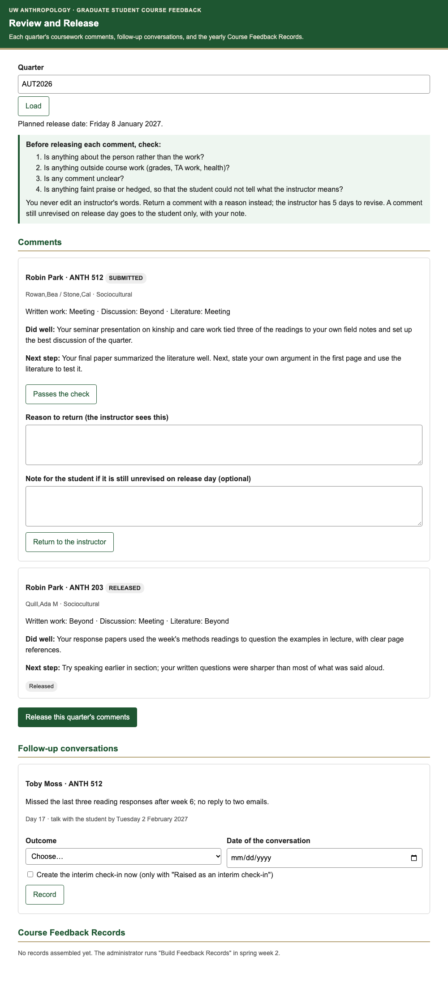
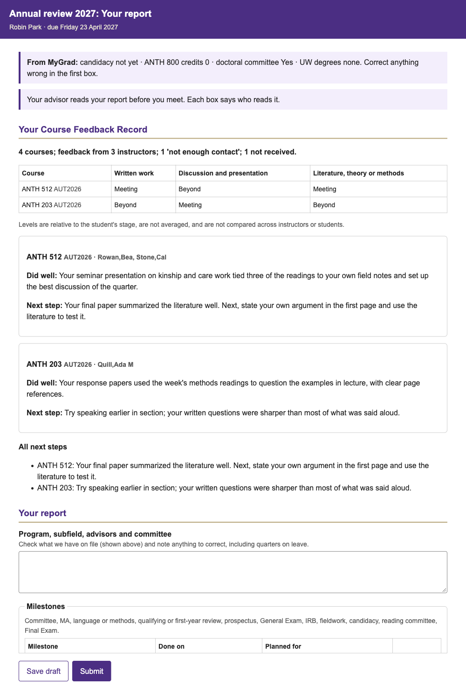

------------------------------------------------------------------------

editor_options: markdown: wrap: sentence ---

# Graduate Review System (UW Anthropology)

An Apps Script web app for two connected processes in the department:

- the **annual review of graduate students** (Graduate School Policy 3.7), with quarterly check-ins for MA students and for students with concerns;
- **instructor feedback on graduate students in courses**, released to students each quarter and gathered into a yearly Course Feedback Record that feeds the annual review.

It is a sibling of [`ta-evaluation-workflow`](../ta-evaluation-workflow) and reuses its infrastructure (audit log, logs, dead-letter queue, alerting).

| File | What it is |
|------------------------------------|------------------------------------|
| [`grad-annual-review-plan.md`](grad-annual-review-plan.md) | The annual review plan: research, design principles, workflow, data, decisions |
| [`course-feedback-plan.md`](course-feedback-plan.md) | The course feedback plan, a module of the same system |
| [`build-spec.md`](build-spec.md) | States, pages, every email text, and the acceptance tests |
| [`app/`](app) | The Apps Script project |
| [`app/tests/run.js`](app/tests/run.js) | Tests for the pure modules: `node --test grad-progress-review-workflow/app/tests/run.js` |
| [`app/tests/screenshots/build.js`](app/tests/screenshots/build.js) | Builds the pages with sample data for the [screenshots](#screenshots) |
| [`r3-postmessage-test/`](r3-postmessage-test) | The R3 test page (passed 17 Nov 2026) |
| [`../bookmarklet-mygrad-table-audit.js`](../bookmarklet-mygrad-table-audit.js) | MyGrad bookmarklet, with the app bridge (task R1) |
| [`../bookmarklet-time-schedule-sections.js`](../bookmarklet-time-schedule-sections.js) | Time Schedule bookmarklet for the app (task R2) |

## Status (18 November 2026)

**Built:** every server module and page in build-spec §2, both bookmarklet bridges, the 24 email templates (CF-1 to CF-11, AR-1 to AR-13), the daily trigger, and metrics.

**Verified:**

- 26 Node tests pass, covering the pure-logic acceptance tests in build-spec §4 (1 to 6, 8, 10, 11, 13, 16, 20 to 22, 24, and the flow part of 19) and the calendar dates both plans state.
- R3: an Apps Script page receives `postMessage` from MyGrad and Time Schedule tabs (course-feedback plan §4.5).
- The Time Schedule parser on the real Autumn 2026 ANTH, ARCHY, BIO A and LING pages, and the joint-listing merge on real pairs.
- How MyGrad shows current, next-quarter and withdrawn courses (all 41 transcripts, 1,329 rows), and that MyGrad's GPA follows the Graduate School's definition (34 of 34).
- Both bookmarklet bridges, run live on 18 Nov 2026 with only counts printed. MyGrad registrations: 41 students, 62 Autumn 2026 rows, no grades sent. MyGrad prefill: 41 students, entry and leave quarters read correctly (MyGrad writes winter as `WTR`). Time Schedule: 98 sections for ANTH, ARCHY and BIO A, and CEC appointment types for 25 of 39 instructors; the other 14 are not in the catalog, so the administrator confirms them.
- Every server file parses, every helper resolves, and every page's script parses and calls only public server functions.

**Run live (18 Nov 2026, build deployment, invented sample data):** the Roster page's CSV uploads, Preview and Import; saving instructor emails; Launch, which sent three CF-1 emails (all to the owner's address); the instructor page opened from the CF-1 link and submitted; and the GPC's Review and Release page. The `Students` and `Enrollments` sheets match acceptance test 7 for the fields the sample filled (GPA, committee flags, ANTH 800 credits, courses; no grade column in `Enrollments`). Leave and candidacy were blank in the sample, so those two are untested.

**Not yet verified:** acceptance tests 9, 12, 14, 15, 17, 18 and 23, and the annual review pages, which need a launched cycle and student or advisor accounts. Releasing comments was not run, because it emails the students. The bookmarklet changes are on the `grad-review-build` branch; the loaders in the main [readme](../readme.md) fetch from `main`, so they take effect after merging.

**Known issues** (found in the live run, not yet fixed):

- The Roster page says "Launch stays disabled" while instructors lack an email, but the button stays enabled; the server refuses the launch with an error instead.
- Saving a missing instructor email updates the `Instructors` sheet only. Click **Import** again before **Launch**, so the existing instructor pages pick up the address.
- The "Instructor pages this quarter" list shows the current calendar quarter, whatever quarter is typed in the box.
- Right after Import, the page list can show blank emails until the page is reloaded.
- The instructor page does not reload the saved "How long did this take?" answer.
- On a spreadsheet that has not been initialized, the Roster upload fails with "The number of columns in the range must be at least 1." Run Initialize first (setup step 7).
- Course Feedback Records print raw quarter codes such as `AUT2026`.
- The student report's first box says "shown above", but the page does not show the program, subfield or advisors.
- A student registered under the non-ANTH side of a joint listing (for example LING 203 A with ANTH 203 A) is excluded as "outside the departments in this phase." Decide whether that is intended.

## Screenshots {#screenshots}

**Live.** These three come from the build deployment on 18 Nov 2026, signed in as the owner, who is also set as administrator and GPC. The data are invented: three students and the instructors in the Time Schedule test fixture, uploaded through the Roster page's CSV fallback.

The Roster page after the CSV uploads and Preview for Winter 2027. The list under "Instructor pages this quarter" shows the Autumn 2026 sample pages, because that list follows the calendar quarter (see Known issues).


The instructor's page, opened from the CF-1 email link, with the answers already submitted. Student names show as "Park, Robin" because the sample prefill CSV gave them in that order, and the page prints the `Name` column as stored.


Review and Release (GPC) for Winter 2027, after the instructor submitted.



**Rendered with sample data.** The next three pages need a launched annual cycle or a student's own account, so they come from [`app/tests/screenshots/build.js`](app/tests/screenshots/build.js) instead. The script assembles each page from the app's real `.html` files, as `page_()` in `WebApp.gs` does, and replaces `google.script.run` with a stub that answers from sample data. The Course Feedback Records come from `buildFeedbackRecord_`, the program-stage flags and starting letter from `computeFlags_` and `defaultLetter_`, and the dates from the calendar functions. The other payloads are written by hand to match the return values of `loadReview`, `programViewData` and `myCourseFeedback`. Every person and email address shown is invented. To rebuild the pages, run `node grad-progress-review-workflow/app/tests/screenshots/build.js <folder>`, serve that folder, and open each page in a browser.

The student's annual report, top of the page: the MyGrad prefill note and the released Course Feedback Record above the form.



Program stage (GPC): a review with the time-limit and GPA flags, the starting letter, and the narrative check; an escalated review; and the Alert tracker.


The student's course feedback for one quarter.


## Setup

The build copy described here was set up on 18 Nov 2026 and runs. For production, repeat these steps under the department account (step 1).

### 1. Accounts

The plan calls for a department account that owns the spreadsheets, the script and the Drive folder (annual review plan, decision 11). Every email the system sends goes out from the owner's Gmail, and the web app runs as the owner, so the owner's account is the one that matters. The build copy is owned by a personal UW account. Move to the department account before launch by repeating steps 2 to 9 under that account.

### 2. Tools

On the computer you deploy from:

1.  Install [Node.js](https://nodejs.org) and clasp: `npm install -g @google/clasp` (the build used clasp 3.4.1).
2.  Sign in: `clasp login`, with the owner's UW Google account.
3.  Turn on the Apps Script API for that account at <https://script.google.com/home/usersettings>. clasp cannot push without it.

### 3. Spreadsheets and folder

Create three things in the owner's Drive:

- **The main spreadsheet**, with the Apps Script project bound to it (Extensions → Apps Script). The build copy is `1mdkZo7d2e2WElWzjzGFgbQUUC0dxB_1hGmGRW_QDi1Q`.
- **The confidential spreadsheet**, an empty spreadsheet shared with no one. It keeps the self-report section marked "Only for the GPC" (annual review plan §8). The build copy is `1cHgReD-TfNRXBQzQw8RySnBp-KxxZYCJhd8awqIsz6Y`.
- **The archive folder** for review PDFs and CV uploads. The build copy does not have one yet, so PDFs and CV uploads will fail until it is set.

Put the project's script ID in `app/.clasp.json`.

### 4. Config.gs

Edit [`app/Config.gs`](app/Config.gs). The values at the top:

| Setting | What to put there |
|------------------------------------|------------------------------------|
| `SPREADSHEET_ID` | The main spreadsheet's ID |
| `CONFIDENTIAL_SPREADSHEET_ID` | The confidential spreadsheet's ID. Initialize stops with an error without it |
| `ARCHIVE_FOLDER_ID` | The archive folder's ID |
| `APP_URL` | The web app URL from step 5. Every email link uses it |
| `ADMIN_EMAIL` | The Graduate Student Administrator, who runs the menus and the Roster page |
| `GPC_EMAIL`, `GPC_NAME` | The Graduate Program Coordinator. `GPC_NAME` signs every email, and replies go to `GPC_EMAIL` |
| `ALTERNATE_EMAIL` | Who does the GPC's work for the GPC's own advisees (by default the department chair; decision 16) |
| `SUBFIELD_COORDINATORS` | One email per subfield, for the subfield summary page |
| `SURVEY_URL` | The anonymous post-cycle survey (annual review plan §9.5) |
| `CYCLE_YEAR` | The spring year of the current annual cycle, for example `2027` |
| `CF_QUARTERS_ON` | Which quarters run course feedback. Autumn 2026 and summers are off (decision 9) |

The build copy sets the IDs and URL above, and uses the owner's address for both `ADMIN_EMAIL` and `GPC_EMAIL` for testing. This repository is public, so anything in `Config.gs` is public once committed. The spreadsheet IDs grant no access by themselves; only the people the files are shared with can open them.

### 5. Push and deploy

From `app/` (clasp looks for `.clasp.json` in the current folder):

```         
cd grad-progress-review-workflow/app
clasp push --force
clasp create-deployment --description "Graduate review"
```

The manifest ([`appsscript.json`](app/appsscript.json)) sets the web app to run as the owner and to allow UW accounts only. Copy the deployment's `/exec` URL into `APP_URL`, then push again. After every later edit, push and update the same deployment, so the URL stays the same:

```         
cd grad-progress-review-workflow/app
clasp push --force
clasp update-deployment <deployment ID>
```

The build deployment ID is `AKfycbz5Ux91ZrBe-V8gH3aCg6DZBIHYES4_CyhcJFtTvBGOXHAFA5tM0Iy_9kzPW-Twjwxn`. The `tests/` folder is never pushed (see `.claspignore`).

### 6. Approve the permissions (owner, once)

Open the web app URL while signed in as the owner. Google may first show a "Verify it's you" page, then an authorization prompt listing the scopes in `appsscript.json` (Sheets, Docs, Drive, sending email, triggers). Approve it. On 18 Nov 2026 this was enough: the web app and the spreadsheet menu both ran afterwards without asking again.

### 7. Initialize the sheets

Open the main spreadsheet and reload it, so the **Graduate review** menu appears. Choose **Graduate review → Initialize**. It creates every tab with its header row (`Students`, `Reviews`, `Enrollments`, `Feedback_Requests`, `Course_Feedback`, `Followups`, `Feedback_Records`, `Instructors`, `Metrics`, `Audit_Log`, `Logs`, `Dead_Letter_Queue`) and the `Confidential` tab in the confidential spreadsheet. It sends nothing, and it is safe to run again.

### 8. Install the bookmarklets

The administrator installs two bookmarklets from the main [readme](../readme.md): [MyGrad Table Audit](../readme.md#mygrad-table-audit-bookmarklet) and [Time Schedule Sections](../readme.md#time-schedule-sections-bookmarklet). The Roster page opens each site in a new tab, and the bookmarklet clicked there sends the data back to the app.

### 9. Fill in the Students sheet

On the Roster page, click **Get MyGrad data** and then the MyGrad bookmarklet in the tab that opens (see "Prepare the annual cycle" below). That adds every current student with the MyGrad fields. Then fill in the columns the administrator maintains, which the import never overwrites:

| Column | What to put there |
|------------------------------------|------------------------------------|
| `Subfield` | The subfield, spelled exactly as in `SUBFIELD_COORDINATORS` (for example `Archaeology`) |
| `Advisor_Emails` | The advisor, and any co-advisors, separated by commas. A student with no advisor is not launched (annual review plan §4.3) |
| `Chair_Email` | The committee chair, who gets the final PDF |
| `GSR_Email` | The Graduate School Representative |
| `Alternate_Reviewer` | Optional: who reviews this student if the GPC is their advisor or chair |
| `Status` | `ACTIVE`, `ON_LEAVE` or `LEFT` |

### 10. Create the triggers (last)

Choose **Graduate review → Create Triggers** only when the sheets list real people. It sets a daily task at 7 a.m. Pacific and two hourly tasks, and from then on the system sends reminders by itself (see "What runs by itself" below). The build copy has not run it. Before running it on a copy that has had test data, delete the test rows from `Students`, `Enrollments`, `Instructors`, `Feedback_Requests` and `Course_Feedback`.

### Trying the app with sample data

To exercise the course feedback steps without real records, set `ADMIN_EMAIL` and `GPC_EMAIL` to your own address, and give every sample instructor your own address too, so every CF-1 email comes to you. An instructor page opens only for its instructors and the administrator. Then upload invented CSVs through the Roster page's **Upload CSVs instead** in the same columns the bookmarklets download, and follow the course feedback steps below. Students' addresses receive email when comments are released, so stop before **Release** unless they are real accounts you control.

## How to Use

### Who does what

| Person | Where they work | What they do |
|------------------------|------------------------|------------------------|
| Graduate Student Administrator | The spreadsheet's **Graduate review** menu and the Roster page | Brings in MyGrad and Time Schedule data, keeps the `Students` and `Instructors` sheets, launches course feedback and the annual cycle |
| Instructor | Their page, opened from the CF-1 email | Comments on each graduate student in their course |
| Student | Their review page, opened from the email; the Your Course Feedback page | Writes the annual report or check-in, reads course feedback, acknowledges the letter |
| Advisor | The review page, opened from the email; the advisees' course feedback page | Meets the student, evaluates, recommends a rating |
| GPC (or the alternate) | Review and Release; the Program stage | Checks and releases course feedback, sets the final rating, edits and releases the letter, tracks Alerts |
| Subfield coordinator | The subfield summary page | Prepares the calibration meeting |

Each page is the web app URL plus a parameter:

| Page | Address |
|------------------------------------|------------------------------------|
| Roster (administrator, GPC) | `APP_URL?view=roster` |
| Review and Release (GPC, alternate) | `APP_URL?view=release` (add `&q=WIN2027` for a quarter) |
| Program stage (GPC, alternate) | `APP_URL?view=program` |
| A student's course feedback | `APP_URL?view=student` |
| An advisor's advisees' course feedback | `APP_URL?view=advisor` |
| Subfield summary (coordinators) | `APP_URL?view=coordinator` |
| Instructor page, review stage | Only through the link in the email, which includes a token |

Every page checks the signed-in UW account. Opening a link sent to someone else shows a message naming the account you are signed in as.

### Opening the Roster page

The Roster page has its own web address: the web app URL followed by `?view=roster`. For the build copy that is

<https://script.google.com/a/macros/uw.edu/s/AKfycbz5Ux91ZrBe-V8gH3aCg6DZBIHYES4_CyhcJFtTvBGOXHAFA5tM0Iy_9kzPW-Twjwxn/exec?view=roster>

Bookmark it. You can also reach it from the main spreadsheet: **Graduate review → Import Roster (opens the Roster page)** shows a link to it. The same pattern opens the GPC's pages: `?view=release` for Review and Release and `?view=program` for the Program stage, or **Graduate review → Review and Release (opens the page)** and **Graduate review → Program stage (opens the page)** in the menu.

Open it signed in with the UW account named in `ADMIN_EMAIL` or `GPC_EMAIL`. Any other account sees "Only the Graduate Student Administrator or the GPC can do this." If Google shows a "Verify it's you" page first, continue as your UW account. After a new deployment the address stays the same, because `clasp update-deployment` keeps the deployment ID.

### Each quarter: course feedback

The calendar is in course-feedback plan §5.4. For Winter 2027: the instructor page opens Mon 15 Mar, is due Fri 2 Apr, and comments are released Fri 9 Apr.

**Administrator, week 3 of the quarter.**

1.  Open the Roster page and type the quarter, for example `WIN2027`.
2.  Click **Get MyGrad registrations**. In the MyGrad tab that opens, click the MyGrad Table Audit bookmarklet. When the Roster page shows "MyGrad: … registrations", close the tab. Grades never leave MyGrad.
3.  Click **Get Time Schedule sections**. In the Time Schedule tab, click the Time Schedule Sections bookmarklet, wait for "Time Schedule: … sections", and close the tab.
4.  Click **Preview**. It writes nothing. Check the counts, the excluded rows and their reasons, and the list of instructor pages.
5.  Click **Import**. For each name under "Instructors without an email", look the person up in the UW Directory, enter their UW email, confirm the appointment if the CEC did not give one, and click **Save**. Then click **Import** again so the pages pick up the emails.

If a bookmarklet cannot send its data back, it offers a CSV download instead. Upload it under **Upload CSVs instead**.

**Administrator, Monday of finals week.** Repeat steps 1 to 5 to drop withdrawals and catch instructor changes. Then click **Launch course feedback** (or **Graduate review → Launch Course Feedback…**). Each instructor gets one CF-1 email per course, with a link to their page. Co-taught courses share one page, which locks for 30 minutes while one instructor edits. The **Add** box beside a page adds a co-instructor the Time Schedule does not list.

**Instructor.** Open the link in the email while signed in to UW. For each student, say whether you had enough contact to comment. If you did, give the three ratings, one thing the student did well, and the one next step. Tick "follow up" only for something the GPC should act on this quarter. Sign and click **Submit**; you can edit until the page closes. If the course is not yours, use "let us know" in the email; the administrator then re-sends the page with **Re-send** on the Roster page.

**GPC, the week after the page closes.**

1.  Open **Review and Release** and load the quarter.
2.  Read each comment against the four-item check on the page. Click **Passes the check**, or write a reason and click **Return to the instructor**, who then has 5 days to revise. The GPC never edits an instructor's words.
3.  Click **Release this quarter's comments**. Students and advisors can then read them, and each student gets an email saying new feedback is there.
4.  Under **Follow-up conversations**, record the outcome and date of each conversation within 21 days of the flag. "Raised as an interim check-in" with the box ticked creates an interim review.

**Spring week 2.** The administrator chooses **Graduate review → Build Feedback Records…** with the spring year. The GPC adds an optional synthesis to each record on Review and Release (written without AI drafting) and clicks **Release records**. Each record then appears in the student's annual report and the advisor's view.

### Each spring: the annual review

The calendar is in annual review plan §4.4: launch in spring week 1, student report due at the end of week 4, advisor evaluation at the end of week 6, calibration in weeks 7 and 8, letters released in week 9, acknowledgement 14 days later.

**Prepare the annual cycle (administrator, before spring week 1).**

1.  On the Roster page, type a spring quarter (for example `SPR2027`) and click **Get MyGrad data**, then the MyGrad bookmarklet in the tab that opens. The app updates `Students` with GPA, leave dates, committee flags, degrees, candidacy, ANTH 800 credits and the year's courses. The page lists anyone active in `Students` who is missing from MyGrad, so you can check whether they have left.
2.  Check `Advisor_Emails`, `Chair_Email` and `Status` for every student (setup step 9).
3.  Set `CYCLE_YEAR` in `Config.gs`, then push and update the deployment.

**Launch (administrator, spring week 1).** Choose **Graduate review → Launch Annual Cycle…** and enter the year. Every active PhD student with an advisor gets a review and an AR-1 email with their link. Students marked `ON_LEAVE` get an `ON_LEAVE` row and no email. A student with no advisor is skipped and logged.

**Student.** Open the link and fill in the report. MyGrad values and last year's goals are filled in; correct anything wrong. The page saves a draft every 30 seconds. The box "Only for the GPC" never reaches the advisor or the PDF. Submit when done; the advisor then gets an email.

**Advisor.** Read the report, meet the student, then fill in the evaluation and recommend a rating. Any rating below Satisfactory needs the benchmark, deadline, support and consequence (Policy 3.7.2). Co-advisors share one draft, and one of them signs.

**GPC, after the subfield calibration meetings.** Open **Program stage**, filter by subfield if useful, and for each review:

1.  Read the flags (for example nearing the Graduate School time limit, or GPA below 3.0) and the course feedback summary.
2.  Set the final rating, giving a reason if it differs from the advisor's, and any status action. Alerts default to the autumn quarter, because Anthropology does not require summer registration.
3.  Edit the starting letter, tick the five narrative checks, and click **Release the letter**. To send a passage back to the advisor instead, use **Return to the advisor** (5 days).
4.  For escalated reviews, choose **Extend**, **Skip the stage** or **Mark exempt**, with a reason.
5.  In the **Alert tracker**, record the date each Alert recommendation went to the Graduate School. It is due by the 10th business day of the Alert quarter.

**Student, after the letter.** Read the evaluation and the letter, acknowledge them (acknowledging is not agreeing), optionally respond in writing or ask to meet the GPC, and sign. The PDF is then built and shared with the student, advisors, committee chair and GPC by link.

**Check-ins.** A rating of "Satisfactory with concerns" or "Unsatisfactory" creates an interim check-in, due in 3 months if the student is missing a milestone or has a GPA below 3.0. MA students get a short check-in at the end of every enrolled quarter instead of an annual review. The daily task launches these on the Monday of finals week, or the administrator can use **Graduate review → Launch MA Check-ins…**.

### What runs by itself

After **Create Triggers**, a daily task at 7 a.m. Pacific:

- sends review reminders every 5 days, at most 2, then marks the review `ESCALATED` and tells the reviewer (no annual-review reminders between spring finals and autumn);
- sends course feedback reminders CF-2 and CF-3 on the two reminder dates, and closes pages after the due date;
- for each follow-up flag, emails the reviewer and the student's advisors the next day (CF-7), and the reviewer again on day 14 if it is still open (CF-8);
- launches MA check-ins on the Monday of finals week;
- reminds the GPC 5 business days before each Alert deadline, and sends the calibration notice when the calibration window opens;
- deletes log rows older than 90 days.

Two hourly tasks retry failed emails from `Dead_Letter_Queue` and check the alert thresholds in `Alerting.gs`. **Run Daily Tasks Now** and **Process Dead Letter Queue Now** in the menu run them by hand. The `Logs` sheet records every email sent, and `Audit_Log` records every import, launch, submission and release. **Compute Metrics** writes the program metrics (annual review plan §9.5) to `Metrics`.

### Changing the text

| Text | File |
|------------------------------------|------------------------------------|
| Instructor page | [`app/FeedbackForm.html`](app/FeedbackForm.html): `guidance()` and `studentBlock()` |
| Annual report, advisor evaluation, check-ins, acknowledgement | [`app/Index.html`](app/Index.html): the field lists `STUDENT_ANNUAL`, `STUDENT_MA`, `ADVISOR_ANNUAL`, `ADVISOR_CHECKIN`, `ACK` |
| Rating levels and review ratings | [`app/Config.gs`](app/Config.gs): `CF_LEVELS_`, `REVIEW_RATINGS_` |
| GPC checklists | [`app/ReviewRelease.html`](app/ReviewRelease.html), [`app/Program.html`](app/Program.html) (`CHECKS`) |
| Roster page, student course feedback page | [`app/RosterPage.html`](app/RosterPage.html), [`app/Home.html`](app/Home.html) |
| Every email | [`app/CoreEmail.gs`](app/CoreEmail.gs) |

After editing, run `node --test grad-progress-review-workflow/app/tests/run.js`, then push and update the deployment (setup step 5).

## How the app is organized

The `Core*.gs` files contain the plans' rules as pure functions with no Google services, so they run under Node in the tests: calendar dates (`CoreDates.gs`), states and transitions (`CoreStates.gs`), the MyGrad-to-Time-Schedule join (`CoreRoster.gs`), every email text (`CoreEmail.gs`), and the Course Feedback Record, the PDF field whitelist and metric suppression (`CoreRecords.gs`). The other `.gs` files are the Apps Script layer, and the `.html` files are the pages (build-spec §2).

## Privacy notice

*Draft for review before launch (course-feedback plan §9; annual review plan §10).*

**What the system keeps.** For each graduate student: the student's annual review report and check-ins; the advisor's evaluation; the program's rating, letter and any status action; the student's acknowledgement and response; and instructors' feedback on the student's course work, with the instructor's name. From MyGrad it keeps the student's email, entry quarter, GPA, leave dates, committee flags, UW degrees, candidacy date, ANTH 800 credits and the year's courses. No grades are collected for course feedback.

**Why.** To review each student's performance and progress under Graduate School Policy 3.7, and to give students feedback on their course work.

**Who sees what.** The student sees everything written about them in the app, except the GPC's calibration notes, which are available on request. Advisors see their advisees' reviews and released course feedback. The committee chair receives the final PDF. Subfield coordinators and calibration meetings see a summary of course feedback only. The section of the self-report marked "Only for the GPC" is kept from the advisor and stored separately. No fellow student sees any record. Instructors see only what they wrote.

**Your rights.** These are education records under FERPA. You may inspect your records (the University responds within 45 days; WAC 478-140-022) and ask for them to be amended (WAC 478-140).

**Email.** Emails never contain a review, a rating, a comment or a letter; they link to the app or to a PDF shared only with your UW account. Course feedback emails never name a student.

**Retention.** The likely records series is Student Folders (6 years after the degree or last activity), pending confirmation with UW Records Management. Nothing is deleted automatically; logs are pruned after 90 days.

**No AI** is used anywhere in the system, and the GPC writes any synthesis of course feedback without AI drafting.
