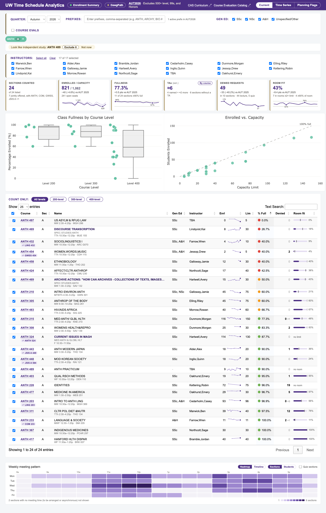
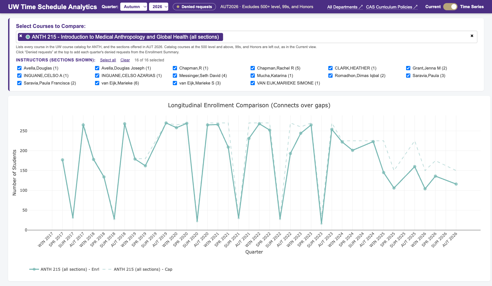
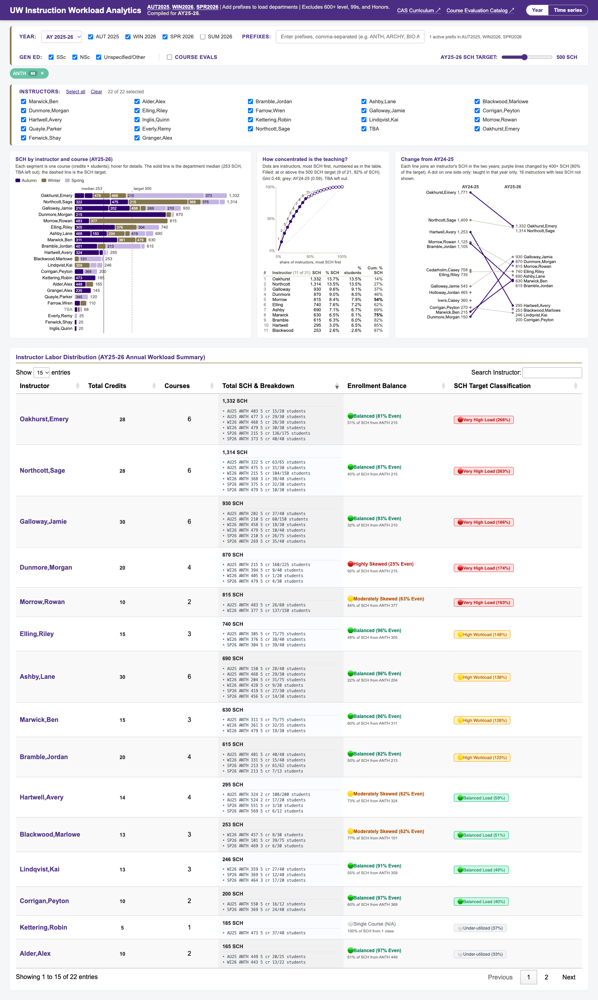

# Web Helpers for UW Administrative Workflows in the [Anthropology Department](https://anthropology.washington.edu/) and [Data Science Minor](https://dataminor.uw.edu/) 

## Introduction

This repository contains scripts, e.g. to create browser bookmarklets or web apps, to help visualize and summarize data and simplify workflows relating to day-to-day operations of the UW Anthropology Department and the Data Science Minor. 

### A Note on Student Privacy and Data Security

**⚠️ Disclaimer & FERPA Warning**: These scripts are unofficial tools created to assist authorized UW faculty/staff workflows. These scripts access FERPA-protected education records. Use is restricted to authorized UW faculty/staff with legitimate educational interest. These scripts are not officially supported or endorsed by the University of Washington or the UW Department of Anthropology. Users of these tools are solely responsible for ensuring compliance with FERPA and [UW Data Security policies](https://it.uw.edu/policies/security-and-privacy-policies/uw-information-security-policies/). Authorised UW faculty/staff will always verify AI-generated outputs against official UW records. AI output is not for official record-keeping; official UW records always take precedence. No automated decisions are made about students using these tools.

**🔒 A Note on Student Privacy and AI**: Because this repository is public, students or parents may be reading this. Please be assured that student privacy is our highest priority:

-   No Public AI: These tools are strictly designed only to be used with UW's enterprise-secured instance of Microsoft Copilot.
-   No AI Training: Under [UW's commercial data protection agreement with Microsoft](https://itconnect.uw.edu/tools-services-support/software-computers/productivity-platforms/microsoft-productivity-platform/microsoft-copilot/), and [Microsoft's data privacy and security policy for Copilot](https://learn.microsoft.com/en-us/copilot/microsoft-365/microsoft-365-copilot-privacy) student data inputted into UW Copilot is never used to train Microsoft's public AI models.
-   Expert, Authorised Human Oversight: Generative AI is used strictly as a summarization and research aide by authorized UW faculty/staff with legitimate educational interests. AI does not make decisions regarding student progress, grades, or degree milestones. All AI-generated summaries are manually reviewed and verified by UW authorised faculty/staff against official university records.

### How to install a bookmarklet:

 A [bookmarklet](https://en.wikipedia.org/wiki/Bookmarklet) is a bookmark stored in your web browser that contains JavaScript commands that make the browser do useful work. These ones only work on sites that require UW credentials to access.

-   Each script must be added to your web browser as a unique bookmark, so repeat these steps for each bookmarklet
-   For Chrome, look on the top menu bar for "Bookmarks", select "Bookmark Manager" 
-   On the very top right of the Bookmarks page, click the three dots to show a drop-down menu, click on "Add new bookmark"
-   For the name field, use 'Time Schedule Viz' or similar for the first bookmarklet (quotes not required)
-   Select all the code in the block under the heading 'Script for the bookmarklet', and paste it into the URL field of the new bookmark box.
-   Click Save to finish making the bookmarklet. Look for the new bookmark in the list of bookmarks top menu bar for "Bookmarks" or on your bookmark bar. 
-   Each bookmarklet loads the latest version of its script every time you click it, so you only need to install it once. 

## Time Schedule Enrollment Dashboard Bookmarklet

#### Overview

For a given quarter, this script collects data from the [UW Time Schedule](https://www.washington.edu/students/timeschd/) pages for any UW course prefix you choose and produces a simple dashboard that visualizes current student enrollment numbers for the selected classes. Type the prefixes you want (one or several, comma-separated, e.g. `ANTH, ARCHY, BIO A`) into the box at the top of the dashboard. The script recognizes all 355 UW course prefixes (e.g. `ANTH`, `ARCHY`, `BIO A`, `CS&SS`, `VIET`); unknown prefixes are rejected with a warning. Each prefix is assigned its own color for the plots and tables. The dashboard includes a switch to a time series view to compare previous quarters of classes to see trends in enrollment, either for a whole course (all lecture sections combined, whoever taught them) or for an individual section and instructor, with checkboxes to include or exclude particular instructors' sections. The course picker in the time series view lists every course in the [UW course catalog](https://www.washington.edu/students/crscat/) for the selected prefixes, so you can follow courses that are not offered in the quarter you are viewing. A quarter picker at the top of the dashboard loads any quarter from Winter 2003 on. A weekly heatmap, with a timeline view of individual sections, shows when the selected sections meet, the table shows each section's meeting times, special-topics title and joint offering, and an optional connection to the Time Schedule's Enrollment Summary (UW NetID required) adds denied registration requests, room fit (enrollment against room capacity) and joint-offering partners, including denied requests over time in the time series view. Course evaluations from the [UW Course Evaluation Catalog](https://www.washington.edu/cec/toc.html) (CEC, UW NetID required) are added for the quarters the CEC covers (it lists one year, currently Autumn 2025 to Summer 2026): the table gets a sortable Eval column with each section's combined median and the number surveyed out of enrolled (hover for each item's median, the evaluation form and the instructor's appointment), each instructor's appointment as listed in the CEC appears next to their name, the chart tooltips add the section's evaluation, and the time series view adds a separate panel with each selected course's combined median in the quarters the CEC covers. The combined median is computed by the dashboard, not reported by the CEC, in the same way as in the Instruction Workload dashboard. Appointment checkboxes next to the Instructors checkboxes (in both views) show or hide everyone with a given appointment. Quiz sections (usually led by TAs) are left out and nothing from the CEC is saved after the tab is closed. The CEC states that its information is for members of the UW academic community and may not be published or redistributed to anyone without a current UW NetID, so do not share screenshots or printouts that show evaluations outside UW. The script does not use or contain AI and does not use any data other than the Time Schedule, course catalog, Course Evaluation Catalog and (if you connect it) Enrollment Summary pages for the prefixes you select; the Enrollment Summary gives section-level counts only. The script runs entirely in your browser. No data are collected from your computer or stored on your computer. No student-level data or other FERPA-protected data are collected or used by this script.

#### Script for the bookmarklet:

```
javascript:(function(){
  var repo = 'benmarwick/uw-anthro-web-helpers';
  var file = 'bookmarklet-time-schedule-viz-generic.js';
  var hint = 'Open a UW Time Schedule quarter page, then click the bookmark again.';
  function load(ref) {
    var s = document.createElement('script');
    s.src = 'https://cdn.jsdelivr.net/gh/' + repo + '@' + ref + '/' + file + (ref === 'main' ? '?t=' + Date.now() : '');
    s.onerror = function() { alert('The tool could not load. Check your internet connection. ' + hint); };
    document.body.appendChild(s);
  }
  fetch('https://api.github.com/repos/' + repo + '/commits/main', { headers: { Accept: 'application/vnd.github.sha' } })
    .then(function(r) { return r.ok ? r.text() : ''; })
    .then(function(sha) { load(/^[0-9a-f]{40}$/.test(sha) ? sha : 'main'); }, function() { load('main'); });
})();
```

#### How to use:

-   Use your UW credentials to log into the University of Washington Seattle Time Schedule for a given quarter-year, e.g. [https://www.washington.edu/students/timeschd/SPR2026/](https://www.washington.edu/students/timeschd/SPR2026/)
-   Click the 'Time Schedule Viz' bookmark (or whatever you named it when you created it) in your browser and the dashboard will appear in a new tab, it should look similar to the screenshot below.
-   Type the prefixes you want to see (e.g. `ANTH, ARCHY, BIO A`) into the box at the top of the dashboard; each prefix loads its data and is shown as a colored chip that you can remove.
-   If you click the bookmark while on a department's page (e.g. [https://www.washington.edu/students/timeschd/SPR2026/anthro.html](https://www.washington.edu/students/timeschd/SPR2026/anthro.html)), that department's prefix (here `ANTH`) is already loaded when the dashboard opens; add more prefixes as usual.
-   Use the Quarter and year menus at the top of the dashboard to load another quarter; the prefixes you have entered are reloaded for that quarter. The time series view ends at the selected quarter.
-   To add denied requests, room fit and joint-offering partners, click "Denied requests" at the top of the dashboard. The Enrollment Summary opens in a new tab; click the Time Schedule Viz bookmark in that tab once. The button then reads "Enrollment Summary" and the Denied and Room fit columns, the Denied requests and Room fit cards (with their line charts), the joint-offering partners in the Sections counted card, and the time series' denied panel fill in. Keep that tab open while you use the dashboard; closing it disconnects. The Enrollment Summary does not define "denied requests" (for example, whether a student who tries again is counted again), so read them as a relative signal of unmet demand.
-   The Weekly meeting pattern heatmap shades each half hour of the week by the number of sections (or students) meeting then; hover a cell to list the sections. Click Timeline to see each section as a bar from its start to its end time instead, with sections that meet at the same time stacked in separate rows and bars colored by course level in UW brand colors (Spirit Gold for 100-level, Lavender for 200-level, Heritage Gold for 300-level, Husky Purple for 400-level); hover a bar for its title, times, room, instructor and enrollment. Tick Quiz sections to include them; in the timeline they are shown as white bars outlined in their course level's color.
-   Use the Instructors checkboxes below the prefix chips to show or hide the sections taught by particular instructors; the stats, charts, and table update to match. The Appointment checkboxes above them show or hide everyone with that appointment (from the Course Evaluation Catalog); a type is shown partly checked when only some of its instructors are checked.
-   Course evaluations load with the prefixes. If the quarter shown is not one the Course Evaluation Catalog covers, the note next to Course evals says so and offers a button to load a covered quarter. Uncheck Course evals to hide every rating, for example when sharing your screen. In the time series view, the bottom panel shows each selected course's combined median in the quarters the CEC covers; hover a point for the number surveyed and enrolled and the evaluation form.
-   The Time Schedule sometimes spells one instructor's name several ways, e.g. `Marwick,B` and `Marwick,Ben`. The Instructors checkboxes in both views treat names with the same surname and matching first and middle names (or their initials) as one person, show the spelling used for the most sections, and list the other spellings when you hover over the name. Names that differ in spelling, e.g. a nickname, are not merged. Names that the Time Schedule prints in all capitals are shown with each word capitalized (e.g. `MARWICK,BEN` as `Marwick,Ben`); names in mixed case keep the Time Schedule's spelling (e.g. `van Eijk`).
-   Explore the dashboard by filtering the data using the checkboxes at the top, e.g. click or double-click on the plot legends to show/hide classes; sort the table at the bottom by %Full.
-   The Sections counted card also shows how many of those sections are jointly offered with another course, and with which prefixes once the Enrollment Summary is connected.
-   The Enrolled / capacity, Fullness, Denied requests and Room fit cards include a small line chart of the Autumn, Winter and Spring quarters of the last five years (Summer quarters are left out), ending at the selected quarter, with the highest and lowest values labelled; hover the line to see each quarter's numbers. In the Enrolled / capacity card the solid line is students enrolled and the dashed line is capacity. The Fullness and Room fit charts use a fixed 0–100% scale with grey lines at 0% and 100%. Past quarters count the same prefixes, Gen Ed filter, excluded courses and course levels as the cards; sections you unchecked and instructors you hid apply only to the selected quarter. The Denied requests and Room fit charts need the Enrollment Summary connected. On narrow cards (for example, with all six cards showing) the charts sit below the numbers, across the full width of the card, instead of beside them. Under each of these numbers, a small line gives the change from the same quarter last year (e.g. "−39 (−4.5%) vs AUT 2025"; percentages change in percentage points).
-   In the table, each Enrl number has a small line beside it showing that course's enrollment (all its lecture sections) in the same quarters as the card charts, with the selected quarter as a dark dot; hover it for the numbers. Courses offered fewer than twice in that period have no line.
-   Use the checkboxes in the first column of the table to leave individual sections out of the stats and charts; unchecked sections stay in the table, grayed out. The checkbox in the header includes or excludes all listed sections, respecting the Text Search box, and the "Count only" buttons above the table check just one course level (e.g. only 100-level sections) or all levels.
-   When you switch to the time series view, the ten courses in the Current view with the most students enrolled (all sections combined) are selected and plotted, and a note under the course picker says so; courses you add or remove there stay as you left them until the Current view shows a different set of courses.
-   In the time series view, choose a course's "(all sections)" entry to see its combined enrollment over the past ten years, or a specific section to follow one instructor's offerings. The Instructors checkboxes there list everyone who taught the selected courses in that period, with the number of sections each taught in parentheses. Each selected course or section gets its own line color, shown as a dot on its tag in the course picker. The picker lists every course in the UW course catalog for your prefixes (courses at the 500 level and above, 99s, and Honors are left out, as in the quarter view); courses with no sections in the selected quarter are marked "not offered".
-   Close the Dashboard tab when finished. To share the dashboard, print it as a PDF or take a screenshot.

Current quarter view: 



Time series view: 



## Time Schedule Instructor Workload Dashboard Bookmarklet

#### Overview

For a given academic year, this script collects data from the [UW Time Schedule](https://www.washington.edu/students/timeschd/) pages for any UW course prefixes you choose and produces a simple dashboard that visualizes instructor workloads for the instructors of the selected prefixes. Type the prefixes you want (one or several, comma-separated, e.g. `ANTH, ARCHY, BIO A`) into the box at the top of the dashboard. The script recognizes all 355 UW course prefixes and rejects unknown prefixes with a warning. Choose the academic year (from 2002-03 on) and the quarters to count from the Year menu and checkboxes at the top of the dashboard; by default the script loads the Autumn, Winter, and Spring pages of the academic year, and Summer can be added. Each prefix gets its own color on its chip at the top of the dashboard. The dashboard calculates annual student credit hours (SCH) for every instructor and shows them in three charts side by side: a bar for each instructor split into one segment per course (credits × students, colored by quarter, with the department median as a solid line and the SCH target as a dashed line), a Lorenz curve of how concentrated the teaching is (each dot is one instructor, filled when at or above the SCH target; a table below the curve lists as many of the top instructors as fit, with their SCH, their share of all SCH, their share of all student enrollments (a student in two courses counts twice; co-taught enrollment is split), and the cumulative share of SCH; the previous year's curve is drawn in grey, and the Gini coefficient for both years is given), and a slopegraph of each instructor's SCH in the previous academic year and the selected one, with changes of at least 80% of the SCH target highlighted. The slopegraph and the grey Lorenz curve load the previous year's Time Schedule pages in the background. Hovering an instructor in any of the three charts highlights the same person in the other two. The script generates a Instructor Labor Distribution table with one row for each instructor, and columns to display the total number of courses, credits, SCH, an enrollment balance metric (so we can see if an instructor's SCH are concentrated in only one big course, or evenly disributed accross multiple courses), and a SCH target classification (relative to a target SCH value, this is adjustable with a slider). When the Time Schedule spells one instructor's name several ways (e.g. `Chapman,R` and `Chapman,Rachel R`), the table combines them into one row, as in the Time Schedule Viz, and lists the other spellings when you hover over the name. Names in all capitals are shown with each word capitalized; names in mixed case keep the Time Schedule's spelling. A switch at the top right of the dashboard changes to a time series view that follows instructors over 5, 10, 15 or 20 academic years ending at the year selected in the Year menu, using the same prefixes, quarters, Gen Ed filter and SCH target. It shows a line chart of each selected instructor's SCH by academic year (or their share of department SCH, students, courses or average class size) against a shaded band for the middle 50% of all instructors and a line for the median instructor; a department panel with total SCH (split into named instructors and TBA or STAFF), the number of instructors at or above and below the SCH target, and the Gini coefficient for each year; a profile for each selected instructor (mean SCH per year, the latest year's SCH, rank and change, a least-squares trend, years at or above the target, average class size, share of seats filled, SCH by course level, the courses with the most SCH, and notes such as years without sections and reliance on one course); a heatmap of every instructor's SCH in each quarter, which shows leaves and gaps; and a sortable table of all instructors with a small SCH chart for each. Up to eight instructors can be compared at once, and the instructor-by-year numbers can be downloaded as a CSV file. A year counts as partial when one of its quarters has no Time Schedule page yet (usually a quarter that has not been published); partial years are marked in every chart and left out of the averages, trends and target counts. Names are matched across years with the same rules as the table. The Time Schedule does not say why an instructor has no sections in a year (leave, buyout, or teaching under another prefix), so read gaps with that in mind. Course evaluations from the [UW Course Evaluation Catalog](https://www.washington.edu/cec/toc.html) (CEC, UW NetID required) are added when the selected quarters overlap the year the CEC covers (it lists one year, currently Autumn 2025 to Summer 2026): each instructor's appointment as listed in the CEC appears under their name, each course line shows its evaluation (combined median, then number surveyed / enrolled), a Course Evaluations column gives each instructor's combined median pooled over their evaluated sections with the sections evaluated and the share of students surveyed, a table shows SCH and evaluations by appointment type, and a scatter plot shows every evaluated section's combined median against its enrollment (dot area is the number surveyed). In the time series view, each instructor profile lists their evaluated sections and the table has an Evaluations column. The combined median is computed by the dashboard, not reported by the CEC: it averages the response shares of the four standard items (course as a whole, course content, instructor's contribution, instructor's effectiveness) and takes their median the way the CEC computes each item's median (5 = Excellent, 0 = Very Poor). The Course Evaluations columns in the Instructor Labor Distribution table and the time series table can be sorted; the highest combined median comes first and instructors without evaluations come last. Appointment checkboxes above the instructor names (in the Year view and in the time series view) group the instructors by their appointment as listed in the CEC (for example Professor, Lecturer or Teaching Assistant), with a count for each; instructors not found in the CEC are grouped as No CEC record. Unchecking a type unchecks all of its instructors, so they leave the charts, tables and totals; a type is shown partly checked when only some of its instructors are checked. Because the CEC lists one year, appointments for other years are matched by name (the same spelling in the CEC year's Time Schedule, or else a CEC name with the same surname and first name or initial), and the dashboard says so; appointments may have changed since. Quiz sections (usually led by TAs) are left out, every rating is shown with the number of students surveyed, and nothing from the CEC is saved after the tab is closed. Uncheck Course evals at the top of the dashboard to hide all evaluations, for example when sharing your screen. The CEC states that its information is for members of the UW academic community and may not be published or redistributed to anyone without a current UW NetID, so do not share screenshots or printouts that show evaluations outside UW. The script does not use or contain AI and does not use any data other than the Time Schedule and Course Evaluation Catalog pages for the prefixes you select. The script runs entirely in your browser. No data are collected from your computer or stored on your computer. No student-level data or other FERPA-protected data are collected or used by this script.

#### Script for the bookmarklet:

```
javascript:(function(){
  var repo = 'benmarwick/uw-anthro-web-helpers';
  var file = 'bookmarklet-time-schedule-workload-generic.js';
  var hint = 'Open a UW Time Schedule quarter page, then click the bookmark again.';
  function load(ref) {
    var s = document.createElement('script');
    s.src = 'https://cdn.jsdelivr.net/gh/' + repo + '@' + ref + '/' + file + (ref === 'main' ? '?t=' + Date.now() : '');
    s.onerror = function() { alert('The tool could not load. Check your internet connection. ' + hint); };
    document.body.appendChild(s);
  }
  fetch('https://api.github.com/repos/' + repo + '/commits/main', { headers: { Accept: 'application/vnd.github.sha' } })
    .then(function(r) { return r.ok ? r.text() : ''; })
    .then(function(sha) { load(/^[0-9a-f]{40}$/.test(sha) ? sha : 'main'); }, function() { load('main'); });
})();
```

#### How to use:

-   Use your UW credentials to log into the University of Washington Seattle Time Schedule for a given quarter-year, e.g. [https://www.washington.edu/students/timeschd/](https://www.washington.edu/students/timeschd/)
-   Click the 'Time Schedule Workload' bookmark (or whatever you named it when you created it) in your browser and the dashboard will appear in a new tab, it should look similar to the screenshot below.
-   Type the prefixes you want to see (e.g. `ANTH, ARCHY, BIO A`) into the box at the top of the dashboard; each prefix loads its Autumn/Winter/Spring data and is shown as a colored chip that you can remove.
-   If you click the bookmark while on a department's page (e.g. [https://www.washington.edu/students/timeschd/SPR2026/anthro.html](https://www.washington.edu/students/timeschd/SPR2026/anthro.html)), that department's prefix (here `ANTH`) is already loaded when the dashboard opens; add more prefixes as usual.
-   Use the Year menu to switch academic years, and the AUT/WIN/SPR/SUM checkboxes to choose which quarters are counted; the charts and table update to match.
-   Use the Instructors checkboxes below the prefix chips to leave particular instructors (or TBA) out of the charts, the table and the totals, as in the Time Schedule Viz; "Select all" and "Clear" check or uncheck everyone. The Appointment checkboxes above the names include or leave out everyone with that appointment (from the Course Evaluation Catalog), and each name shows its appointment in small gray text.
-   Explore the dashboard by filtering the data using the checkboxes at the top; hover over a bar, dot or line in the charts to see the numbers and highlight that instructor in all three charts; sort the table at the bottom by each column.
-   Click "Time series" at the top right to follow instructors across years. Choose the span (5 to 20 years, ending at the year in the Year menu) and the measure. The four instructors with the most SCH in the latest complete year are selected at first; type a name in the "Compare instructors" box, click a name in the heatmap, or click a row in the table to add or remove instructors (up to eight). Hover over (or tab to the chart and use the arrow keys on) the line chart to read each year's values and ranks; hover over a heatmap cell or a profile bar for that quarter's or year's courses. The first visit to a span loads its Time Schedule pages (three or four per prefix per year), which can take a minute for 20 years; the pages are kept while the dashboard is open. "Download CSV" saves one row per instructor and academic year. Click "Year" to return.
-   Close the Dashboard tab when finished. To share the dashboard, print it as a PDF or take a screenshot.




## MyGrad Table Audit Bookmarklet

#### Overview

For the [Current Student List](https://webappssecure.grad.uw.edu/mgp-dept.stu.detail/home/studentlist?orgid=14) view of MyGrad, this script modifies the table rows to indicate years since admission to the program, and whether or not a student has an advisor. It also adds five milestone columns, one per indicator:

| Column | Meaning | Source |
|---|---|---|
| Anthropology MA | an Anthropology master's degree is on record | student's degrees |
| Committee | the committee the student's programme requires | student list data |
| Candidacy Granted | the doctoral exam result is Candidacy Granted, with the date in the tooltip | doctoral exam requests |
| ANTH 800 Credits | dissertation credits on the transcript, shown against the 27-credit requirement | transcript |
| Graduated | the degree the student is currently working on is complete | see below |

`Committee` reports the committee type the programme actually calls for rather than always the doctoral one. A student in a master's programme, such as the Anthropology Archaeological Heritage MA, is shown their master's committee. Every other student, including pre-doctoral students, is shown their doctoral committee. A pre-doctoral student who still holds only a master's committee from a previous degree therefore reads as having no committee yet, which is what their programme requires. Hovering the cell says which committee type was checked.

The five columns are inserted directly after Name, on the left, so they are visible without scrolling. To make room, the Student Number, Email UCS and Current Credits columns are hidden. They are hidden rather than removed, so the page's own column state is left intact.

`Graduated` is read differently depending on the degree level, because MyGrad records the two separately. For a master's student it is the literal `Degree Granted` in the status column of the master's requests page. For a doctoral or pre-doctoral student it is the literal `Dept Conveyed Exam Passed` in the status column of the doctoral exam requests page, which the department records once the final defence has been passed and conveyed. A student in the Anthropology Archaeological Heritage master's programme is covered by the first of these.

Master's students with no committee of any kind are marked with a red flag next to their name. A filter panel narrows the list to students matching a given condition, with a count on each button. The script will work on any UW graduate program that uses MyGrad.

Every milestone cell is a link to the MyGrad page the value was read from, and opens in a new tab, so a value can be checked against its source without losing the table. Hovering a cell shows the evidence behind it: the degrees on record, the committee flag, the exam date for a candidacy, or the credit count and grades behind the ANTH 800 total.

The first two columns are read from data the page has already loaded, so they appear immediately. The other three require page requests per student and are filled in only when you press **Fetch milestones**; simply loading the page causes no network traffic. A full pass over a 19-student department makes 41 requests, one transcript each, one doctoral exam request page each, and a master's requests page only for the students actually in a master's programme, and takes about a minute. Results are held in the browser tab's session storage, so paging and sorting do not refetch, and **Refresh milestones** re-runs the pass for students whose status may have changed.

Each cell has three states, and the glyph or the number carries the meaning rather than colour alone: `✓` yes, `–` no, `?` the request was made and failed. A `?` never means "no": it means the answer is unknown and the cell should be re-fetched. A student whose MyGrad session has expired is reported in the panel rather than being filled in with a negative. ANTH 800 totals are green at or above the 27-credit requirement, amber when some credits are recorded, and grey at zero.

One caveat worth knowing: the Anthropology MA test reads UW degrees only, so an MA earned at another institution is not counted.

The script does not collect or use any information about the student outside of MyGrad. The script does not use or contain AI. The data collected by the script are protected by the Family Educational Rights and Privacy Act ([FERPA](https://registrar.washington.edu/staff-faculty/ferpa/)) of 1974 and must not be shared outside of the UW Anthropology advising office without written consent of the student. No data are collected from your computer. 

#### Script for the bookmarklet:

```
javascript:(function(){
  var repo = 'benmarwick/uw-anthro-web-helpers';
  var file = 'bookmarklet-mygrad-table-audit.js';
  var hint = 'Open the Current Student List in MyGrad, then click the bookmark again.';
  function load(ref) {
    var s = document.createElement('script');
    s.src = 'https://cdn.jsdelivr.net/gh/' + repo + '@' + ref + '/' + file + (ref === 'main' ? '?t=' + Date.now() : '');
    s.onerror = function() { alert('The tool could not load. Check your internet connection. ' + hint); };
    document.body.appendChild(s);
  }
  fetch('https://api.github.com/repos/' + repo + '/commits/main', { headers: { Accept: 'application/vnd.github.sha' } })
    .then(function(r) { return r.ok ? r.text() : ''; })
    .then(function(sha) { load(/^[0-9a-f]{40}$/.test(sha) ? sha : 'main'); }, function() { load('main'); });
})();
```

#### How to use:

-   Using your official UW-issued computer, use your UW credentials to log in to [MyGrad Department View](https://facstaff.grad.uw.edu/mygrad-for-faculty-and-staff/#mygrad-faculty-staff-2). These are FERPA-protected education records and this view is only available to authorized faculty and staff in GPC/GPA roles.
-   Navigate to the [Current Student List](https://webappssecure.grad.uw.edu/mgp-dept.stu.detail/home/studentlist)
-   Click the 'MyGrad Table Audit' bookmark (or whatever you named it when you created it) in your browser 
-   The years-in-program colouring, the missing-advisor warning, the `Anthropology MA` and `Committee` columns, and the filter panel appear at once, in the columns directly after Name.
-   Press **Fetch milestones** in the panel to fill in `Candidacy Granted`, `ANTH 800 Credits` and `Graduated` for every student. The panel reports progress per phase and finishes with `Done.`
-   Check the panel for any `?` cells. A question mark means the request failed rather than that the milestone is missing, and **Refresh milestones** will retry.
-   Click any milestone value to open the MyGrad page it came from in a new tab, and hover to see the evidence behind it. Click the panel title to collapse the panel if it is in the way.


## MyGrad Anthropology Department Student Summary Bookmarklet

#### Overview

For a given graduate student, this script collects data from [MyGrad's](https://facstaff.grad.uw.edu/mygrad-for-faculty-and-staff/) Student Detail page, the Transcripts page, the Advisors / Committees page, and the Doctoral Exam Requests page. It structures the data as a single, compact JSON object and pastes the data into your computer's clipboard. The pasted data are prefixed by plain text instructions specifically for use with UW's [Microsoft Copilot with commercial data protection](https://itconnect.uw.edu/tools-services-support/software-computers/productivity-platforms/microsoft-productivity-platform/microsoft-copilot/). These instructions tell Copilot to review the relevant UW Anthropology graduate program (e.g. [Sociocultural Anthropology](https://anthropology.washington.edu/phd-anthropology-sociocultural-anthropology), [Archaeology](https://anthropology.washington.edu/phd-anthropology-archaeology) and [Biological Anthropology](https://anthropology.washington.edu/phd-anthropology-biological-anthropology) and [UW Graduate School web pages](https://grad.uw.edu/policy_audience/doctoral-students/). Copilot will compare the student's data on MyGrad with the published program requirements and summarize findings in a structured summary report. Copilot will return a table indicating the student's progress relative to key milestones of the student's specific Doctoral program, a table of potential administrative issues, a narrative of the student's current administrative status and recommended next steps to advance to the next program requirement. The report is strictly limited to the requirements documented in the department's program website, the UW Graduate School policies, and the student's record in MyGrad. With minor modifications the script could make similar summaries for any UW graduate program. The script does not collect or use any information about the student outside of MyGrad. The script does not use or contain AI and does not interact directly with Copilot, this is left to you. The data collected by the script are protected by the Family Educational Rights and Privacy Act ([FERPA](https://registrar.washington.edu/staff-faculty/ferpa/)) of 1974 and must not be shared outside of the UW Anthropology advising office without written consent of the student. No data are collected from your computer. 

#### Script for the bookmarklet:

```
javascript:(function(){
  var repo = 'benmarwick/uw-anthro-web-helpers';
  var file = 'bookmarklet-mygrad-student-summary.js';
  var hint = 'Open the Student Detail page for a student in MyGrad, then click the bookmark again.';
  function load(ref) {
    var s = document.createElement('script');
    s.src = 'https://cdn.jsdelivr.net/gh/' + repo + '@' + ref + '/' + file + (ref === 'main' ? '?t=' + Date.now() : '');
    s.onerror = function() { alert('The tool could not load. Check your internet connection. ' + hint); };
    document.body.appendChild(s);
  }
  fetch('https://api.github.com/repos/' + repo + '/commits/main', { headers: { Accept: 'application/vnd.github.sha' } })
    .then(function(r) { return r.ok ? r.text() : ''; })
    .then(function(sha) { load(/^[0-9a-f]{40}$/.test(sha) ? sha : 'main'); }, function() { load('main'); });
})();
```

#### How to use:

-   Using your official UW-issued computer, use your UW credentials to log in to [MyGrad Department View](https://facstaff.grad.uw.edu/mygrad-for-faculty-and-staff/#mygrad-faculty-staff-2). These are FERPA-protected education records and this view is only available to authorized faculty and staff in GPC/GPA roles.
-   Navigate to the [Current Student List](https://webappssecure.grad.uw.edu/mgp-dept.stu.detail/home/studentlist)
-   Click on a student's name to go the Student Detail page for that student
-   Click the 'MyGrad Student Summary' bookmark (or whatever you named it when you created it) in your browser and look for a new button to appear at the top center of the Student Detail web page
-   Click the new button and wait for it to turn green to indicate that the script has finished working. Do not leave the page until the script has finished or it will fail (click it again to retry). When the button is green, you computer's clipboard is loaded with text ready for the next steps
-   Go to https://copilot.microsoft.com/ and log in with your UW Net ID to ensure your data are not shared outside of UW, and start a New Chat
-   In the lower left of the chat box, change "Smart" to "Think deeper", this is essential to get a high-quality report
-   Click in the chat box and paste in the data from MyGrad. It may show as plain text or a single file attachement, either are ok. Press enter to submit the chat
-   Wait for Copilot to reply and review the report. Do not save, screenshot, or copy-paste the report out of Copilot
-   You must manually verify the AI's report against the student's official MyGrad record before taking any advising action or corresponding with the student or their faculty advisor. This is important because Copilot may occasionally hallucinate or misinterpret policies or misread the student's data.
-   Immediately delete the chat from Copilot after reviewing the report. Immediately copy to your clipboard a random word from this website to replace the student data and ensure you do not accidentally paste the student's FERPA-protected JSON data elsewhere.

## EARS Data Science Minor Bookmarklet

#### Overview

For a undergraduate student in the Data Science Minor, this script collects data from [EARS](https://registrar.washington.edu/staff-faculty/ears/) to help with managing the Minor's [overlap restriction](https://dataminor.uw.edu/curriculum/overlap/) and assigning classes taken by a student to fulfil the Minor's requirements. The script collects data from the student's degree audits and identifies if there are more than ten credits overlap between the Data Science Minor and the 'Departmental Requirements' or 'Admissions Requirements' section of their major degree audit. The script identifies if there are credits needed to meet the 25 credit minimum, and identifies if courses the student has already taken can by applied to the Minor. The script bundles the audit data and puts it on your clipboard ready to paste into Copilot for verification. If the student has more than 10 credits of overlap, the script prompts Copilot to suggest possible course substitutions from the list of courses taken by the student but that are not currently assigned to a requirement. The script prompts Copilot to suggest courses taken by the student that could be applied to the 25 credit requirement, if that requirement has not been fulfilled. The script does not collect or use any information about the student outside of EARS. With minor modifications the script could do similar overlap analysis for other UW undergraduate programs. The script does not use or contain AI and does not interact directly with Copilot, this is left to you. The data collected by the script are protected by the Family Educational Rights and Privacy Act ([FERPA](https://registrar.washington.edu/staff-faculty/ferpa/)) of 1974 and must not be shared outside of the UW Undergraduate Academic Advising office without written consent of the student. No data are collected from your computer.

#### Script for the bookmarklet:

```
javascript:(function(){
  var repo = 'benmarwick/uw-anthro-web-helpers';
  var file = 'bookmarklet-ears-dsm-overlap.js';
  var hint = 'Open the Degree Audit tab for the student in EARS, then click the bookmark again.';
  function load(ref) {
    var s = document.createElement('script');
    s.src = 'https://cdn.jsdelivr.net/gh/' + repo + '@' + ref + '/' + file + (ref === 'main' ? '?t=' + Date.now() : '');
    s.onerror = function() { alert('The tool could not load. Check your internet connection. ' + hint); };
    document.body.appendChild(s);
  }
  fetch('https://api.github.com/repos/' + repo + '/commits/main', { headers: { Accept: 'application/vnd.github.sha' } })
    .then(function(r) { return r.ok ? r.text() : ''; })
    .then(function(sha) { load(/^[0-9a-f]{40}$/.test(sha) ? sha : 'main'); }, function() { load('main'); });
})();
```

#### How to use:

-   Using your official UW-issued computer, use your UW credentials to log in to [EARS](https://sdb.admin.uw.edu/sisAdvising/securid/dars.aspx). These are FERPA-protected education records and this view is only available to authorized faculty and staff in advising roles.
-   Enter the student number to access their record, click on the 'Degree Audit' tab
-   Create and submit (or resubmit) audits for both their Major(s) and the Data Science Minor
-   Wait for the 'Available Audits' table to show 'Detail' links in the 'Detail' column for both the Major(s) and the Data Science Minor
-   Click the 'EARS DSM overlap' bookmark (or whatever you named it when you created it) in your browser. Do not leave the page until the script has finished or it will fail (click it again to retry). When the script has finished running, a message will pop up to let you know. This pop-up includes a summary of the overlap situation for this student. At this point your computer's clipboard is loaded with text ready for the next steps
-   Go to https://copilot.microsoft.com/ and log in with your UW Net ID to ensure your data are not shared outside of UW, and start a New Chat
-   In the lower left of the chat box, change "Smart" to "Think deeper", this is essential to get a high-quality report
-   Click in the chat box and paste in the data from EARS. It may show as plain text or a single file attachement, either are ok. Press enter to submit the chat
-   Wait for Copilot to reply and review the report. Do not save, screenshot, or copy-paste the report out of Copilot
-   You must manually verify the AI's report against the student's official EARS record before taking any advising action or corresponding with the student. This is important because Copilot may occasionally hallucinate or misinterpret policies or misread the student's data.
-   Immediately delete the chat from Copilot after reviewing the report. Immediately copy to your clipboard a random word from this website to replace the student data and ensure you do not accidentally paste the student's FERPA-protected JSON data elsewhere.

## TA Allocation Google Apps Script

#### Overview

This script is for the [Apps Script extension](https://script.google.com/u/2/home/projects/1JbpEoRzFEPgIgiQYu_LC9fyc2_siE0_Hj3pXuzPh1PEEg4wngowhXYKC/edit) of the Google Sheet that has the [responses](https://docs.google.com/spreadsheets/d/1AciklpugU7b5dmF8QMEo0oQBhXkEVpzGwO5oWJQ8qlw/edit?resourcekey=&gid=1270289789#gid=1270289789) to the [TA application form](https://docs.google.com/forms/d/1mxCN2SqQHeep9nvWni1c53RTk5T2PPJhL2VrZJU4_cY/edit). The script uses the TA requests entered by faculty in the three sub-disciplines' planning sheets ([ANTH](https://docs.google.com/spreadsheets/d/1LEg20-MM1noo5Kq6W4MYFe4IUObB5ZveDj8uGZ75fPE/edit?gid=57332291#gid=57332291), [ARCHY](https://docs.google.com/spreadsheets/d/1qu6Dl1ua2dLnkeR-j3ek1OJWAEVATlIdSJzjpH8CoAQ/edit?gid=907170236#gid=907170236), [BIO A](https://docs.google.com/spreadsheets/d/15UlwHFfsHngtT5VXnyLs6EinHqBtWuyOphy5ZaHLmXo/edit?gid=250576250#gid=250576250)), these are automatically aggregated on the [Anthropology curriculum forecast sheet](https://docs.google.com/spreadsheets/d/1KTLT-PZzRjaZYCOdWGMEfAcZwEjby1mhXWoJMnUF8E0/edit?gid=1652963397#gid=1652963397). The script takes this agregation of TA requests from faculty, the form responses from student applicants, and applies the eligibility and ranking criteria of the [Anthropology Department's ASE Appointment Policy Document](https://uwnetid.sharepoint.com/:w:/s/anthropology/IQCSL8eTPICOQpJnJDdLKhYIAddRn-8w1dv9tuAR5907A74?e=YOAAOv) to allocate applicants to the TA positions requested by faculty. In brief, it matches students with the classes they are eligible to TA for, then within those groups, applies multiple passes of rankings based on guaranteed funding status, numbers of prior TA positions, progress in their program, and evidence of readiness to TA. The script produces a sheet showing all applicants eligible for each course, and their rankings, with columns detailing the evidence for the ranking. It also generates an allocation summary sheet that shows how the department's obligations to students with guaranteed funding can be met by TA placements. This sheet shows an overview of the TA placements for all students with guaranteed funding, detailing the courses they best meet the eligibilty criteria for. It also identifies any unplaced students to assist with manual review. The script has several elements that are hard-coded for the 2026-27 application cycle, these will need to be updated for future years. The script does not collect or use any information about the student outside of their response to the TA application form. The script does not use or contain AI. The data collected by the script are protected by the Family Educational Rights and Privacy Act ([FERPA](https://registrar.washington.edu/staff-faculty/ferpa/)) of 1974 and must not be shared outside of the UW Anthropology Department without written consent of the student. No data are collected from your computer.  

#### Script for the App

[google-apps-ta-allocation-workflow.gs](https://github.com/benmarwick/uw-anthro-web-helpers/blob/main/google-apps-ta-allocation-workflow.gs)

#### How to use:

- Review the data entered into the three sub-disciplines' planning sheets ([ANTH](https://docs.google.com/spreadsheets/d/1LEg20-MM1noo5Kq6W4MYFe4IUObB5ZveDj8uGZ75fPE/edit?gid=57332291#gid=57332291), [ARCHY](https://docs.google.com/spreadsheets/d/1qu6Dl1ua2dLnkeR-j3ek1OJWAEVATlIdSJzjpH8CoAQ/edit?gid=907170236#gid=907170236), [BIO A](https://docs.google.com/spreadsheets/d/15UlwHFfsHngtT5VXnyLs6EinHqBtWuyOphy5ZaHLmXo/edit?gid=250576250#gid=250576250)). In particular, ensure that the column for # TAs does not have non-numeric content, the script will not handle this. Look to see that all courses have a prefix (ANTH/ARCHY/BIO A) and course number (exactly three digits, nothing else), if any of these are missing or in an unusual format, the script will not include them.
- Review the automatic aggregation of the TA requests on the [Anthropology curriculum forecast sheet](https://docs.google.com/spreadsheets/d/1KTLT-PZzRjaZYCOdWGMEfAcZwEjby1mhXWoJMnUF8E0/edit?gid=1652963397#gid=1652963397) to ensure that all the requests on the sub-disciplines' planning sheets have accurately been captured.
- Open the [Apps Script extension](https://script.google.com/u/2/home/projects/1JbpEoRzFEPgIgiQYu_LC9fyc2_siE0_Hj3pXuzPh1PEEg4wngowhXYKC/edit) of the Google Sheet that has the [responses](https://docs.google.com/spreadsheets/d/1AciklpugU7b5dmF8QMEo0oQBhXkEVpzGwO5oWJQ8qlw/edit?resourcekey=&gid=1270289789#gid=1270289789) to the [TA application form](https://docs.google.com/forms/d/1mxCN2SqQHeep9nvWni1c53RTk5T2PPJhL2VrZJU4_cY/edit).
- In the Code.gs editor, paste in the script and click the save icon.
- Switch to the Google Sheet that has the [responses](https://docs.google.com/spreadsheets/d/1AciklpugU7b5dmF8QMEo0oQBhXkEVpzGwO5oWJQ8qlw/edit?resourcekey=&gid=1270289789#gid=1270289789), look at the menu at the top of the page for a new item called "TA Allocation", click on it and select the first item "1. Extract Evaluation Scores", these are only used for breaking rare ties at the end of the filtering and sorting steps. Wait a few moments for the script to run. 
-  Click a second time on "TA Allocation", click on it and select the second item "2. Run Ranking Workflow". Wait a moment for the script to run, a message will pop up indicating success, and two new tabs will be present in the sheet: Ranked_Applicants and Allocation_Summary
- Review the results in the new sheets to identify who to offer which TA position, and make manual adjustments as necessary 

## TA Evaluation System Google Apps Script

#### Overview

This app provides an online workflow the department's "[Academic Student Employee (ASE) Evaluation Form](ta-evaluation-workflow/examples/Academic%20Student%20Employee%20(ASE)%20Evaluation%20Form.pdf)". For each ASE (e.g. a teaching assistant), the app manages the evaluation workflow: the instructor rates the ASE's job duties and signs the evaluation, the ASE reviews the feedback and adds a self-evaluation, and the instructor reviews the ASE's self-evaluation and gives a final sign-off. The completed evaluation is rendered as a signed PDF that is emailed to both parties and archived in Google Drive. Each step is securely reached by the professor or the ASE through a unique, time-limited link emailed to them, and every transition is recorded in an audit log. The app runs entirely within UW's Google Workspace and does not use or contain AI. No data are collected from anyone's computers.

#### Scripts for the App

[ta-evaluation-workflow/](https://github.com/benmarwick/uw-anthro-web-helpers/tree/main/ta-evaluation-workflow), with full documentation in its [README](https://github.com/benmarwick/uw-anthro-web-helpers/blob/main/ta-evaluation-workflow/README.md)

#### How to use:

-   The app is deployed as a [Google Apps Script web app](https://script.google.com/macros/s/AKfycbyseoid07zdu5E6YmHy3S9of35FlhQn1PqjPBYUqIcVKakjVLyk_Lp1vaDMIthssQXNMg/exec) with its master [spreadsheet](https://docs.google.com/spreadsheets/d/1hCvDujkSyjmbtH9ZOyntV6Va1c8ye7Hxt0RbSOFIxDc/edit). Set the coordinator email, archive Drive folder, and app URL in `Config.gs`.
-   Open the [Apps Script project](https://script.google.com/home/projects/17tiixPCukHffnZMe8Ph48qL1Y8x7Lz3pmeX4IgHK_TV3Vd--Kjb5qrTU), push the code with [clasp](https://developers.google.com/apps-script/guides/clasp) (`clasp push`), and deploy it as a Web App.
-   In the master spreadsheet, use the **TA Evaluation System** menu to run *Initialize Sheets*, select the `NOT_STARTED` rows, and run *Launch Selected Evaluation(s)* to email the instructor their evaluation link.
-   The instructor completes and signs the evaluation, the ASE adds a self-evaluation, and the instructor reviews this self-evaluation and gives a final sign-off — each step is emailed to the next party as a new tokenized link.
-   The completed evaluation is rendered as a signed PDF, emailed to both the instructor and the ASE, and archived in Google Drive. Every step is written to the audit log.

### License

Copyright 2026 [Ben Marwick](https://faculty.washington.edu/bmarwick/)

Permission is hereby granted, free of charge, to any person obtaining a copy of this software and associated documentation files (the “Software”), to deal in the Software without restriction, including without limitation the rights to use, copy, modify, merge, publish, distribute, sublicense, and/or sell copies of the Software, and to permit persons to whom the Software is furnished to do so, subject to the following conditions:

The above copyright notice and this permission notice shall be included in all copies or substantial portions of the Software.

THE SOFTWARE IS PROVIDED “AS IS”, WITHOUT WARRANTY OF ANY KIND, EXPRESS OR IMPLIED, INCLUDING BUT NOT LIMITED TO THE WARRANTIES OF MERCHANTABILITY, FITNESS FOR A PARTICULAR PURPOSE AND NONINFRINGEMENT. IN NO EVENT SHALL THE AUTHORS OR COPYRIGHT HOLDERS BE LIABLE FOR ANY CLAIM, DAMAGES OR OTHER LIABILITY, WHETHER IN AN ACTION OF CONTRACT, TORT OR OTHERWISE, ARISING FROM, OUT OF OR IN CONNECTION WITH THE SOFTWARE OR THE USE OR OTHER DEALINGS IN THE SOFTWARE.

### Acknowledgments

The code in this repository was developed and tested with assistance from generative AI tools, including Mimo Pro 2.5, DeepSeek V4, Qwen 3.7-Plus, ChatGPT 5.2, Claude Sonnet 5, and Gemini 3.1 Pro. I used [Purple](https://purple.uw.edu/), [OpenCode](https://opencode.ai/) and [OpenRouter](https://openrouter.ai/).   
