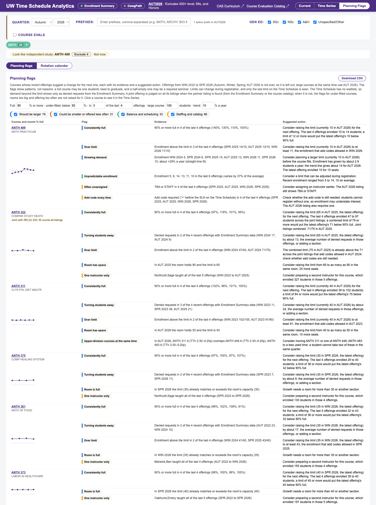
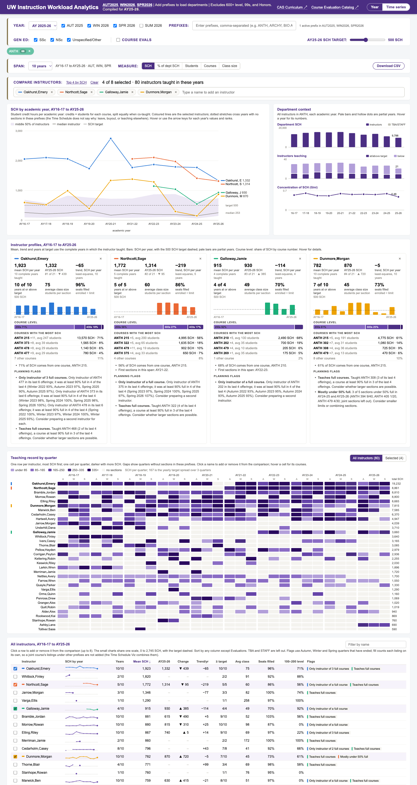

# Web Helpers for UW Administrative Workflows in the [Anthropology Department](https://anthropology.washington.edu/) and [Data Science Minor](https://dataminor.uw.edu/) 

## Introduction

This repository contains scripts, e.g. to create browser bookmarklets or web apps, to help visualize and summarize data and simplify workflows relating to day-to-day operations of the UW Anthropology Department and the Data Science Minor. 

### A Note on Student Privacy and Data Security

**⚠️ Disclaimer & FERPA Warning**: These scripts are unofficial tools created to assist authorized UW faculty/staff workflows. These scripts access FERPA-protected education records. Use is restricted to authorized UW faculty/staff with legitimate educational interest. These scripts are not officially supported or endorsed by the University of Washington or the UW Department of Anthropology. Users of these tools are solely responsible for ensuring compliance with FERPA and [UW Data Security policies](https://it.uw.edu/policies/security-and-privacy-policies/uw-information-security-policies/). Authorised UW faculty/staff will always verify AI-generated outputs against official UW records. AI output is not for official record-keeping; official UW records always take precedence. No automated decisions are made about students using these tools.

**🔒 A Note on Student Privacy and AI**: Because this repository is public, students or parents may be reading this. Please be assured that student privacy is our highest priority:

-   No Public AI: These tools are strictly designed only to be used with UW's enterprise-secured instance of Microsoft Copilot.
-   No AI Training: Under [UW's commercial data protection agreement with Microsoft](https://itconnect.uw.edu/tools-services-support/software-computers/productivity-platforms/microsoft-productivity-platform/microsoft-copilot/), and [Microsoft's data privacy and security policy for Copilot](https://learn.microsoft.com/en-us/copilot/microsoft-365/microsoft-365-copilot-privacy) student data inputted into UW Copilot is never used to train Microsoft's public AI models.
-   Expert, Authorised Human Oversight: Generative AI is used strictly as a summarization and research aide by authorized UW faculty/staff with legitimate educational interests. AI does not make decisions regarding student progress, grades, or degree milestones. All AI-generated summaries are manually reviewed and verified by UW authorised faculty/staff against official university records.

### How to install a bookmarklet:

 A [bookmarklet](https://en.wikipedia.org/wiki/Bookmarklet) is a bookmark stored in your web browser that contains JavaScript commands that make the browser do useful work. These ones only work on sites that require UW credentials to access.

-   Each script must be added to your web browser as a unique bookmark, so repeat these steps for each bookmarklet
-   For Chrome, look on the top menu bar for "Bookmarks", select "Bookmark Manager" 
-   On the very top right of the Bookmarks page, click the three dots to show a drop-down menu, click on "Add new bookmark"
-   For the name field, use 'Time Schedule Viz' or similar for the first bookmarklet (quotes not required)
-   Select all the code in the block under the heading 'Script for the bookmarklet', and paste it into the URL field of the new bookmark box.
-   Click Save to finish making the bookmarklet. Look for the new bookmark in the list of bookmarks top menu bar for "Bookmarks" or on your bookmark bar. 
-   Each bookmarklet loads the latest version of its script every time you click it, so you only need to install it once. 

## Time Schedule Enrollment Dashboard Bookmarklet

#### Overview

For a given quarter, this script reads the [UW Time Schedule](https://www.washington.edu/students/timeschd/) pages for the UW course prefixes you choose (one or several, e.g. `ANTH, ARCHY, BIO A`; all 355 UW prefixes are recognized) and shows a dashboard of enrollment in those courses. Each prefix gets its own color. The dashboard has three views:

-   **Current**: the selected quarter. Stat cards for sections, enrolled / capacity, fullness and estimated TAs, plus denied requests and room fit when the Enrollment Summary is connected. The enrollment, fullness, denied and room cards each have a small chart of the last five years. Below them are a table of sections with meeting times, enrollment, joint offerings and a small enrollment chart for each course, and a weekly meeting-pattern heatmap with a timeline of sections.
-   **Time Series**: enrollment in chosen courses, or in single sections, over the past ten years. The ten courses with the most students in the Current view are plotted at first. The course picker lists every course in the UW course catalog for the selected prefixes, so courses not offered in the selected quarter can be followed too.
-   **Planning Flags**: courses whose Autumn, Winter and Spring offerings in the last five years suggest a change for the next offering, such as a higher limit, fewer offerings or another instructor. Each flag shows its evidence in numbers, a small chart of how full each recent offering was, and a suggested action with figures. The flags also cover scheduling across courses: a prerequisite not offered in the year before a course, upper-division courses that meet at the same time, falling enrollment in a prefix's Gen Ed (SSc, A&H, NSc) and DIV courses, courses that need an add code every time, and courses whose only instructor has no sections now. A Rotation calendar tab shows every course in the catalog across the last eight academic years, quarter by quarter, with its usual cycle (for example, every 2 years) and whether it is due this year, due next year or overdue.

Data sources:

-   [UW Time Schedule](https://www.washington.edu/students/timeschd/) quarter pages, from Winter 2003 on.
-   [UW course catalog](https://www.washington.edu/students/crscat/), for the Time Series course picker, the rotation calendar, the partner courses of joint offerings and course prerequisites.
-   The Time Schedule's [Enrollment Summary](https://sdb.admin.uw.edu/timeschd/uwnetid/tsstat.asp?QTRYR=AUT+2026&CURRIC=ANTH) (optional, UW NetID required; this example link is ANTH in Autumn 2026), for denied registration requests, room capacity and joint-offering partners. It gives section-level counts only.
-   [UW Course Evaluation Catalog](https://www.washington.edu/cec/toc.html) (CEC, UW NetID required), for course evaluations and instructors' appointments in the year the CEC lists (currently Autumn 2025 to Summer 2026). The dashboard shows each section's combined median, which it computes from the four standard items; the CEC does not report this number. Quiz sections (usually led by TAs) are left out.
-   [DawgPath](https://dawgpath.uw.edu/) (optional, UW NetID required), for its bottleneck and gateway marks, the courses that list each course as a prerequisite, its Course Outcome Index (COI, a beta measure of whether more or fewer students earned credit than DawgPath's model predicted) and, for each major whose code matches a loaded prefix, the ten courses most often taken before declaring it. DawgPath updates its data each quarter and shows only courses with seven or more students.

The CEC states that its information is for members of the UW academic community and may not be published or redistributed to anyone without a current UW NetID, so do not share screenshots or printouts that show evaluations outside UW. Treat DawgPath data the same way. The script does not use or contain AI and uses no data other than the pages listed above for the prefixes you select. It runs entirely in your browser. No data are collected from your computer or stored on it, and nothing from the CEC or DawgPath is kept after the tab is closed. No student-level data or other FERPA-protected data are collected or used by this script.

#### Script for the bookmarklet:

```
javascript:(function(){
  var repo = 'benmarwick/uw-anthro-web-helpers';
  var file = 'bookmarklet-time-schedule-viz-generic.js';
  var hint = 'Open a UW Time Schedule quarter page, then click the bookmark again.';
  function load(ref) {
    var s = document.createElement('script');
    s.src = 'https://cdn.jsdelivr.net/gh/' + repo + '@' + ref + '/' + file + (ref === 'main' ? '?t=' + Date.now() : '');
    s.onerror = function() { alert('The tool could not load. Check your internet connection. ' + hint); };
    document.body.appendChild(s);
  }
  fetch('https://api.github.com/repos/' + repo + '/commits/main', { headers: { Accept: 'application/vnd.github.sha' } })
    .then(function(r) { return r.ok ? r.text() : ''; })
    .then(function(sha) { load(/^[0-9a-f]{40}$/.test(sha) ? sha : 'main'); }, function() { load('main'); });
})();
```

#### How to use:

-   Use your UW credentials to log into the University of Washington Seattle Time Schedule for a given quarter, e.g. [https://www.washington.edu/students/timeschd/SPR2026/](https://www.washington.edu/students/timeschd/SPR2026/)
-   Click the 'Time Schedule Viz' bookmark (or whatever you named it) and the dashboard opens in a new tab. If you click it on a department's page (e.g. [anthro.html](https://www.washington.edu/students/timeschd/SPR2026/anthro.html)), that department's prefix (here `ANTH`) is already loaded.
-   Type more prefixes into the Prefixes box. Use the quarter and year menus next to it to load another quarter. The quarter shown in the header (e.g. `SPR2026`) links to that quarter's Time Schedule page.
-   Switch views with the Current, Time Series and Planning Flags buttons at the top right.
-   Use the Instructors checkboxes to show or hide particular instructors' sections, and the Appointment checkboxes (from the CEC) to show or hide everyone with an appointment type. Names that the Time Schedule spells several ways (e.g. `Marwick,B` and `Marwick,Ben`) are shown as one person; hover over the name to see the other spellings.
-   In the Current view, use the checkboxes in the table to leave sections out of the stats and charts, and the "Count only" buttons above the table to count one course level only.
-   To add denied requests, room fit and joint-offering partners, click "Denied requests" at the top of the dashboard. The Enrollment Summary opens in a new tab; click the bookmark in that tab once, and keep the tab open while you use the dashboard. The Enrollment Summary does not define "denied requests", so read them as a relative signal of unmet demand.
-   To add DawgPath's information, click "DawgPath" at the top of the dashboard, sign in if asked, and click the bookmark once in the DawgPath tab that opens; keep that tab open. Course names then carry tags: "Bottleneck" (DawgPath: high-demand, typically required for graduation, has prerequisites), "Gateway", "Feeds the … major" (one of the ten courses most often taken before declaring that major), and, in the Planning Flags view, the course's COI. The Planning Flags view also gets a Bottleneck switch (All, With tag, Without) that shows only the bottleneck courses or only the others. A COI of −2 or lower raises a "Low course outcome index" flag. A course that DawgPath lists as a prerequisite for courses under prefixes you have not entered gets a "Prerequisite for other departments" flag naming those courses (for example ANTH 203 for GWSS 450 and four LING courses), so the other departments can be asked before its seats or offerings are cut. The COI pools every section and instructor, so it describes the course and says nothing about any one instructor. Leave DawgPath unconnected when you take screenshots to share.
-   Uncheck Course evals to hide every rating, for example when sharing your screen.
-   In the Planning Flags view, hover over a flag name for its full definition (when it is raised, the data it reads, and its cut-offs), change the thresholds at the top of the panel (they are not saved), click a course to see it in the Time Series view, and click "Download CSV" to save the flags. The flags use only quarters that have ended and leave out Summer. A joint offering is judged on all its listings: for example, ANTH 322 A in Autumn 2025 had 63 of 65 seats filled and its partner RELIG 320 A had 8 of 10, so the flags use 71 of 75 (95% full). The flags that need room capacity or denied requests appear only when the Enrollment Summary is connected. A flag shows a pattern in the Time Schedule, not its reason: a full course may be one students need to graduate, and a half-empty one may be a required seminar.
-   Close the Dashboard tab when finished. To share the dashboard, print it as a PDF or take a screenshot.

Current quarter view: 


Time series view: 


Planning flags view (the first courses of the table): 



## Time Schedule Instructor Workload Dashboard Bookmarklet

#### Overview

For a given academic year, this script reads the [UW Time Schedule](https://www.washington.edu/students/timeschd/) pages for the UW course prefixes you choose (all 355 UW prefixes are recognized) and works out each instructor's annual student credit hours (SCH: credits × students enrolled, split equally when a course is co-taught). You choose the academic year (from 2002-03 on) and the quarters to count (Autumn, Winter and Spring by default; Summer can be added). The dashboard has two views:

-   **Year**: three linked charts and a table. The charts are each instructor's SCH split by course, with the department median and an adjustable SCH target; a Lorenz curve of how concentrated the teaching is, with the Gini coefficient for this year and the previous one; and a slopegraph of each instructor's SCH in the previous year and this one. Hovering an instructor in one chart highlights them in the other two. The Instructor Labor Distribution table gives each instructor's courses, credits, SCH, an enrollment balance measure (whether their SCH comes from one big course or several) and their position against the SCH target.
-   **Time series**: instructors' SCH by academic year over 5, 10, 15 or 20 years (or their share of department SCH, their number of students or courses, or their average class size), against the middle 50% and the median of all instructors. It also shows department totals and the Gini coefficient for each year, a profile card for each selected instructor, a heatmap of every instructor's SCH by quarter (which shows leaves and gaps), and a table of all instructors. The four instructors with the most SCH in the latest complete year are selected at first, and up to eight can be compared. A year with a quarter not yet published is marked as partial and left out of averages and trends.

Data sources:

-   [UW Time Schedule](https://www.washington.edu/students/timeschd/) quarter pages, from Winter 2003 on (the earliest online).
-   [UW Course Evaluation Catalog](https://www.washington.edu/cec/toc.html) (CEC, UW NetID required), for course evaluations and instructors' appointments in the year the CEC lists (currently Autumn 2025 to Summer 2026). The dashboard adds each instructor's appointment, a pooled combined median for their evaluated sections, a table of SCH and evaluations by appointment type, and a scatter plot of each section's combined median against its enrollment. The combined median is computed by the dashboard from the four standard items; the CEC does not report this number. For other years, appointments are matched by name and may have changed. Quiz sections (usually led by TAs) are left out, and every rating is shown with the number of students surveyed.

The Time Schedule does not say why an instructor has no sections in a year (leave, buyout, or teaching under another prefix), so read gaps with that in mind. The CEC states that its information is for members of the UW academic community and may not be published or redistributed to anyone without a current UW NetID, so do not share screenshots or printouts that show evaluations outside UW. The script does not use or contain AI and uses no data other than the pages listed above for the prefixes you select. It runs entirely in your browser. No data are collected from your computer or stored on it, and nothing from the CEC is kept after the tab is closed. No student-level data or other FERPA-protected data are collected or used by this script.

#### Script for the bookmarklet:

```
javascript:(function(){
  var repo = 'benmarwick/uw-anthro-web-helpers';
  var file = 'bookmarklet-time-schedule-workload-generic.js';
  var hint = 'Open a UW Time Schedule quarter page, then click the bookmark again.';
  function load(ref) {
    var s = document.createElement('script');
    s.src = 'https://cdn.jsdelivr.net/gh/' + repo + '@' + ref + '/' + file + (ref === 'main' ? '?t=' + Date.now() : '');
    s.onerror = function() { alert('The tool could not load. Check your internet connection. ' + hint); };
    document.body.appendChild(s);
  }
  fetch('https://api.github.com/repos/' + repo + '/commits/main', { headers: { Accept: 'application/vnd.github.sha' } })
    .then(function(r) { return r.ok ? r.text() : ''; })
    .then(function(sha) { load(/^[0-9a-f]{40}$/.test(sha) ? sha : 'main'); }, function() { load('main'); });
})();
```

#### How to use:

-   Use your UW credentials to log into the University of Washington Seattle Time Schedule, e.g. [https://www.washington.edu/students/timeschd/](https://www.washington.edu/students/timeschd/)
-   Click the 'Time Schedule Workload' bookmark (or whatever you named it) and the dashboard opens in a new tab. If you click it on a department's page (e.g. [anthro.html](https://www.washington.edu/students/timeschd/SPR2026/anthro.html)), that department's prefix (here `ANTH`) is already loaded.
-   Type more prefixes into the Prefixes box. Use the Year menu to switch academic years and the AUT/WIN/SPR/SUM checkboxes to choose which quarters are counted. Move the slider to change the SCH target.
-   Use the Instructors checkboxes to leave particular instructors (or TBA) out of the charts, the table and the totals, and the Appointment checkboxes (from the CEC) to include or leave out everyone with an appointment type. Names that the Time Schedule spells several ways (e.g. `Marwick,B` and `Marwick,Ben`) are combined into one row; hover over the name to see the other spellings.
-   Uncheck Course evals to hide every rating, for example when sharing your screen.
-   Click "Time series" at the top right to follow instructors across years. Choose the span and the measure, and add or remove instructors by typing a name in the "Compare instructors" box, clicking a name in the heatmap, or clicking a row in the table. The first visit to a span loads its Time Schedule pages, which can take a minute for 20 years. "Download CSV" saves one row per instructor and academic year. Click "Year" to return.
-   The profile cards and the Flags column in the time series table show three planning flags: the only instructor of a course that was at least 90% full in 3 of its last 4 offerings; taught 2 or more of the last 4 offerings of such a course; and most of their sections under 50% full in the last two complete academic years. Hover over a flag for its evidence. These flags count each listing of a joint course on its own (the Time Schedule Viz adds the listings together), so jointly offered sections are left out of the under-filled flag.
-   Close the Dashboard tab when finished. To share the dashboard, print it as a PDF or take a screenshot.

Year view: 


Time series view: 




## MyGrad Table Audit Bookmarklet

#### Overview

For the [Current Student List](https://webappssecure.grad.uw.edu/mgp-dept.stu.detail/home/studentlist?orgid=14) view of MyGrad, this script modifies the table rows to indicate years since admission to the program, and whether or not a student has an advisor. It also adds five milestone columns, one per indicator:

| Column | Meaning | Source |
|---|---|---|
| Anthropology MA | an Anthropology master's degree is on record | student's degrees |
| Committee | the committee the student's programme requires | student list data |
| Candidacy Granted | the doctoral exam result is Candidacy Granted, with the date in the tooltip | doctoral exam requests |
| ANTH 800 Credits | dissertation credits on the transcript, shown against the 27-credit requirement | transcript |
| Graduated | the degree the student is currently working on is complete | see below |

`Committee` reports the committee type the programme actually calls for rather than always the doctoral one. A student in a master's programme, such as the Anthropology Archaeological Heritage MA, is shown their master's committee. Every other student, including pre-doctoral students, is shown their doctoral committee. A pre-doctoral student who still holds only a master's committee from a previous degree therefore reads as having no committee yet, which is what their programme requires. Hovering the cell says which committee type was checked.

The five columns are inserted directly after Name, on the left, so they are visible without scrolling. To make room, the Student Number, Email UCS and Current Credits columns are hidden. They are hidden rather than removed, so the page's own column state is left intact.

`Graduated` is read differently depending on the degree level, because MyGrad records the two separately. For a master's student it is the literal `Degree Granted` in the status column of the master's requests page. For a doctoral or pre-doctoral student it is the literal `Dept Conveyed Exam Passed` in the status column of the doctoral exam requests page, which the department records once the final defence has been passed and conveyed. A student in the Anthropology Archaeological Heritage master's programme is covered by the first of these.

Master's students with no committee of any kind are marked with a red flag next to their name. A filter panel narrows the list to students matching a given condition, with a count on each button. The script will work on any UW graduate program that uses MyGrad.

Every milestone cell is a link to the MyGrad page the value was read from, and opens in a new tab, so a value can be checked against its source without losing the table. Hovering a cell shows the evidence behind it: the degrees on record, the committee flag, the exam date for a candidacy, or the credit count and grades behind the ANTH 800 total.

The first two columns are read from data the page has already loaded, so they appear immediately. The other three require page requests per student and are filled in only when you press **Fetch milestones**; simply loading the page causes no network traffic. A full pass over a 19-student department makes 41 requests, one transcript each, one doctoral exam request page each, and a master's requests page only for the students actually in a master's programme, and takes about a minute. Results are held in the browser tab's session storage, so paging and sorting do not refetch, and **Refresh milestones** re-runs the pass for students whose status may have changed.

Each cell has three states, and the glyph or the number carries the meaning rather than colour alone: `✓` yes, `–` no, `?` the request was made and failed. A `?` never means "no": it means the answer is unknown and the cell should be re-fetched. A student whose MyGrad session has expired is reported in the panel rather than being filled in with a negative. ANTH 800 totals are green at or above the 27-credit requirement, amber when some credits are recorded, and grey at zero.

One caveat worth knowing: the Anthropology MA test reads UW degrees only, so an MA earned at another institution is not counted.

The script does not collect or use any information about the student outside of MyGrad. The script does not use or contain AI. The data collected by the script are protected by the Family Educational Rights and Privacy Act ([FERPA](https://registrar.washington.edu/staff-faculty/ferpa/)) of 1974 and must not be shared outside of the UW Anthropology advising office without written consent of the student. No data are collected from your computer. 

#### Script for the bookmarklet:

```
javascript:(function(){
  var repo = 'benmarwick/uw-anthro-web-helpers';
  var file = 'bookmarklet-mygrad-table-audit.js';
  var hint = 'Open the Current Student List in MyGrad, then click the bookmark again.';
  function load(ref) {
    var s = document.createElement('script');
    s.src = 'https://cdn.jsdelivr.net/gh/' + repo + '@' + ref + '/' + file + (ref === 'main' ? '?t=' + Date.now() : '');
    s.onerror = function() { alert('The tool could not load. Check your internet connection. ' + hint); };
    document.body.appendChild(s);
  }
  fetch('https://api.github.com/repos/' + repo + '/commits/main', { headers: { Accept: 'application/vnd.github.sha' } })
    .then(function(r) { return r.ok ? r.text() : ''; })
    .then(function(sha) { load(/^[0-9a-f]{40}$/.test(sha) ? sha : 'main'); }, function() { load('main'); });
})();
```

#### How to use:

-   Using your official UW-issued computer, use your UW credentials to log in to [MyGrad Department View](https://facstaff.grad.uw.edu/mygrad-for-faculty-and-staff/#mygrad-faculty-staff-2). These are FERPA-protected education records and this view is only available to authorized faculty and staff in GPC/GPA roles.
-   Navigate to the [Current Student List](https://webappssecure.grad.uw.edu/mgp-dept.stu.detail/home/studentlist)
-   Click the 'MyGrad Table Audit' bookmark (or whatever you named it when you created it) in your browser 
-   The years-in-program colouring, the missing-advisor warning, the `Anthropology MA` and `Committee` columns, and the filter panel appear at once, in the columns directly after Name.
-   Press **Fetch milestones** in the panel to fill in `Candidacy Granted`, `ANTH 800 Credits` and `Graduated` for every student. The panel reports progress per phase and finishes with `Done.`
-   Check the panel for any `?` cells. A question mark means the request failed rather than that the milestone is missing, and **Refresh milestones** will retry.
-   Click any milestone value to open the MyGrad page it came from in a new tab, and hover to see the evidence behind it. Click the panel title to collapse the panel if it is in the way.


## MyGrad Anthropology Department Student Summary Bookmarklet

#### Overview

For a given graduate student, this script collects data from [MyGrad's](https://facstaff.grad.uw.edu/mygrad-for-faculty-and-staff/) Student Detail page, the Transcripts page, the Advisors / Committees page, and the Doctoral Exam Requests page. It structures the data as a single, compact JSON object and pastes the data into your computer's clipboard. The pasted data are prefixed by plain text instructions specifically for use with UW's [Microsoft Copilot with commercial data protection](https://itconnect.uw.edu/tools-services-support/software-computers/productivity-platforms/microsoft-productivity-platform/microsoft-copilot/). These instructions tell Copilot to review the relevant UW Anthropology graduate program (e.g. [Sociocultural Anthropology](https://anthropology.washington.edu/phd-anthropology-sociocultural-anthropology), [Archaeology](https://anthropology.washington.edu/phd-anthropology-archaeology) and [Biological Anthropology](https://anthropology.washington.edu/phd-anthropology-biological-anthropology) and [UW Graduate School web pages](https://grad.uw.edu/policy_audience/doctoral-students/). Copilot will compare the student's data on MyGrad with the published program requirements and summarize findings in a structured summary report. Copilot will return a table indicating the student's progress relative to key milestones of the student's specific Doctoral program, a table of potential administrative issues, a narrative of the student's current administrative status and recommended next steps to advance to the next program requirement. The report is strictly limited to the requirements documented in the department's program website, the UW Graduate School policies, and the student's record in MyGrad. With minor modifications the script could make similar summaries for any UW graduate program. The script does not collect or use any information about the student outside of MyGrad. The script does not use or contain AI and does not interact directly with Copilot, this is left to you. The data collected by the script are protected by the Family Educational Rights and Privacy Act ([FERPA](https://registrar.washington.edu/staff-faculty/ferpa/)) of 1974 and must not be shared outside of the UW Anthropology advising office without written consent of the student. No data are collected from your computer. 

#### Script for the bookmarklet:

```
javascript:(function(){
  var repo = 'benmarwick/uw-anthro-web-helpers';
  var file = 'bookmarklet-mygrad-student-summary.js';
  var hint = 'Open the Student Detail page for a student in MyGrad, then click the bookmark again.';
  function load(ref) {
    var s = document.createElement('script');
    s.src = 'https://cdn.jsdelivr.net/gh/' + repo + '@' + ref + '/' + file + (ref === 'main' ? '?t=' + Date.now() : '');
    s.onerror = function() { alert('The tool could not load. Check your internet connection. ' + hint); };
    document.body.appendChild(s);
  }
  fetch('https://api.github.com/repos/' + repo + '/commits/main', { headers: { Accept: 'application/vnd.github.sha' } })
    .then(function(r) { return r.ok ? r.text() : ''; })
    .then(function(sha) { load(/^[0-9a-f]{40}$/.test(sha) ? sha : 'main'); }, function() { load('main'); });
})();
```

#### How to use:

-   Using your official UW-issued computer, use your UW credentials to log in to [MyGrad Department View](https://facstaff.grad.uw.edu/mygrad-for-faculty-and-staff/#mygrad-faculty-staff-2). These are FERPA-protected education records and this view is only available to authorized faculty and staff in GPC/GPA roles.
-   Navigate to the [Current Student List](https://webappssecure.grad.uw.edu/mgp-dept.stu.detail/home/studentlist)
-   Click on a student's name to go the Student Detail page for that student
-   Click the 'MyGrad Student Summary' bookmark (or whatever you named it when you created it) in your browser and look for a new button to appear at the top center of the Student Detail web page
-   Click the new button and wait for it to turn green to indicate that the script has finished working. Do not leave the page until the script has finished or it will fail (click it again to retry). When the button is green, you computer's clipboard is loaded with text ready for the next steps
-   Go to https://copilot.microsoft.com/ and log in with your UW Net ID to ensure your data are not shared outside of UW, and start a New Chat
-   In the lower left of the chat box, change "Smart" to "Think deeper", this is essential to get a high-quality report
-   Click in the chat box and paste in the data from MyGrad. It may show as plain text or a single file attachement, either are ok. Press enter to submit the chat
-   Wait for Copilot to reply and review the report. Do not save, screenshot, or copy-paste the report out of Copilot
-   You must manually verify the AI's report against the student's official MyGrad record before taking any advising action or corresponding with the student or their faculty advisor. This is important because Copilot may occasionally hallucinate or misinterpret policies or misread the student's data.
-   Immediately delete the chat from Copilot after reviewing the report. Immediately copy to your clipboard a random word from this website to replace the student data and ensure you do not accidentally paste the student's FERPA-protected JSON data elsewhere.

## EARS Data Science Minor Bookmarklet

#### Overview

For a undergraduate student in the Data Science Minor, this script collects data from [EARS](https://registrar.washington.edu/staff-faculty/ears/) to help with managing the Minor's [overlap restriction](https://dataminor.uw.edu/curriculum/overlap/) and assigning classes taken by a student to fulfil the Minor's requirements. The script collects data from the student's degree audits and identifies if there are more than ten credits overlap between the Data Science Minor and the 'Departmental Requirements' or 'Admissions Requirements' section of their major degree audit. The script identifies if there are credits needed to meet the 25 credit minimum, and identifies if courses the student has already taken can by applied to the Minor. The script bundles the audit data and puts it on your clipboard ready to paste into Copilot for verification. If the student has more than 10 credits of overlap, the script prompts Copilot to suggest possible course substitutions from the list of courses taken by the student but that are not currently assigned to a requirement. The script prompts Copilot to suggest courses taken by the student that could be applied to the 25 credit requirement, if that requirement has not been fulfilled. The script does not collect or use any information about the student outside of EARS. With minor modifications the script could do similar overlap analysis for other UW undergraduate programs. The script does not use or contain AI and does not interact directly with Copilot, this is left to you. The data collected by the script are protected by the Family Educational Rights and Privacy Act ([FERPA](https://registrar.washington.edu/staff-faculty/ferpa/)) of 1974 and must not be shared outside of the UW Undergraduate Academic Advising office without written consent of the student. No data are collected from your computer.

#### Script for the bookmarklet:

```
javascript:(function(){
  var repo = 'benmarwick/uw-anthro-web-helpers';
  var file = 'bookmarklet-ears-dsm-overlap.js';
  var hint = 'Open the Degree Audit tab for the student in EARS, then click the bookmark again.';
  function load(ref) {
    var s = document.createElement('script');
    s.src = 'https://cdn.jsdelivr.net/gh/' + repo + '@' + ref + '/' + file + (ref === 'main' ? '?t=' + Date.now() : '');
    s.onerror = function() { alert('The tool could not load. Check your internet connection. ' + hint); };
    document.body.appendChild(s);
  }
  fetch('https://api.github.com/repos/' + repo + '/commits/main', { headers: { Accept: 'application/vnd.github.sha' } })
    .then(function(r) { return r.ok ? r.text() : ''; })
    .then(function(sha) { load(/^[0-9a-f]{40}$/.test(sha) ? sha : 'main'); }, function() { load('main'); });
})();
```

#### How to use:

-   Using your official UW-issued computer, use your UW credentials to log in to [EARS](https://sdb.admin.uw.edu/sisAdvising/securid/dars.aspx). These are FERPA-protected education records and this view is only available to authorized faculty and staff in advising roles.
-   Enter the student number to access their record, click on the 'Degree Audit' tab
-   Create and submit (or resubmit) audits for both their Major(s) and the Data Science Minor
-   Wait for the 'Available Audits' table to show 'Detail' links in the 'Detail' column for both the Major(s) and the Data Science Minor
-   Click the 'EARS DSM overlap' bookmark (or whatever you named it when you created it) in your browser. Do not leave the page until the script has finished or it will fail (click it again to retry). When the script has finished running, a message will pop up to let you know. This pop-up includes a summary of the overlap situation for this student. At this point your computer's clipboard is loaded with text ready for the next steps
-   Go to https://copilot.microsoft.com/ and log in with your UW Net ID to ensure your data are not shared outside of UW, and start a New Chat
-   In the lower left of the chat box, change "Smart" to "Think deeper", this is essential to get a high-quality report
-   Click in the chat box and paste in the data from EARS. It may show as plain text or a single file attachement, either are ok. Press enter to submit the chat
-   Wait for Copilot to reply and review the report. Do not save, screenshot, or copy-paste the report out of Copilot
-   You must manually verify the AI's report against the student's official EARS record before taking any advising action or corresponding with the student. This is important because Copilot may occasionally hallucinate or misinterpret policies or misread the student's data.
-   Immediately delete the chat from Copilot after reviewing the report. Immediately copy to your clipboard a random word from this website to replace the student data and ensure you do not accidentally paste the student's FERPA-protected JSON data elsewhere.

## TA Allocation Google Apps Script

#### Overview

This script is for the [Apps Script extension](https://script.google.com/u/2/home/projects/1JbpEoRzFEPgIgiQYu_LC9fyc2_siE0_Hj3pXuzPh1PEEg4wngowhXYKC/edit) of the Google Sheet that has the [responses](https://docs.google.com/spreadsheets/d/1AciklpugU7b5dmF8QMEo0oQBhXkEVpzGwO5oWJQ8qlw/edit?resourcekey=&gid=1270289789#gid=1270289789) to the [TA application form](https://docs.google.com/forms/d/1mxCN2SqQHeep9nvWni1c53RTk5T2PPJhL2VrZJU4_cY/edit). The script uses the TA requests entered by faculty in the three sub-disciplines' planning sheets ([ANTH](https://docs.google.com/spreadsheets/d/1LEg20-MM1noo5Kq6W4MYFe4IUObB5ZveDj8uGZ75fPE/edit?gid=57332291#gid=57332291), [ARCHY](https://docs.google.com/spreadsheets/d/1qu6Dl1ua2dLnkeR-j3ek1OJWAEVATlIdSJzjpH8CoAQ/edit?gid=907170236#gid=907170236), [BIO A](https://docs.google.com/spreadsheets/d/15UlwHFfsHngtT5VXnyLs6EinHqBtWuyOphy5ZaHLmXo/edit?gid=250576250#gid=250576250)), these are automatically aggregated on the [Anthropology curriculum forecast sheet](https://docs.google.com/spreadsheets/d/1KTLT-PZzRjaZYCOdWGMEfAcZwEjby1mhXWoJMnUF8E0/edit?gid=1652963397#gid=1652963397). The script takes this agregation of TA requests from faculty, the form responses from student applicants, and applies the eligibility and ranking criteria of the [Anthropology Department's ASE Appointment Policy Document](https://uwnetid.sharepoint.com/:w:/s/anthropology/IQCSL8eTPICOQpJnJDdLKhYIAddRn-8w1dv9tuAR5907A74?e=YOAAOv) to allocate applicants to the TA positions requested by faculty. In brief, it matches students with the classes they are eligible to TA for, then within those groups, applies multiple passes of rankings based on guaranteed funding status, numbers of prior TA positions, progress in their program, and evidence of readiness to TA. The script produces a sheet showing all applicants eligible for each course, and their rankings, with columns detailing the evidence for the ranking. It also generates an allocation summary sheet that shows how the department's obligations to students with guaranteed funding can be met by TA placements. This sheet shows an overview of the TA placements for all students with guaranteed funding, detailing the courses they best meet the eligibilty criteria for. It also identifies any unplaced students to assist with manual review. The script has several elements that are hard-coded for the 2026-27 application cycle, these will need to be updated for future years. The script does not collect or use any information about the student outside of their response to the TA application form. The script does not use or contain AI. The data collected by the script are protected by the Family Educational Rights and Privacy Act ([FERPA](https://registrar.washington.edu/staff-faculty/ferpa/)) of 1974 and must not be shared outside of the UW Anthropology Department without written consent of the student. No data are collected from your computer.  

#### Script for the App

[google-apps-ta-allocation-workflow.gs](https://github.com/benmarwick/uw-anthro-web-helpers/blob/main/google-apps-ta-allocation-workflow.gs)

#### How to use:

- Review the data entered into the three sub-disciplines' planning sheets ([ANTH](https://docs.google.com/spreadsheets/d/1LEg20-MM1noo5Kq6W4MYFe4IUObB5ZveDj8uGZ75fPE/edit?gid=57332291#gid=57332291), [ARCHY](https://docs.google.com/spreadsheets/d/1qu6Dl1ua2dLnkeR-j3ek1OJWAEVATlIdSJzjpH8CoAQ/edit?gid=907170236#gid=907170236), [BIO A](https://docs.google.com/spreadsheets/d/15UlwHFfsHngtT5VXnyLs6EinHqBtWuyOphy5ZaHLmXo/edit?gid=250576250#gid=250576250)). In particular, ensure that the column for # TAs does not have non-numeric content, the script will not handle this. Look to see that all courses have a prefix (ANTH/ARCHY/BIO A) and course number (exactly three digits, nothing else), if any of these are missing or in an unusual format, the script will not include them.
- Review the automatic aggregation of the TA requests on the [Anthropology curriculum forecast sheet](https://docs.google.com/spreadsheets/d/1KTLT-PZzRjaZYCOdWGMEfAcZwEjby1mhXWoJMnUF8E0/edit?gid=1652963397#gid=1652963397) to ensure that all the requests on the sub-disciplines' planning sheets have accurately been captured.
- Open the [Apps Script extension](https://script.google.com/u/2/home/projects/1JbpEoRzFEPgIgiQYu_LC9fyc2_siE0_Hj3pXuzPh1PEEg4wngowhXYKC/edit) of the Google Sheet that has the [responses](https://docs.google.com/spreadsheets/d/1AciklpugU7b5dmF8QMEo0oQBhXkEVpzGwO5oWJQ8qlw/edit?resourcekey=&gid=1270289789#gid=1270289789) to the [TA application form](https://docs.google.com/forms/d/1mxCN2SqQHeep9nvWni1c53RTk5T2PPJhL2VrZJU4_cY/edit).
- In the Code.gs editor, paste in the script and click the save icon.
- Switch to the Google Sheet that has the [responses](https://docs.google.com/spreadsheets/d/1AciklpugU7b5dmF8QMEo0oQBhXkEVpzGwO5oWJQ8qlw/edit?resourcekey=&gid=1270289789#gid=1270289789), look at the menu at the top of the page for a new item called "TA Allocation", click on it and select the first item "1. Extract Evaluation Scores", these are only used for breaking rare ties at the end of the filtering and sorting steps. Wait a few moments for the script to run. 
-  Click a second time on "TA Allocation", click on it and select the second item "2. Run Ranking Workflow". Wait a moment for the script to run, a message will pop up indicating success, and two new tabs will be present in the sheet: Ranked_Applicants and Allocation_Summary
- Review the results in the new sheets to identify who to offer which TA position, and make manual adjustments as necessary 

## TA Evaluation System Google Apps Script

#### Overview

This app provides an online workflow the department's "[Academic Student Employee (ASE) Evaluation Form](ta-evaluation-workflow/examples/Academic%20Student%20Employee%20(ASE)%20Evaluation%20Form.pdf)". For each ASE (e.g. a teaching assistant), the app manages the evaluation workflow: the instructor rates the ASE's job duties and signs the evaluation, the ASE reviews the feedback and adds a self-evaluation, and the instructor reviews the ASE's self-evaluation and gives a final sign-off. The completed evaluation is rendered as a signed PDF that is emailed to both parties and archived in Google Drive. Each step is securely reached by the professor or the ASE through a unique, time-limited link emailed to them, and every transition is recorded in an audit log. The app runs entirely within UW's Google Workspace and does not use or contain AI. No data are collected from anyone's computers.

#### Scripts for the App

[ta-evaluation-workflow/](https://github.com/benmarwick/uw-anthro-web-helpers/tree/main/ta-evaluation-workflow), with full documentation in its [README](https://github.com/benmarwick/uw-anthro-web-helpers/blob/main/ta-evaluation-workflow/README.md)

#### How to use:

-   The app is deployed as a [Google Apps Script web app](https://script.google.com/macros/s/AKfycbyseoid07zdu5E6YmHy3S9of35FlhQn1PqjPBYUqIcVKakjVLyk_Lp1vaDMIthssQXNMg/exec) with its master [spreadsheet](https://docs.google.com/spreadsheets/d/1hCvDujkSyjmbtH9ZOyntV6Va1c8ye7Hxt0RbSOFIxDc/edit). Set the coordinator email, archive Drive folder, and app URL in `Config.gs`.
-   Open the [Apps Script project](https://script.google.com/home/projects/17tiixPCukHffnZMe8Ph48qL1Y8x7Lz3pmeX4IgHK_TV3Vd--Kjb5qrTU), push the code with [clasp](https://developers.google.com/apps-script/guides/clasp) (`clasp push`), and deploy it as a Web App.
-   In the master spreadsheet, use the **TA Evaluation System** menu to run *Initialize Sheets*, select the `NOT_STARTED` rows, and run *Launch Selected Evaluation(s)* to email the instructor their evaluation link.
-   The instructor completes and signs the evaluation, the ASE adds a self-evaluation, and the instructor reviews this self-evaluation and gives a final sign-off — each step is emailed to the next party as a new tokenized link.
-   The completed evaluation is rendered as a signed PDF, emailed to both the instructor and the ASE, and archived in Google Drive. Every step is written to the audit log.

### License

Copyright 2026 [Ben Marwick](https://faculty.washington.edu/bmarwick/)

Permission is hereby granted, free of charge, to any person obtaining a copy of this software and associated documentation files (the “Software”), to deal in the Software without restriction, including without limitation the rights to use, copy, modify, merge, publish, distribute, sublicense, and/or sell copies of the Software, and to permit persons to whom the Software is furnished to do so, subject to the following conditions:

The above copyright notice and this permission notice shall be included in all copies or substantial portions of the Software.

THE SOFTWARE IS PROVIDED “AS IS”, WITHOUT WARRANTY OF ANY KIND, EXPRESS OR IMPLIED, INCLUDING BUT NOT LIMITED TO THE WARRANTIES OF MERCHANTABILITY, FITNESS FOR A PARTICULAR PURPOSE AND NONINFRINGEMENT. IN NO EVENT SHALL THE AUTHORS OR COPYRIGHT HOLDERS BE LIABLE FOR ANY CLAIM, DAMAGES OR OTHER LIABILITY, WHETHER IN AN ACTION OF CONTRACT, TORT OR OTHERWISE, ARISING FROM, OUT OF OR IN CONNECTION WITH THE SOFTWARE OR THE USE OR OTHER DEALINGS IN THE SOFTWARE.

### Acknowledgments

The code in this repository was developed and tested with assistance from generative AI tools, including Mimo Pro 2.5, DeepSeek V4, Qwen 3.7-Plus, ChatGPT 5.2, Claude Sonnet 5, and Gemini 3.1 Pro. I used [Purple](https://purple.uw.edu/), [OpenCode](https://opencode.ai/) and [OpenRouter](https://openrouter.ai/).   
