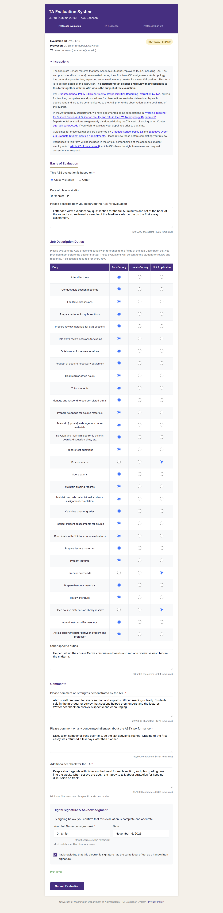
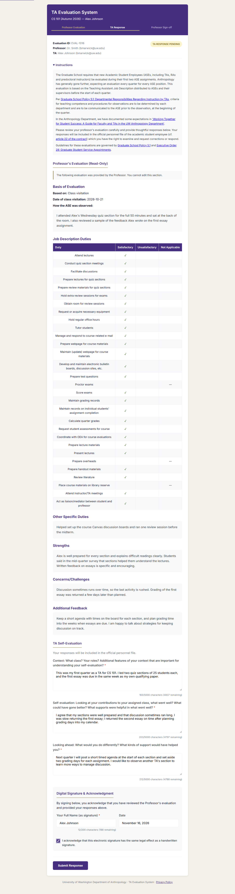
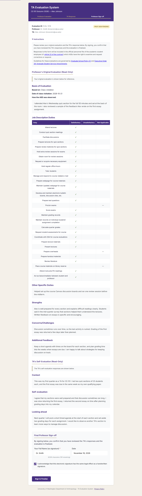
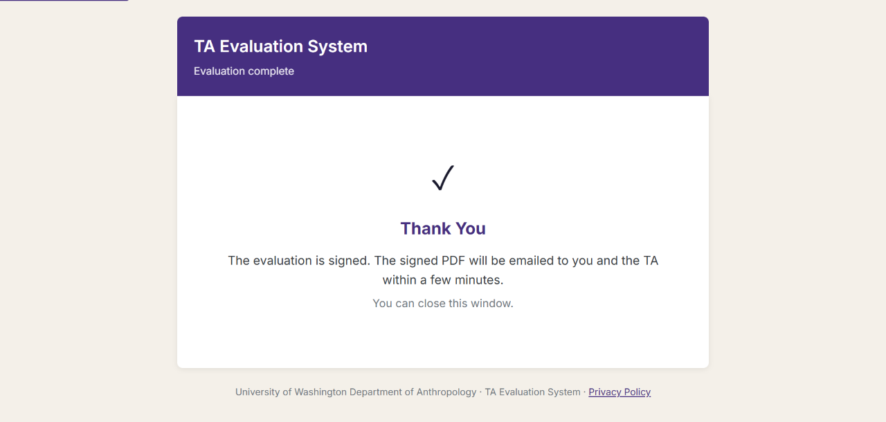
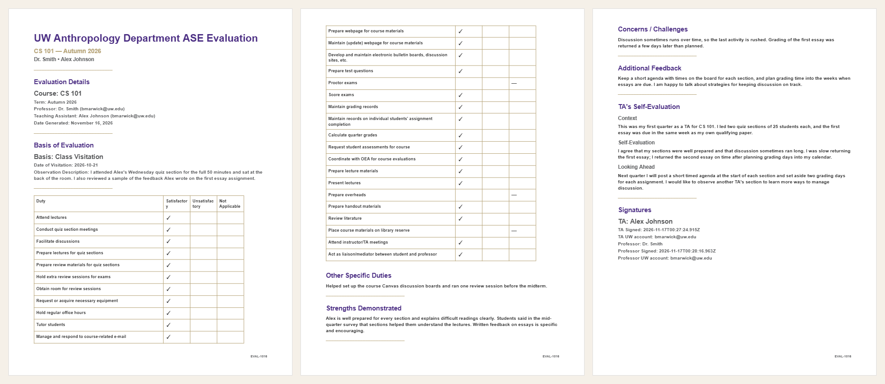

# TA Evaluation System (UW Anthropology — ASE Evaluations)

A secure, event-driven, multi-step Teaching Assistant / Academic Student Employee (ASE) evaluation, response, digital signature, and PDF archiving system for the **University of Washington Department of Anthropology**, built on **Google Apps Script**, **Google Sheets**, **Google Docs**, **Google Drive**, and **Gmail**.

The app digitizes the department's paper "[Academic Student Employee (ASE) Evaluation Form](examples/Academic%20Student%20Employee%20(ASE)%20Evaluation%20Form.pdf)": instructors rate an ASE's job duties, the ASE reviews the feedback and self-evaluates, the instructor gives a final sign-off, and the finished evaluation is rendered as a signed PDF that is emailed to both parties and archived in Google Drive.

## Links

- **Apps Script project:** https://script.google.com/home/projects/1_PrgQr69MHSwukvT4HNUIdcA03iaYlBtogtrDWvjA8F2lojDMZHX2NTu
- **Google Sheet (master spreadsheet):** https://docs.google.com/spreadsheets/d/1hCvDujkSyjmbtH9ZOyntV6Va1c8ye7Hxt0RbSOFIxDc/edit
- **Web app (deployment):** https://script.google.com/a/macros/uw.edu/s/AKfycbxjtb3CKSgW2YnCkNa_Zk6EZVxs8Ddk38JWuTUu6puNs6BTcA6dnmD42dzKQYR4LXD2/exec
- **Privacy policy:** [Privacy Policy](#privacy-policy), at the end of this page

---

## Quick Start: Send the Evaluations for a Quarter

These steps are for the coordinator who sends out the evaluations each quarter. You need edit access to the master spreadsheet. Step 0 is a check that usually takes a minute; after that you do not need to touch the code. The technical sections after this one are for whoever maintains the system.

### Step 0. Check That the Script Is Attached to the Spreadsheet

The menus and emails only work if the Apps Script code is attached to the master spreadsheet itself.

1. Open the [master spreadsheet](https://docs.google.com/spreadsheets/d/1hCvDujkSyjmbtH9ZOyntV6Va1c8ye7Hxt0RbSOFIxDc/edit) and wait a few seconds.
2. Look for a menu called **TA Evaluation System** at the right end of the menu bar, after **Help**. If it is there, go to Step 1.
3. If it is not there, reload the page once. If it is still missing, choose **Extensions > Apps Script**. This opens the script project attached to this spreadsheet.
4. Look at the **Files** list on the left of the editor. It should contain these 14 files, with exactly these names:
   - script files: `Alerting.gs`, `AuditLog.gs`, `Automation.gs`, `Config.gs`, `DeadLetterQueue.gs`, `EmailEngine.gs`, `Logs.gs`, `PdfEngine.gs`, `Security.gs`, `SheetAdmin.gs`, `WebApp.gs`
   - HTML files: `Index.html`, `ErrorView.html`, `CompletedView.html`

   If they are all there, the code is attached; ask the maintainer why the menu does not appear. If the list is empty or only has `Code.gs`, set the project up as described below.

#### Setting Up the Attached Script Project

Do this once, in the editor you opened from **Extensions > Apps Script**. The files to copy are in this folder of the repository.

1. **Add the script files.** For each `.gs` file listed above, click **+** next to **Files**, choose **Script**, and type the name without `.gs` (for example `Config`); the editor adds `.gs`. Delete everything in the new file, then paste in the full contents of the file from this folder.
2. **Add the HTML files.** For `Index.html`, `ErrorView.html` and `CompletedView.html`, click **+**, choose **HTML**, and type the name without `.html`. Paste in the contents the same way. The names must match exactly, because the code opens these pages by name (`WebApp.gs` loads `Index`, `ErrorView` and `CompletedView`).
3. **Replace the manifest.** Click the gear icon (**Project Settings**) and tick **Show "appsscript.json" manifest file in editor**. Go back to the editor, open `appsscript.json`, and replace its contents with `appsscript.json` from this folder. This file lists the permissions the script needs.
4. **Delete `Code.gs`** if the editor created it. It only holds an empty example function.
5. **Check `Config.gs`.** `SPREADSHEET_ID` must be this spreadsheet's ID: the part of its address between `/d/` and `/edit`. Also check `ADMIN_EMAIL` (who gets alerts) and `ARCHIVE_FOLDER_ID` (the Drive folder for finished PDFs).
6. **Save.** Click the save icon, or press Ctrl+S (Cmd+S on a Mac).
7. **Reload the spreadsheet.** The **TA Evaluation System** menu should now appear. The first time you choose a menu item, Google asks you to approve the script's permissions.
8. **Install the reminders.** Choose **TA Evaluation System > Create/Refresh All Triggers**, then **Run Health Check**, and check that it says **Triggers Healthy: Yes**.
9. **Publish the web app.** In the editor, choose **Deploy > New deployment**, select **Web app**, set **Execute as** to **Me** and **Who has access** to the option limited to University of Washington accounts, and click **Deploy**. These are the settings in §12. Copy the **Web app URL**, paste it into `APP_URL` in `Config.gs`, and save again. The links in every email are built from `APP_URL`, so the forms do not open until it is set.

A maintainer who uses [clasp](https://developers.google.com/apps-script/guides/clasp) can replace steps 1 to 4. Copy the Script ID from **Project Settings** into `scriptId` in `.clasp.json`, then run `clasp push` from this folder.

If an older, separate copy of the script exists, as a standalone file in Drive, delete its triggers and archive its web app deployment. Otherwise reminders go out twice, and the old web app stays reachable.

### Step 1. Make the List of Evaluations

For every TA you want evaluated, collect six pieces of information:

- the course (for example `ANTH 101`)
- the quarter (for example `Autumn 2025`)
- the instructor's name and UW email address
- the TA's name and UW email address

Each evaluation is one TA in one course. A course with three TAs needs three evaluations. A TA who worked in two courses needs two.

Use the email address the person signs in to UW Google with. For most people this is their UW NetID followed by `@uw.edu`. You can look addresses up in the [UW Directory](https://directory.uw.edu). The forms only open for the person each step belongs to. When someone opens their link, the system checks that they are signed in to Google with the address in the spreadsheet. It ignores capital letters and extra spaces, but a different alias (such as `jane.doe@uw.edu` instead of `jdoe@uw.edu`) or a personal Gmail account will stop that person from opening the form.

### Step 2. Open the Spreadsheet

1. Open the [master spreadsheet](https://docs.google.com/spreadsheets/d/1hCvDujkSyjmbtH9ZOyntV6Va1c8ye7Hxt0RbSOFIxDc/edit).
2. Wait a few seconds for a menu called **TA Evaluation System** to appear at the right end of the menu bar (after **Help**). If it does not appear, reload the page.
3. Click the **TA_Evaluations** tab at the bottom of the window.
4. If there is no **TA_Evaluations** tab, or its first row has no column headings, choose **TA Evaluation System > Initialize Sheets**.

The first time you use a menu item, Google asks you to authorize the script. Follow the prompts, choose your UW account, and allow access.

### Step 3. Enter One Row per Evaluation

Start at the first empty row below any earlier evaluations. Fill in columns B to H only:

| Column | Heading | What to type | Example |
|---|---|---|---|
| A | `Evaluation_ID` | Leave blank. Launch gives the row the next free number | `EVAL-1004` |
| B | `Course_Code` | Course prefix and number | `ANTH 101` |
| C | `Term` | Quarter and year, as you want them to appear in the emails | `Autumn 2025` |
| D | `Prof_Name` | The instructor's name, as it should appear after "Dear" in the email | `Prof. Jane Doe` |
| E | `Prof_Email` | The instructor's UW email address (see Step 1) | `jdoe@uw.edu` |
| F | `TA_Name` | The TA's full name | `Alex Johnson` |
| G | `TA_Email` | The TA's UW email address (see Step 1) | `ajohnson@uw.edu` |
| H | `Status` | Leave blank for now | |

Leave columns I to R empty. The system fills them in.

### Step 4. Mark the Rows That Are Ready to Send

In column H (`Status`), type `NOT_STARTED` (capital letters, with the underscore) in each row you want to send now.

**Launching sends every row marked `NOT_STARTED`, not only the rows you have selected**, despite the menu item's name. Leave `Status` blank in any row you are not ready to send. Rows from earlier quarters have other statuses (such as `COMPLETED`), and launching skips them.

If this is your first time, do a trial run first. Add one row with your own email address as both the instructor and the TA, and mark only that row `NOT_STARTED`. Launch it (Step 5), work through all three forms yourself, and check that the PDF arrives.

### Step 5. Launch

1. Choose **TA Evaluation System > Launch Selected Evaluation(s)**.
2. A message says **Launched N evaluation(s)**. Check that N equals the number of rows you marked in Step 4. If any rows were not launched, the message lists them with the reason: an instructor or TA address that is not a `@uw.edu` address, or the same address for both. Fix those rows and launch again. (A test row with `ADMIN_EMAIL` as both instructor and TA is allowed.)
3. In each launched row, `Status` changes to `PROF_EVAL_PENDING` and the system fills in dates, a reminder count and a secure token in columns I to R.

Each instructor receives an email with the subject "Action needed by *due date*: evaluate your TA *TA name* (*course*, *term*)" and a **Start the evaluation** button. The emails are sent from the Google account of the person who chose **Launch**, under the name "UW Anthropology TA Evaluations", and replies go to `ADMIN_EMAIL`.

Every email shows the date the step is due. Due dates are tied to the end of the quarter in the row's `Term`, so the whole evaluation finishes by the last day of finals:

| Step | Due |
|---|---|
| Instructor's evaluation | 14 days before the last day of finals |
| TA's response | 7 days before the last day of finals |
| Instructor's sign-off | the last day of finals |

For Autumn 2026 (finals end Friday, December 18) that is December 4, December 11 and December 18. A step that starts late still gets at least 3 days. If the quarter has already ended when a step starts, or the `Term` is not in the quarter table, the step is due 14 days after it starts (`DUE_DAYS`). Write the term as `Autumn 2026`; `AUT 2026`, `AU26`, `Fall 2026` and similar also work. The quarter end dates are in `QUARTER_END_DATES_` in `Config.gs`, taken from the registrar's [academic calendar summaries](https://www.washington.edu/students/reg/begendcal.html), through Summer 2033 (for summer, the last day of instruction). Launch lists any row whose `Term` is not in the table.

Each email also says how long the form takes (about 10 minutes, `EVAL_MINUTES`) and why the evaluation matters, with links to UW Executive Order 28, Graduate School Policy 5.1 and Article 22 of the UAW ASE contract. It also says which UW account to sign in with, and includes a plain link under the button and a plain-text version of the message. The wording is in `EmailEngine.gs`.

### Step 6. Follow Progress

The `Status` column shows where each evaluation is. You do not need to forward anything: each email goes out automatically when the previous person submits.

| Status | Who has to act next |
|---|---|
| `PROF_EVAL_PENDING` | The instructor fills in the evaluation form |
| `TA_RESPONSE_PENDING` | The TA reads the evaluation and writes a response |
| `PROF_SIGN_PENDING` | The instructor reads the TA's response and signs |
| `PDF_GENERATING` | Nobody. The instructor has signed and the system is making the PDF in the background, usually within a few minutes (at most about 10) |
| `COMPLETED` | Nobody. Both people have received the signed PDF by email. A copy is in the archive Drive folder, linked in the `Final_PDF_Link` column |
| `ESCALATED` | You. The person did not act after two reminders (see Problems below) |

The system sends a reminder after 5 days without action, and a second reminder 5 days later (day 10). Each reminder shows the due date and how long the step has been waiting; the second says it is the last automatic one. After two reminders, once the step is past its due date, it marks the row `ESCALATED` and emails the administrator (`ADMIN_EMAIL` in `Config.gs`). Reminders only run if the triggers are installed. Choose **TA Evaluation System > Run Health Check** and confirm that it says **Triggers Healthy: Yes**. If it says **No**, choose **Create/Refresh All Triggers** once.

After launch, do not edit columns H to R by hand except as described below.

### Problems and What to Do

- **Someone did not get an email.** Ask them to check their spam folder. Check the email address in their row. Choose **View Error Logs (Last 50)** and **View Dead Letter Queue** to see whether the system failed to send it.
- **Someone sees "This evaluation link is for the instructor" (or "for the TA"), or "Sign in with your UW Google account".** They are signed in with a different account from the address in their row, or not signed in. The message names the account they are using. Either they sign in with the address in the sheet (a private browser window helps when several Google accounts are signed in), or you correct the address in the sheet.
- **An address was wrong when you launched.** Correct it in the row, then follow the next item to send a new link to the right person. The new link stops the old one from working.
- **Someone sees "This link has expired" or "Invalid or expired evaluation link."** Links expire after 30 days, and each link stops working once its step is done. Choose **Regenerate Token for Evaluation** and enter the row's `Evaluation_ID`. The box shows a new token. Send the person this link, with the token pasted at the end:
  - status `PROF_EVAL_PENDING`: `<web app URL>?action=prof_eval&token=`
  - status `TA_RESPONSE_PENDING`: `<web app URL>?action=ta_respond&token=`
  - status `PROF_SIGN_PENDING`: `<web app URL>?action=prof_sign&token=`

  The web app URL is in **Links** at the top of this page.
- **A row is `ESCALATED`.** The forms do not open while a row is `ESCALATED`; the link shows "This evaluation is not open for input right now". Contact the person who has not acted. When they are ready, change `Status` back to the stage named in the escalation email (for example `TA_RESPONSE_PENDING`) and set `Reminder_Count` (column L) to `0`. The next daily run, at about 9 a.m., sends them a reminder with their link. If the row was launched or last moved more than 30 days ago, regenerate the token first (previous item) so the reminder carries a link that still works.

---

## 1. Lifecycle

Each evaluation row in the master sheet moves through a strict state machine:

| Status | Meaning |
|---|---|
| `NOT_STARTED` | Row created, not yet launched |
| `PROF_EVAL_PENDING` | Waiting for the professor to complete the evaluation form |
| `TA_RESPONSE_PENDING` | Waiting for the TA to review feedback and self-evaluate |
| `PROF_SIGN_PENDING` | Waiting for the professor's final sign-off |
| `PDF_GENERATING` | PDF generation in progress |
| `COMPLETED` | PDF generated and emailed to both parties |
| `ESCALATED` | Inactive too long; escalated to the department administrator |

Flow:

1. **Launch** — the coordinator runs *Launch Selected Evaluation(s)* from the Sheets menu, which launches every `NOT_STARTED` row (the current selection is ignored). Each row gets a UUID access token (`Secure_Token`, 30-day expiry), status moves to `PROF_EVAL_PENDING`, and an invitation email goes to the professor.
2. **Stage 1 — Professor Evaluation** (`prof_eval`): the professor completes the evaluation form via a tokenized web link, signs it, and submits. Status → `TA_RESPONSE_PENDING`; the TA gets an email invite.
3. **Stage 2 — TA Review & Response** (`ta_respond`): the TA views the professor's evaluation read-only, writes a self-evaluation (context / self-evaluation / looking ahead), signs, and submits. Status → `PROF_SIGN_PENDING`; the professor gets an email invite.
4. **Stage 3 — Professor Final Sign-off** (`prof_sign`): the professor reviews the full evaluation + TA response read-only and signs. Status → `PDF_GENERATING`, and the page replies straight away.
5. **PDF Generation** — in the background, a one-off trigger (`generatePendingPdfs`, about a minute after the sign-off) builds a styled, UW-branded PDF, saved to the archive Drive folder, and emailed to both the professor and TA. Status → `COMPLETED`. On failure, status reverts to `PROF_SIGN_PENDING` for retry and an alert is sent to the admin.
6. **Automation** — a daily trigger checks pending evaluations. After 5 days of inactivity it sends up to 2 reminders, 5 days apart; when reminders are exhausted the evaluation is marked `ESCALATED` and the department administrator is emailed.

Every transition is written to the `Audit_Log` sheet and the `Data_Payload` JSON column is updated.

---

## 2. Technical Stack

- **Platform:** Google Apps Script (V8 runtime), HTML Service web app (`HtmlService.createTemplateFromFile('Index')`).
- **Database:** Google Sheets (master roster + audit/log/queue sheets in a single spreadsheet).
- **Document generation:** PDFs are built programmatically in Google Docs (styled with UW colors) and exported as `application/pdf` — **not** from a tokenized template doc.
- **Storage:** Google Drive (archive folder for final PDFs).
- **Email:** Gmail via `GmailApp`.
- **OAuth scopes (`appsscript.json`):** spreadsheets, documents, drive, gmail.send, script.external_request, script.scriptapp (needed to create and list triggers), script.container.ui (needed for the menu's pop-up windows, `showModalDialog`), userinfo.email (needed for `Session.getActiveUser().getEmail()`; without it the signed-in email comes back blank).

---

## 3. File Structure

```
├── Config.gs             # Global constants (sheet names, IDs, thresholds, toggles)
├── SheetAdmin.gs         # Sheets custom menu, schema init, launch, sample data, admin dialogs
├── Security.gs           # Access checks, rate limiting, input checks, required content, sheet protection
├── AuditLog.gs           # Audit trail: logEvent(), query helpers
├── Logs.gs               # Structured logging: logInfo/Warn/Error/Fatal, query + prune
├── DeadLetterQueue.gs    # Failed task queue with exponential-backoff retries
├── Alerting.gs           # Threshold monitoring + hourly consolidated alert email
├── WebApp.gs             # doGet, form functions called from the page, state transitions, health check
├── PdfEngine.gs          # Programmatic PDF builder + distribution + retry logic
├── EmailEngine.gs        # HTML email templates (invites, reminders, escalation, completion)
├── Automation.gs         # Daily reminder/escalation trigger
├── Index.html            # Single dynamic web app UI (UW palette, WCAG 2.1 AA)
├── ErrorView.html        # Error page template
├── CompletedView.html    # Completion page template
├── appsscript.json       # Script manifest (scopes, runtime, timezone)
└── examples/             # Original paper ASE evaluation forms (reference)
```

The project is deployed with [clasp](https://developers.google.com/apps-script/guides/clasp) (see `.clasp.json`).

---

## 4. Data Model (Google Sheets)

### 4.1 Master Sheet: `TA_Evaluations`
18 columns:

1. `Evaluation_ID` — e.g. `EVAL-1001`
2. `Course_Code` — e.g. `CS 101`
3. `Term` — e.g. `Autumn 2025`
4. `Prof_Name`
5. `Prof_Email`
6. `TA_Name`
7. `TA_Email`
8. `Status` — one of the states in §1
9. `Created_Date` — ISO timestamp
10. `Completed_Date` — ISO timestamp (blank until `COMPLETED`)
11. `Last_Action_Date` — ISO timestamp (drives reminder logic)
12. `Reminder_Count` — 0–2
13. `Secure_Token` — UUID v4 used in email links
14. `Token_Expiry` — ISO timestamp (30 days from issue)
15. `Data_Payload` — JSON string with all ratings, duties, comments, responses, and signatures
16. `Final_PDF_Link` — Drive URL of the archived PDF
17. `Final_PDF_File_ID` — Drive file ID (idempotency checks)
18. `Payload_Version` — schema version, default `1`

#### `Data_Payload` structure
The JSON payload accumulates fields across stages via deep merge:

```jsonc
{
  "evalBasis": "class_visitation" | "other",
  "visitationDate": "YYYY-MM-DD",
  "visitationDescription": "…",
  "taskStatus": { "task_attend_lectures": "satisfactory" | "unsatisfactory" | "na", "…": "…" },
  "otherDuties": "…",
  "strengths": "…",
  "concerns": "…",
  "feedback": "…",
  "responses": { "context": "…", "self_eval": "…", "looking_ahead": "…" },
  "signatureName": "…",
  "signatureTimestamp": "ISO",
  "taSignatureName": "…", "taSignatureTimestamp": "…",
  "profSignatureName": "…", "profSignatureTimestamp": "…"
}
```

### 4.2 Audit Log: `Audit_Log`
`Timestamp`, `Actor_Email`, `Action`, `Evaluation_ID`, `Old_Status`, `New_Status`, `Details` (JSON), `Client_IP`.

Actions: `LAUNCH`, `PROF_EVAL_SUBMIT`, `TA_RESPONSE_SUBMIT`, `PROF_SIGN_SUBMIT`, `PDF_GENERATED`, `PDF_FAILED`, `REMINDER_SENT`, `ESCALATED`, `TOKEN_REGENERATED`, `MANUAL_OVERRIDE`.

### 4.3 Structured Logs: `Logs`
`Timestamp`, `Level` (`DEBUG`–`FATAL`), `Function`, `Message`, `Context_JSON`, `Actor_Email`, `Evaluation_ID`, `Duration_MS`.

### 4.4 Dead Letter Queue: `Dead_Letter_Queue`
`ID`, `Created_Timestamp`, `Action`, `Payload_JSON`, `Error_Message`, `Error_Stack`, `Retry_Count`, `Max_Retries`, `Next_Retry_Timestamp`, `Status`, `Last_Attempt_Timestamp`, `Last_Attempt_Error`.

Actions: `SEND_EMAIL`, `GENERATE_PDF`, `SEND_REMINDER`, `SEND_ESCALATION`, `SEND_COMPLETION`.

All sheets are created automatically (`Initialize Sheets` menu) and can be protected so only the admin email can edit them.

---

## 5. Web App

Single-page app served at `?action=<action>&token=<token>`. Each stage link is unique to the recipient (professor or TA) and embedded in an invitation email. The page decides which form to show from the row's `Status`; the `action` in the link is ignored.

### `doGet` actions
- `ping` — returns `pong` (liveness). Open to any UW user.
- `health` — JSON health check (see §8). Only `ADMIN_EMAIL` may call it.
- `regen?evalId=…` — rotates the token for an evaluation and returns the new link. Only `ADMIN_EMAIL` may call it.
- `regen_pdf?evalId=…` — regenerates the final PDF for an evaluation. Only `ADMIN_EMAIL` may call it.
- Any request with a `token` — renders the form for the row's current stage (via `Index.html`), after the access checks below.
- Invalid, expired or missing token, or a user who is not the stage's party → error page (`ErrorView`) with a plain message. Internal errors show a generic message and go to the `Logs` sheet.
- `COMPLETED` evaluations → `CompletedView`.

### Functions the page calls
The page talks to the server through `google.script.run`, which can call any top-level server function whose name does not end in `_` ([Google's documentation](https://developers.google.com/apps-script/guides/html/communication)). Only these entry points are public:

- `submitForm(token, action, payload)` — submits the current stage: `prof_eval` → `TA_RESPONSE_PENDING` + TA invite; `ta_respond` → `PROF_SIGN_PENDING` + sign-off invite; `prof_sign` → `PDF_GENERATING`; the reply comes straight back and the PDF is built in the background (§6).
- `saveDraftData(token, payload)` / `loadDraftData(token)` — the instructor's draft, during `PROF_EVAL_PENDING` only.
- `doGet` (the web app), `onOpen` and the 14 menu items, which refuse anyone except `ADMIN_EMAIL` (`assertOwner_`). The check names the account, so it does not depend on how the web app is deployed.
- The trigger handlers (`checkRemindersAndEscalations`, `processDeadLetterQueue`, `checkAlertThresholds`, and the one-off `generatePendingPdfs`), which run only for `ADMIN_EMAIL` or for a trigger event whose `triggerUid` matches one of this project's own triggers for that handler (`assertTriggerOrOwner_`). A forged event object is refused.

Every other function ends in `_` and cannot be called from a browser.

### Access checks
Every call from the page first passes cheap checks that touch neither the sheet nor the lock (`precheckCaller_` in `WebApp.gs`):

1. **Link format** — the token must be a UUID (`isTokenShape_`). Anything else, including oversized strings, is refused without logging.
2. **Signed in** — the caller must be a signed-in UW account (`Session.getActiveUser()`).
3. **Rate limit** — per account: 30 submissions an hour, 300 draft loads and saves an hour (`CacheService`, hashed keys). Sending a different token each time does not reset it.

Then opening a link and every call go through `loadAuthorizedRow_` / `checkStageAccess_` in `Security.gs`:

4. **Token** — must match a row. A cleared token matches nothing.
5. **Expiry** — the token must not be past `Token_Expiry`.
6. **Stage** — the row's `Status` must be open for input, and a submission must be for that stage.
7. **Addresses** — both addresses must be `@uw.edu` and different (`addressProblem_`), except a test row where `ADMIN_EMAIL` is both.
8. **Identity** — the signed-in account must match `Prof_Email` for the instructor's steps or `TA_Email` for the TA's step, ignoring case and spaces. Users the app cannot identify are refused.

A submission then has to pass:

9. **Fields** — each stage may only write its own fields (`STAGE_FIELDS_`), so the TA cannot change the instructor's evaluation and the reverse. Text is stored as typed, length-capped, with control characters removed; it is escaped where it is shown (the pages use `<?= ?>`, the PDF is plain text). Duty ratings are limited to `satisfactory`/`unsatisfactory`/`na`, and duty keys to `task_` names.
10. **Required content** (`validateStageFields_`) — the instructor's evaluation needs a basis of evaluation, a rating for every duty in `DUTY_LIST_` (`Config.gs`; the same list feeds the form and the PDF), strengths, concerns and at least 10 characters of feedback. The TA's response needs all three answers. Each step needs the typed signature. A whole evaluation must fit in 45,000 characters.
11. **Signature** — the server records the signer's UW account and the time (`signatureEmail`/`taSignatureEmail`/`profSignatureEmail` and the matching timestamps), and the audit log records the account.
12. **Lock** — `submitForm` and draft saves hold the script lock (`LockService`) while they re-check steps 4–8 and update the row, so a late autosave cannot undo a submission. Row updates write only the changed cells and never read them first.
13. **Token rotation** — a new token is issued at every stage transition, so a finished step's link stops working. The token is cleared when the evaluation is `COMPLETED`.

### UI (`Index.html`)
Single dynamic page (not a separate template per stage) that renders the active step. Styled to the UW brand (purple `#4B2E83`, gold `#B7A57A`, Inter font) and built for WCAG 2.1 AA: skip link, semantic landmarks, ARIA progress bar, visible keyboard focus, `role="alert"` live regions, print stylesheet, mobile-responsive layout, character counters, and accessible custom radio buttons. The web forms meet current accessibility best practices: every input is labeled, required fields are announced and validated with clear error messages, radio groups use `<fieldset>`/`<legend>`, and all controls have touch targets of at least 44 px. The professor's form auto-saves to the server (1 s debounce). Nothing is kept in the browser; a draft left there by an older version is deleted when the form opens.

The screenshots below come from one test evaluation run through all three steps of the deployed web app on November 16, 2026. The names and comments are made up: the instructor is "Dr. Smith" and the TA is "Alex Johnson". Both roles use the coordinator's own UW account (`bmarwick@uw.edu`), because each form opens only for the account named in the row, so one person can run the whole test.

### Professor Evaluation Form (`prof_eval`)
- **Basis of Evaluation** — class visitation vs. other, with visitation date and observation description.
- **Job Description Duties** — a 30-row duty matrix (Attend lectures, Hold regular office hours, Proctor exams, …) rated **Satisfactory / Unsatisfactory / Not Applicable**; every row requires a rating. Optional "Other specific duties" free text.
- **Comments** — required strengths, required concerns/challenges, and additional feedback (min 10 chars).
- **Digital Signature** — full name + acknowledgment checkbox ("this electronic signature has the same legal effect as a handwritten signature").

<details>
<summary>Screenshot: the instructor's evaluation form, filled in</summary>



</details>

### TA Response Form (`ta_respond`)
- Professor's evaluation displayed read-only (duty matrix + strengths + concerns + feedback).
- **Self-evaluation** — three required free-text fields: *Context*, *Self-evaluation*, *Looking ahead*.
- Digital signature + acknowledgment.

<details>
<summary>Screenshot: the TA's response form, filled in</summary>



</details>

### Professor Sign-off Form (`prof_sign`)
- Professor's original evaluation and the TA's self-evaluation displayed read-only.
- Final signature + acknowledgment.

<details>
<summary>Screenshot: the instructor's sign-off form, filled in</summary>



</details>

After the instructor signs, the page confirms that the PDF is on its way:



---

## 6. PDF Generation (`PdfEngine.gs`)

The PDF is **built programmatically** — no template doc. A temporary Google Doc is created, populated by `buildStyledDocument_()`, then exported as `application/pdf`.

- **Contents:** "UW Anthropology Department ASE Evaluation" header (course/term, professor • TA), evaluation metadata, basis of evaluation, the duty-matrix table (with ✓ / ✗ / — marks), other duties, strengths, concerns, additional feedback, TA self-evaluation, and signature blocks. Each signature block shows the typed name, the time the server recorded, and the UW account that signed. The `Evaluation_ID` also appears in small grey text (7 pt) at the bottom right of every page.

  
- **Deterministic filename:** `Evaluation_<EvalID>_<Course>_<TAName>.pdf`.
- **Idempotent:** if `Final_PDF_Link`/`Final_PDF_File_ID` are already set, generation is skipped and `PDF_GENERATED` is logged with `idempotent: true`.
- **Retry:** up to `MAX_RETRIES` retries (default 3) with exponential backoff (base 5 s) for transient errors (rate limits, quota, timeouts, network). Non-retryable errors (e.g. file size > 10 MB) fail fast.
- **When:** the final sign-off only marks the row `PDF_GENERATING` and schedules a one-off trigger, `generatePendingPdfs`, to run in about a minute. That trigger builds every waiting PDF and then deletes itself. The 10-minute dead-letter trigger also builds any PDF still waiting, so a PDF is never stuck if the one-off trigger is not created. Each row is claimed in the script cache first, so the two triggers never build the same PDF twice. Opening the link while the PDF is being made shows a "PDF on its way" page.
- **Duty table:** the 31-row table is created in one `appendTable` call and styled at the table level; only the marked cell in each row gets its own style.
- **Distribution:** the file is saved to the archive Drive folder and the row's `Final_PDF_Link`/`Final_PDF_File_ID` are persisted *before* email dispatch, so a crash after upload won't duplicate the file.
- **Completion:** emails the PDF to both professor and TA, sets `Completed_Date`, moves status to `COMPLETED`, clears `Secure_Token` and `Token_Expiry`, and audits `PDF_GENERATED`.
- **Failure:** reverts status to `PROF_SIGN_PENDING`, audits `PDF_FAILED`, emails the admin, and enqueues a `GENERATE_PDF` DLQ item for retry.

The `TEMPLATE_DOC_ID` in `Config.gs` is only checked for existence by the health check.

---

## 7. Automation, Alerts & Retries

### Reminders & escalations (`Automation.gs`)
Daily trigger at 09:00 runs `checkRemindersAndEscalations()`. It also deletes `Logs` entries, and finished dead-letter entries, older than `LOG_RETENTION_DAYS` (90). It finds due rows without the lock, then for each one takes the lock, re-reads the row by `Evaluation_ID` and acts only if nothing changed, so a submission arriving during the run is never overwritten. For any evaluation in `PROF_EVAL_PENDING` / `TA_RESPONSE_PENDING` / `PROF_SIGN_PENDING`:
- ≥ 5 days (`REMINDER_INTERVAL_DAYS`) since last activity and `Reminder_Count < 2` → send reminder to the responsible party, increment `Reminder_Count`, reset `Last_Action_Date`.
- `Reminder_Count >= 2` and the step is past its due date → mark `ESCALATED`, send escalation email to `ADMIN_EMAIL`.

`Reminder_Count` goes back to `0` whenever a step is submitted, so each step gets its own two reminders before it escalates.

### Dead letter queue (`DeadLetterQueue.gs`)
Failed emails and PDF generation are enqueued with a 60 s base delay that doubles per retry (max 3 retries). A 10-minute trigger processes due items and also builds any PDF still waiting in `PDF_GENERATING`; items that exhaust retries are marked `MAX_RETRIES_EXCEEDED` and alert the admin. A PDF retry stores only the `Evaluation_ID`; every PDF build re-reads the current row by ID (so sorting the sheet cannot misdirect it, and an existing PDF is never built twice) and refuses to build without a final sign-off. An item's `Payload_JSON` is cleared when it succeeds or runs out of retries, because email payloads contain working links.

### Alerting (`Alerting.gs`)
Hourly trigger runs `checkAlertThresholds()`, which checks:
- PDF failures / hour (5 or more)
- Email failures / hour (10 or more)
- Trigger failures / 24 h (3 or more)
- Missing expected triggers (`checkRemindersAndEscalations`, `processDeadLetterQueue`)
- Quota usage (> 80%)
- DLQ backlog (> 50 pending, > 10 max-retries-exceeded)
- Stale evaluations (> 20 pending with no activity for 14 days)

Triggers with alerts found → consolidated email to `ADMIN_EMAIL` grouped by severity (Critical / High / Warning).

---

## 8. Health Check

`GET /?action=health` returns JSON. Only `ADMIN_EMAIL` may call it; anyone else gets `{"success": false, "error": "Not authorized."}`.

```json
{
  "status": "healthy" | "degraded",
  "timestamp": "…",
  "version": 1,
  "uptimeMs": 0,
  "evaluations": { "total": 0, "byStatus": { } },
  "deadLetterQueue": { "pending": 0, "success": 0, "maxRetries": 0, "total": 0 },
  "triggers": { "total": 0, "expected": [], "missing": [], "healthy": true },
  "quota": { "email": {}, "urlFetch": {}, "properties": {}, "maxUsagePct": 0 },
  "checks": { "masterSheet": true, "auditLogSheet": true, "logsSheet": true,
              "deadLetterSheet": true, "templateDoc": true, "archiveFolder": true }
}
```

`status` becomes `degraded` if any dependency check fails, the DLQ backlog exceeds 50, or quota usage exceeds 80%. (Run in-sheet via the *Run Health Check* menu item, which renders the same data as a dialog.)

---

## 9. Security and Privacy

- **Access:** the web app is limited to UW accounts and runs as the owner. Every form, draft and submission checks that the signed-in account is the stage's instructor or TA (§5). Admin URLs (`health`, `regen`, `regen_pdf`) are limited to `ADMIN_EMAIL`.
- **Server functions:** only the entry points in §5 are public. Menu items run only for `ADMIN_EMAIL`; trigger handlers run only for `ADMIN_EMAIL` or an event from one of the project's own triggers.
- **Abuse limits:** malformed links and callers who are not signed in are refused before the sheet, the cache or the lock is touched; the rate limits are per account (§5).
- **Tokenized links:** UUID v4 tokens per evaluation and stage, rotated on every transition, expiring after 30 days (`TOKEN_TTL_DAYS`), cleared on completion. A link alone does not open a form; the right account must be signed in.
- **Signatures:** the typed name, plus the UW account and time recorded by the server, appear in the audit log and on the PDF.
- **Input handling:** per-stage field lists and required content (§5). Text is stored as typed and escaped on output: the pages use `<?= ?>`, the PDF is plain text, and the emails to instructors and TAs escape names.
- **Browser storage:** none. Drafts are kept on the server.
- **Framing:** the page uses Google's default frame protection (no `ALLOWALL`).
- **Errors:** users see plain messages; details go to the `Logs` sheet.
- **Sheet protection:** admin sheets can be protected so only `ADMIN_EMAIL` can edit. Share the master spreadsheet and the archive folder only with the owner and the Graduate Program Coordinator, as the [Privacy Policy](#privacy-policy) states: the sheet contains live tokens and every evaluation's text.
- **Retention:** `Logs` entries and finished dead-letter entries are deleted after `LOG_RETENTION_DAYS`; dead-letter payloads are cleared when an item finishes, and PDF retries store only the ID. The temporary Doc used to build a PDF is deleted even when the build fails. `Audit_Log` is kept: it records who signed each step and holds no evaluation text or tokens. `Data_Payload` and the archived PDFs are kept until someone deletes them. The [Privacy Policy](#privacy-policy) sets how long: at least 6 years after the ASE's employment with the department ends (UW records series "Personnel Records for Academic Student Employees (ASE)"). The code does not delete them; the Graduate Program Coordinator does.
- **Email account:** invitations, reminders and PDFs are sent from the Google account that owns the script, so copies collect in that account's Sent folder. Deploying from a department account avoids this.
- **CSP:** an optional nonce attribute on the inline script; disabled by default (`SECURITY.CSP_NONCE_ENABLED`).

---

## 10. Sheets Menu (`SheetAdmin.gs`)

Opening the spreadsheet adds a **TA Evaluation System** menu:

- **Initialize Sheets** — creates/updates all four sheets and headers.
- **Launch Selected Evaluation(s)** — launches all `NOT_STARTED` rows (tokens, status, invites).
- **Send Reminders / Check Escalations Now** — runs the reminder/escalation check manually.
- **Generate Sample Data** — appends 3 sample `NOT_STARTED` rows with blank IDs. Both the instructor and TA email are the account running the menu item, so one person can test the whole flow.
- **View Audit Log (Last 50)** / **View Error Logs (Last 50)** / **View Dead Letter Queue** — modal viewers.
- **Process Dead Letter Queue Now** — runs DLQ retries manually.
- **Run Health Check** — renders the health check as a dialog.
- **Check Alert Thresholds** — runs alerting and shows any triggered alerts.
- **Protect Admin Sheets** — applies sheet-level edit protections.
- **Regenerate Token for Evaluation** — prompts for an `Evaluation_ID` and issues a fresh token.
- **Fix Corrupted Task Keys** — repairs `taskStatus` keys in `Data_Payload` that were mangled by HTML entity encoding (`&apos;`, `&#x2F;`, etc.).
- **Create/Refresh All Triggers** — installs the daily reminder, 10-minute DLQ, and hourly alerting triggers.

---

## 11. Configuration (`Config.gs`)

Key settings (all in the `CONFIG` object):

| Setting | Default / Value |
|---|---|
| `SPREADSHEET_ID` | Master spreadsheet ID |
| `TEMPLATE_DOC_ID` | Template doc (legacy; only health-checked) |
| `ARCHIVE_FOLDER_ID` | Drive folder where final PDFs are saved |
| `ADMIN_EMAIL` | Coordinator receiving escalations/alerts |
| `APP_URL` | Web App deployment URL (used to build email links) |
| `REMINDER_INTERVAL_DAYS` / `MAX_REMINDERS` | `5` / `2` (reminders 5 days apart; escalation only after the step's due date) |
| `DUE_DAYS` | `14` (fallback due date, counted from the start of a step, when its `Term` is unknown or already over) |
| `QUARTER_END_DATES_`, `STEP_DAYS_BEFORE_END_`, `MIN_STEP_DAYS_` | Last day of finals for each quarter through Summer 2033; steps due 14 / 7 / 0 days before it; at least 3 days per step (constants below `CONFIG`) |
| `EVAL_MINUTES` | `10` (time estimate shown in the emails) |
| `TOKEN_TTL_DAYS` | `30` |
| `LOG_RETENTION_DAYS` | `90` (the daily trigger deletes older `Logs` entries) |
| `DEAD_LETTER_MAX_RETRIES` / `DEAD_LETTER_BASE_DELAY_MS` | `3` / `60000` |
| `SECURITY.TOKEN_ROTATION_ON_STAGE_CHANGE` | `true` |
| `SECURITY.CSP_NONCE_ENABLED` | `false` |
| `PDF.MAX_RETRIES` / `PDF.BASE_RETRY_DELAY_MS` / `PDF.MAX_FILE_SIZE_MB` | `3` / `5000` / `10` |
| `ALERT_THRESHOLDS` | PDF ≥ 5/hr, email ≥ 10/hr, triggers ≥ 3/day, quota > 80% |

---

## 12. Setup & Deployment

1. **Create a spreadsheet** for evaluations and paste its ID into `SPREADSHEET_ID` in `Config.gs`.
2. Create the archive Drive folder and set `ARCHIVE_FOLDER_ID`; set `ADMIN_EMAIL` and `APP_URL`.
3. Push the project to Apps Script with clasp (`clasp push`).
4. In the spreadsheet, run **Initialize Sheets**, then **Generate Sample Data**, then **Launch Selected Evaluation(s)** to smoke-test the flow.
5. Deploy as a **Web App** with **Execute as: Me** and **Who has access** limited to University of Washington accounts, then update `APP_URL` to the deployment URL. "Me" lets the app write to the master spreadsheet without every instructor and TA having their own access to it. Google's [Session reference](https://developers.google.com/apps-script/reference/base/session) says that under "execute as me" the visitor's email is blank unless the developer and the visitor are in the same Google Workspace domain. Limiting access to UW accounts keeps every visitor in the UW domain, so the email check works.
6. Run **Create/Refresh All Triggers** to install the daily reminder, DLQ, and alerting triggers.
7. (Optional) Run **Protect Admin Sheets** to restrict editing to the admin.

---

## 13. Logging & Audit

- `AuditLog.gs` records every lifecycle event (`logEvent_`) — launch, each submit, PDF success/failure, reminders, escalations, and token rotations — with actor, old/new status, and JSON details.
- `Logs.gs` writes leveled, structured logs (`logInfo_`/`logWarn_`/`logError_`/`logFatal_`) with function name, context JSON, actor, evaluation ID, and duration. Helpers `withLogging_`/`withLoggingAsync_` wrap function entry/exit. `pruneOldLogs_()` removes entries older than `LOG_RETENTION_DAYS`; the daily trigger runs it.
- `Alerting.gs` surfaces failures to the admin by email and in the health check.

---

## Privacy Policy

*Last updated: November 15, 2026*

This policy explains how the University of Washington (UW) Department of Anthropology collects, uses, shares, keeps and protects personal information in the TA Evaluation System. It applies to the instructors and the Academic Student Employees (ASEs, including TAs) who use the evaluation forms and receive the system's emails.

It supplements the [UW Online Privacy Statement](https://www.washington.edu/online/privacy/). That statement says that collecting or using personal information for purposes it does not describe "requires supplemental and more specific notification", and this policy is that notification. It covers the elements that the UW Privacy Office lists for a privacy notice ([Provide Privacy Notice](https://it.uw.edu/guides/privacy/take-action/be-transparent/provide-privacy-notice/)).

### Who Is Responsible

The Department of Anthropology's **Graduate Program Coordinator** is responsible for the information in this system and is the contact for every question and request in this policy:

> Graduate Program Coordinator, Department of Anthropology, University of Washington: [agp-advisor@uw.edu](mailto:agp-advisor@uw.edu)

The Graduate Program Coordinator decides who may see the records, answers requests to see or correct them, deletes them at the end of the retention period, and reports suspected misuse. [Article 22 of the UAW ASE contract](https://hr.uw.edu/labor/academic-and-student-unions/uaw-ase/ase-contract) makes departments responsible for the official personnel file of ASEs and requires that ASEs be told who its custodian is. For evaluations made with this system, the custodian is the Graduate Program Coordinator.

The system runs under one UW Google account, called the *system account* below. That account owns the master spreadsheet and the archive folder, sends the emails, and is set as `ADMIN_EMAIL` in `Config.gs`.

### What Information the System Collects

| Information | Where it comes from | Required? |
|---|---|---|
| Course, quarter, instructor's name and UW email address, TA's name and UW email address | The Graduate Program Coordinator, from the department's TA assignments | Yes. Without them the system cannot send the forms. |
| The instructor's evaluation: basis of evaluation, a rating for each of 30 duties, strengths, concerns and feedback | The instructor, on the evaluation form | Yes. The form cannot be submitted without them. |
| Date and description of a class visit, and other duties | The instructor, on the evaluation form | No |
| The TA's response: context, self-evaluation and looking ahead | The TA, on the response form | Yes. The form cannot be submitted without them. |
| A typed name as signature, with an acknowledgment, at each step | The person completing that step | Yes |
| The UW account that signed each step, and the time | Recorded by the system when each step is submitted | Automatic |
| A record of each step: the UW account that acted, the change of status and the time (the `Audit_Log` sheet) | Recorded by the system | Automatic |
| Dates, reminder counts and the link codes used in emails | Recorded by the system | Automatic |
| Error and activity logs, which can include a UW account and an evaluation ID (the `Logs` sheet) | Recorded by the system | Automatic |

The system does not collect IP addresses: the `Audit_Log` sheet has a `Client_IP` column, but the code leaves it blank. It does not ask for student numbers, birth dates, Social Security numbers or any other identification numbers. It uses no analytics or tracking cookies, and the forms store nothing in your browser. To slow down misuse, it counts each account's submissions for one hour; it stores a one-way hash of the account in place of the address, and the count expires after the hour. The form pages load the Inter typeface from Google Fonts, so your browser contacts Google's font servers when a page opens.

If an instructor does not complete the required parts, the evaluation cannot move to the TA. If a TA does not want to respond, or cannot, the TA should tell the Graduate Program Coordinator, who decides how to finish the evaluation. The system makes no automated decisions about anyone. It sends reminders on a fixed schedule and tells the system account when a step is overdue.

### Why the Department Collects It

UW [Executive Order 28](https://policy.uw.edu/directory/po/executive-orders/eo-28-graduate-student-service-appointments/) says that "each department will be responsible for implementing a program of evaluation, which allows for student response, to be conducted at least annually". For TAs it requires "at least one observation by faculty with feedback to the student" in each of their first two quarters of teaching at UW. The department uses the information to:

- run that evaluation program, and give each TA written feedback and a chance to respond;
- place the finished evaluation in the ASE's personnel file (UAW ASE contract, Article 22);
- consider reappointment and promotion of ASEs, together with other information, as Executive Order 28 provides ("evaluations of the student appointee's performance should be part of the basis for the reappointment consideration");
- send the forms, reminders and the signed PDF, record who signed each step, and find and fix problems with the system.

The department does not use the information for any other purpose, does not sell it, and does not use it for marketing.

### Legal Protections for These Records

- **FERPA.** Under the federal regulations that apply FERPA, records about a person "who is employed as a result of his or her status as a student are education records" ([34 CFR 99.3](https://www.ecfr.gov/current/title-34/subtitle-A/part-99/subpart-A/section-99.3), definition of *education records*, paragraph (b)(3)(ii)). Executive Order 28 (section 2.A) awards graduate appointments "to enrolled (not On Leave) graduate students only", so an evaluation of a TA is an education record of that TA. UW classifies information protected by law, including FERPA student records, as *Confidential* ([UW Data Classifications](https://it.uw.edu/guides/privacy/reference-materials/personal-data-data-classifications-and-structures/data-classifications/)).
- **Personnel file.** Article 22, Section 5, of the UAW ASE contract says that all materials in an ASE's personnel file, "including supervisory job performance evaluations, shall be confidential except as required to be publicly available under State and/or Federal law."
- **Public records.** UW is a state agency, so its records are subject to the Washington Public Records Act (chapter 42.56 RCW). That act exempts "personal information in files maintained for employees, appointees, or elected officials of any public agency to the extent that disclosure would violate their right to privacy" ([RCW 42.56.230(3)](https://app.leg.wa.gov/RCW/default.aspx?cite=42.56.230)). It also lets other laws, such as FERPA, exempt or prohibit disclosure ([RCW 42.56.070(1)](https://app.leg.wa.gov/RCW/default.aspx?cite=42.56.070)).

### Who Can See the Information

| Who | What they can see |
|---|---|
| The instructor | Their own evaluation; the TA's response at the sign-off step; the signed PDF |
| The TA | The instructor's evaluation, read-only; their own response; the signed PDF |
| The Graduate Program Coordinator and the system account | Everything in the master spreadsheet and the archive folder, and the reminder, escalation and alert emails |
| Other UW faculty and staff | Only when they have a legitimate UW-related business need, such as a reappointment decision |
| The union (UAW 4121) | Only with the ASE's written consent (UAW ASE contract, Article 22, Section 6) |
| Google | Google stores and processes the information as UW's service provider. The records are kept in UW Google: Google Sheets, Google Drive and Gmail, which [UW-IT lists as core services](https://uwconnect.uw.edu/it?id=kb_article_view&sysparm_article=KB0034358) covered by UW's agreement with Google. |
| Anyone else | Only with the consent of the person the record is about, or where the law requires or allows it, for example under FERPA's exceptions ([34 CFR 99.31](https://www.ecfr.gov/current/title-34/subtitle-A/part-99/subpart-D/section-99.31)), a court order or the Public Records Act |

A link from an email does not open a form by itself. Each form opens only for the person whose step it is, signed in with the UW Google account the email was sent to.

### How the Information Is Stored and Protected

The information is kept in one Google Sheet (the master spreadsheet) and one Google Drive folder (the signed PDFs), both owned by the system account in UW Google. The department shares them only with the Graduate Program Coordinator and the system account. Copies of the emails stay in the system account's Sent mail, and in the instructor's and TA's mailboxes, along with the attached PDF.

Following the UW principles of collecting only what is needed and giving access only to those who need it ([APS 2.2](https://policy.uw.edu/directory/aps/section-00/aps-2-2-university-privacy-policy/), [UW Privacy Principles](https://it.uw.edu/guides/privacy/principles/)), the system:

- requires a UW sign-in, and checks at every step that the account matches the instructor or TA named for that evaluation;
- uses a different link code for each step, which expires after 30 days, stops working when the step is done, and is erased when the evaluation is complete;
- lets each person change only their own part of the evaluation;
- saves the instructor's draft on the server instead of in the browser;
- records who completed each step, and when, in the audit log.

Section [9. Security and Privacy](#9-security-and-privacy) describes these controls in technical detail.

### How Long the Information Is Kept

| Information | How long |
|---|---|
| The finished evaluation (its row in the master spreadsheet and the signed PDF) and its audit log entries | At least the period set by the [UW General Records Retention Schedule](https://finance.uw.edu/recmgt/) series [Personnel Records for Academic Student Employees (ASE)](https://finance.uw.edu/recmgt/recordseries/personnel-records-ase): 6 years after the ASE's employment with the department ends. The Graduate Program Coordinator then deletes them. The system does not delete them automatically. |
| Evaluations that were started but never finished | The same as finished evaluations |
| Error and activity logs (`Logs` sheet), and finished entries in the `Dead_Letter_Queue` sheet | 90 days, deleted automatically every day |
| Rate-limit counts | One hour, deleted automatically |
| Emails and PDFs in the instructor's and TA's own mailboxes | Up to each person |

Questions about which retention series applies go to [UW Records Management Services](https://finance.uw.edu/recmgt/).

### Your Rights and How to Use Them

If you are the TA, you have these rights over your evaluation:

- **See it.** You receive the signed PDF. You can also ask for a copy of anything the system keeps about you. Article 22, Section 2, of the UAW ASE contract gives you the right to examine your personnel file within 3 working days of asking. FERPA gives you the right to inspect your education records within 45 days ([WAC 478-140-022](https://app.leg.wa.gov/WAC/default.aspx?cite=478-140)).
- **Correct it.** You can ask for inaccurate or inappropriate material to be corrected or removed (Article 22, Section 3; [WAC 478-140-025](https://app.leg.wa.gov/WAC/default.aspx?cite=478-140)), and you can attach a concise statement in response to anything in your file (Article 22, Section 3). Your response in the form is part of the evaluation.
- **Control disclosure.** Except where FERPA allows disclosure without consent, the department needs your written consent before it discloses your evaluation outside the uses listed above ([WAC 478-140-024](https://app.leg.wa.gov/WAC/default.aspx?cite=478-140)).
- **Complain.** You can file a complaint with the U.S. Department of Education about an alleged failure to comply with FERPA ([WAC 478-140-035](https://app.leg.wa.gov/WAC/default.aspx?cite=478-140); see UW's [FERPA page](https://registrar.washington.edu/students/ferpa/)).

If you are the instructor, you can ask for a copy of the information the system keeps about you, and for corrections to your name or email address. What you wrote in a finished evaluation becomes part of the TA's record.

If the European Union's General Data Protection Regulation (EU GDPR) applies to your data, you also have the rights described in the [UW Online Privacy Statement](https://www.washington.edu/online/privacy/).

To make a request, email the Graduate Program Coordinator at [agp-advisor@uw.edu](mailto:agp-advisor@uw.edu) from your UW email address. Include the course and quarter, or the evaluation ID printed at the bottom of the PDF and the emails.

### Questions, Concerns and Incidents

Send questions and concerns to the Graduate Program Coordinator at [agp-advisor@uw.edu](mailto:agp-advisor@uw.edu).

If you think information has gone to the wrong person, for example if an email or a link went to someone else, tell the Graduate Program Coordinator straight away. UW policy requires workforce members to report a potential or confirmed breach of personal data "promptly" ([APS 2.5](https://policy.uw.edu/directory/aps/section-00/aps-2-5-information-security-and-privacy-incident-reporting-and-management/)). The Graduate Program Coordinator reports it to the UW Privacy Office through [Report an Incident or Data Breach](https://it.uw.edu/guides/privacy/take-action/report-an-incident-or-data-breach/), where anyone can also report it directly.

If the Graduate Program Coordinator does not resolve your question or concern, you can contact the University Privacy Officer at [uwprivacy@uw.edu](mailto:uwprivacy@uw.edu).

### Changes to This Policy

The Graduate Program Coordinator reviews this policy when the system or the policies it relies on change. The date at the top shows the last update, and the history of this file in the repository records every change.
